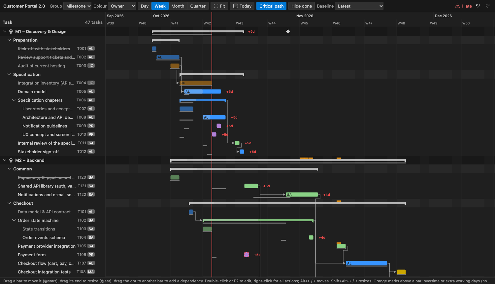
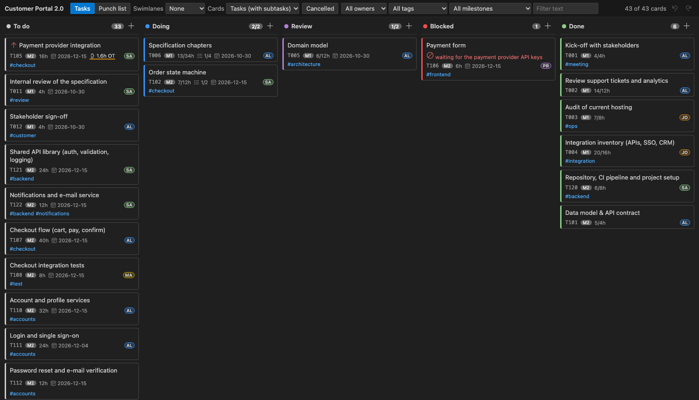
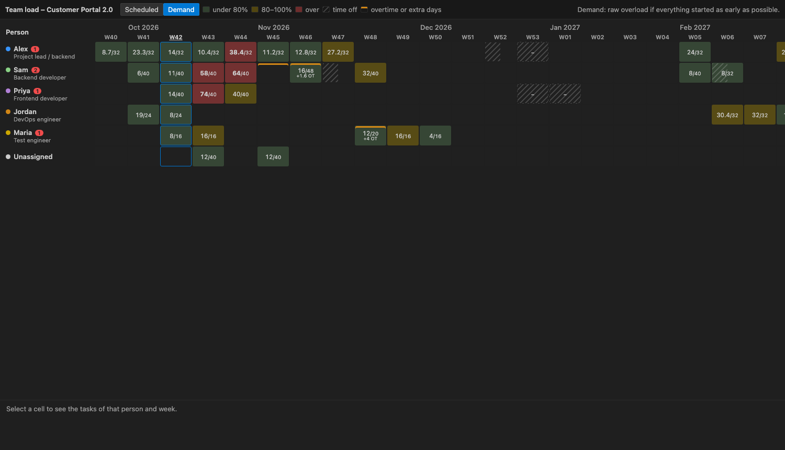
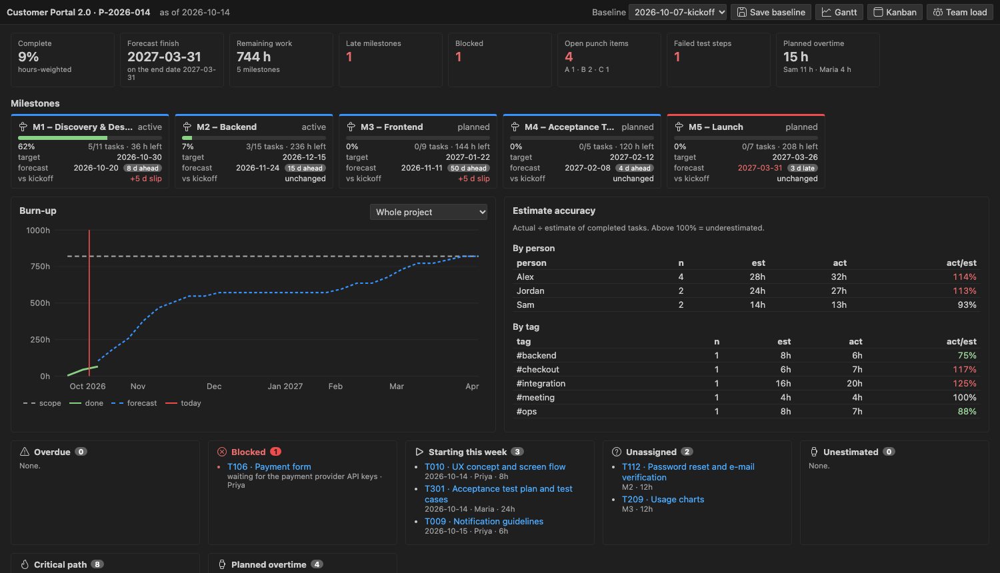
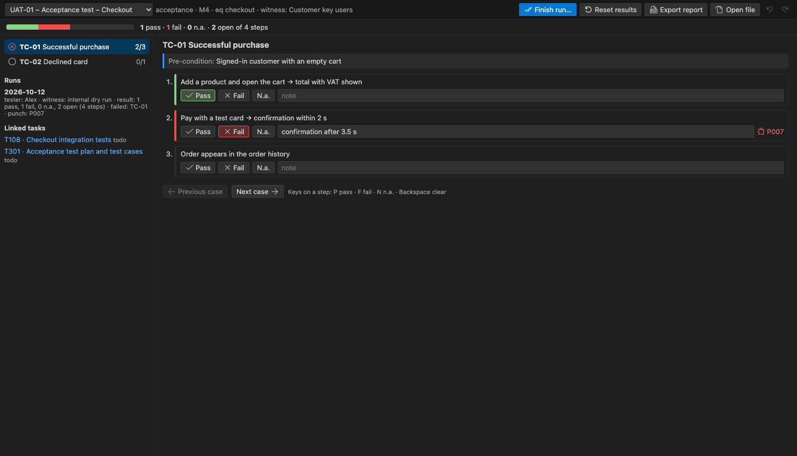

# Markdown Project Planner

Plan projects in plain Markdown, right next to your code: a `plan/` folder of files becomes a
scheduled project with a Gantt chart, a Kanban board, a team-load heatmap, a dashboard,
acceptance test runs, a punch list, status reports, AI help that never writes without your
approval, and an MCP server so agents can build and run the plan.

Made for a project lead who plans their own work and that of a small team, in a repository next to
the code.



## Why Markdown

- **Plain text is the source of truth.** Diff it, review it in pull requests, edit it anywhere.
  The extension never rewrites your files: every change is a minimal edit of the characters that
  change, and comments, unknown attributes and free text are kept exactly as they are.
- **The schedule is computed, not stored.** Dates come from estimates, dependencies, capacity and
  time off, deterministically. Nothing about the schedule is written into your Markdown.
- **No Markdown required.** Add and edit tasks, milestones, people, time off and the project
  calendar from forms, sidebar buttons, CodeLens links and the boards; type in the files whenever
  you prefer.
- **Everything is undoable.** Edits from forms, the Gantt, Kanban, trees and commands are ordinary
  VS Code edits (Ctrl+Z works), and the views have their own undo/redo too.

## Getting started

1. Install the extension (see [Installation](#installation)).
2. Run **Planner: New project…** and pick a template (or open a workspace that already has
   `plan/project.md`). The getting-started walkthrough (**Help → Welcome → Get started with
   Markdown Project Planner**) shows every feature step by step.
3. Open the **Planner** view in the activity bar and add tasks with **+** (or write them in the
   milestone files).

Try it on the sample project in [`examples/customer-portal`](examples/customer-portal): the
release of a customer portal with five milestones, a team of five, acceptance tests and a punch
list.

The **[user manual](docs/manual/README.md)** explains every view, button and file format with
annotated screenshots, from a hands-on tutorial to power-user recipes. It is included in the
extension: run **Planner: Open user manual** in VS Code.

## The plan format

```text
plan/
  project.md            name, start/end, work week, hours per day, holidays
  team.md               one ## section per person: capacity, skills, time off
  milestones/M2-backend.md
  tests/UAT-01-checkout.md
  punchlist.md
  inbox.md
```

```markdown
# M2 – Backend

id: M2
target: 2026-12-15
depends: M1

## Checkout

- [x] Data model & API contract @est:4h @act:5h @owner:alex @done:2026-10-09 ^T101
- [/] Order state machine @est:12h @owner:sam @dep:T101 #checkout ^T102
  - [x] State transitions @est:6h @act:7h ^T103
  - [ ] Order events schema @est:6h ^T104
        Notes indented under a task are its description.
- [ ] Payment provider integration @est:2d @owner:sam @start:2026-11-10 @prio:high @eq:checkout/payment ^T105
- [!] Payment form @est:6h @owner:priya @blocked:"waiting for the payment provider contract" ^T106
- [ ] Checkout flow (cart, pay, confirm) @est:1w @owner:alex @dep:T102,T105+1d ^T107
```

| Checkbox | Status        | Common attributes                                                |
| -------- | ------------- | ---------------------------------------------------------------- |
| `[ ]`    | to do         | `@est:4h` / `1.5d` / `1w`, `@act:` actual hours                  |
| `[/]`    | in progress   | `@owner:` person id, `@dep:T101` (`+2d` lag), `@start:`, `@due:` |
| `[?]`    | review / test | `@prio:high\|med\|low`, `@progress:40%`, `@blocked:"reason"`     |
| `[!]`    | blocked       | `@eq:` component, `@test:` test plan, `@src:` code link          |
| `[x]`    | done          | `@started:` and `@done:` are written when the status changes     |
| `[-]`    | cancelled     | `#tags`, `^T101` id (missing ids are added on save)              |

Test plans are milestone-like files with `## TC-01 …` cases and checklist steps
(`@result:pass|fail|na`, `@note:`, `@punch:P007`); punch items are tasks with `^P001` ids,
`@sev:A|B|C` and an `@from:UAT-01/TC-01` back-link. Every element of the format is described in
the user manual: [Plan files](docs/manual/04-plan-files.md).

## Features

### Add and edit from the UI

Forms for everything in the plan: tasks (every attribute, subtasks, move, delete with dependency
clean-up), sections, milestones, people (capacity, work week, time off, capacity changes, skills),
the project calendar, inbox notes and punch items. Start them from the sidebar toolbars and row
buttons, the CodeLens links above milestones, tasks and people, a Kanban column's **+**, a
double-click on a card, or the right-click menus of the Gantt and Kanban.

### Editor

Completion for owners, dependencies, attribute keys and dates; hovers with the schedule; go to
definition, find references and rename for task ids; diagnostics with quick fixes (unknown owners
and dependencies, cycles, invalid durations, late and overbooked tasks); CodeLens with milestone
progress and forecasts and each task's dates and slack, next to clickable actions (owner, Edit, Add
task …). Hover a checkbox to change the status, or press
**Ctrl+Alt+X** (**Cmd+Alt+X** on macOS) to cycle it.

### Sidebar

**Milestones** (milestone → section → task → subtask), **My Work / Team**, **Inbox** (plan an idea
into a milestone), **Punch List**, **Tests** and **TODOs in Code** (TODO/FIXME comments in your
code; promote one to a task linked both ways). Filters per view; buttons on each row (edit, assign
owner, next status, add task, edit person, time off); context menus for every action.

### Gantt

Bars from the deterministic, resource-levelled schedule: dependencies, the critical path, slack,
milestones with targets and forecasts, baselines and slip. Drag a bar to set `@start`, resize it to
set the estimate, drag between bars to add a dependency, double-click (or F2) to edit title, owner
and estimate (**All fields…** for the rest), right-click for every task action. Group by milestone, section, owner or tag; colour by owner, status or milestone; zoom by day,
week, month or quarter, or fit the whole project.

### Kanban



Columns per status, swimlanes per owner or milestone, WIP limits, filters, a punch-list board.
Moving a card writes the status and its dates; moving to **Blocked** asks for a reason;
reordering writes `@prio`. **+** in a column adds a card; click the owner to reassign; double-click
or F2 edits every field.

### Team load and dashboard



The heatmap shows scheduled hours against capacity per person and ISO week, with time off;
demand mode shows where work piles up if everything started as early as possible.

Plan **overtime** (`overtime: 2026-11-02..2026-11-13 +8h/week`) and **extra working days**
(`workday: 2026-11-28`, a Saturday or holiday) per person when a date cannot move: the schedule
uses them, the team load marks them, and the dashboard and status report add up the planned
overtime. Plan them from the team load with one click.



The dashboard has KPIs, milestone cards (hours-weighted progress, forecast against target, trend
since the baseline), the project's hours budget against the planned and forecast hours (and why it
goes over), burn-up charts, estimate accuracy per person and tag, overdue, blocked (with what waits
for them and how long they can stay blocked), unassigned and unestimated work, test status and
open punch items. **Planner: Save baseline**
stores a snapshot in `plan/baselines/`.

### Time tracking

Start and stop a timer on a task (status bar), or log time manually; time is rounded and added to
`@act`.

### Test runner



Step through the cases of a test plan (acceptance, FAT, SAT, integration or unit tests), record
**P**ass / **F**ail / **N**.a. with notes, raise punch items from failed steps, append a run log
with tester and witness, and export the test report with a signature block.

### Export

**Planner: Export…** writes to `plan/reports/`: a self-contained HTML status report (with your
branding), PDF (via Edge or Chrome), Excel, MS Project XML (MSPDI), CSV and test reports.

### AI (optional)

With `planner.ai.provider` set to `vscode-lm` (a VS Code language model, such as GitHub Copilot)
or `anthropic` (the Claude API, key in VS Code's encrypted storage), the **Planner AI** commands can
break a task down, estimate, calibrate estimates against your actuals, suggest owners, turn notes
into tasks, draft a status summary and review the schedule. Every change is shown as a **diff with
Accept / Reject**; nothing is written before you accept, and the AI never computes dates. Terms in
`planner.ai.redact` are removed before anything is sent, and every request is logged in the
**Planner AI** output channel. `none` hides every AI command.

### MCP server

Every feature of the planner is an MCP tool (50+ tools, checked by a test against every command),
so an agent such as Claude Code can create the project and build the whole plan from a plain-text
description in one validated step (`build_plan`: team, milestones, sections, tasks, dependencies),
then run it day to day: statuses, owners, overtime, test results, punch items, baselines, exports.
**New project** writes `.mcp.json` for Claude Code automatically (or run **Planner: Configure MCP
for Claude Code**, also before a plan exists); Copilot agent mode gets the server through VS Code's
MCP API in a workspace with a plan (or after Configure MCP). Changes go through the same core and
minimal-diff writer, and a change that would break the plan is refused. The server tells every agent
the rules when it connects, and **Planner: Add the md-planner Skill for AI Agents** (also done by
New project) adds a skill to `.claude/skills/` with playbooks, which Claude Code and Copilot agent
mode load when you ask them about the plan.

### Command line

The extension ships a CLI (`dist/cli.js` in the extension folder, Node 20+) for CI pipelines:

```sh
node dist/cli.js validate --plan plan --strict
node dist/cli.js schedule --plan plan --json
node dist/cli.js export --plan plan --format html,xlsx,mspdi
```

## Settings

All settings are under `planner.*`; see [docs/settings.md](docs/settings.md) for the full list.
The most used ones:

| Setting                    | Default     | What it does                                    |
| -------------------------- | ----------- | ----------------------------------------------- |
| `planner.planFolder`       | `plan`      | where the plan files are                        |
| `planner.me`               | (empty)     | your person id: shown first in My Work          |
| `planner.autoSave`         | `true`      | save files after edits from views               |
| `planner.kanban.wipLimits` | `{}`        | WIP limit per column, e.g. `{ "doing": 3 }`     |
| `planner.export.branding`  | `{}`        | company name, accent colour and logo of reports |
| `planner.ai.provider`      | `vscode-lm` | `vscode-lm`, `anthropic` or `none`              |
| `planner.ai.redact`        | `[]`        | terms removed from AI prompts                   |

## Privacy and security

The extension makes no network calls except to the AI provider you choose, and only when you run
an AI command. The Claude API key is kept in VS Code's encrypted storage. Webviews run with a
strict content security policy and never touch files; all edits go through VS Code.

## Performance and accessibility

A 2,000-task plan is re-parsed, rescheduled and re-validated in about 80 ms, with every view
open; the views render in about 120 ms (`npm run perf:webviews`). All webviews work with the
keyboard (tree and grid navigation, Alt+arrows to move bars and cards, dialogs that return
focus), have ARIA labels, use only theme colours and pass axe-core WCAG 2.1 AA checks in the
light, dark and high-contrast themes (`npm run a11y`).

## Installation

Install **Markdown Project Planner** from the Visual Studio Marketplace: open the Extensions view
(Ctrl+Shift+X, Cmd+Shift+X on macOS), search for `Markdown Project Planner` and click **Install**,
or run

```sh
code --install-extension acro.md-planner
```

To install from a `.vsix` file instead (for example one built with `npm run package`): **Extensions → … → Install from VSIX…**.

Requires VS Code 1.95 or later. PDF export needs Microsoft Edge or Google Chrome.

## Development

```sh
npm install
npm run build              # type-check and bundle
npm test                   # unit tests (Vitest)
npm run test:integration   # extension tests in VS Code
npm run lint
npm run package            # md-planner-<version>.vsix
```

One pure TypeScript core (`src/core`: parser, minimal-diff writer, scheduler, metrics) is shared by
the extension, the webviews, the MCP server and the command-line tool, so they behave the same.
The sample project in `examples/customer-portal` is used by the tests and the screenshots.

## License

[MIT](LICENSE). The open-source packages bundled with the extension and their licenses are listed in
[THIRD-PARTY-NOTICES.md](THIRD-PARTY-NOTICES.md).
