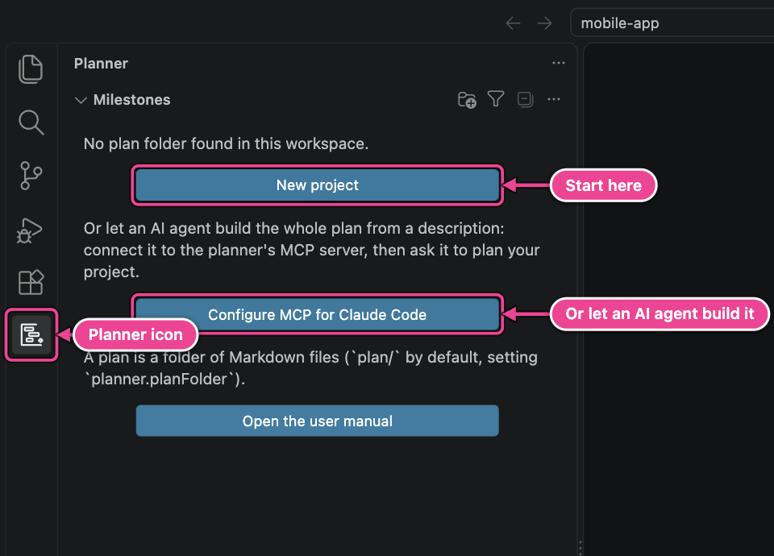
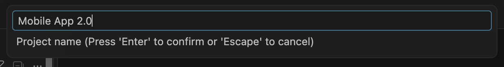
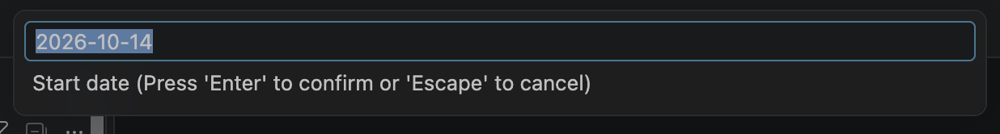
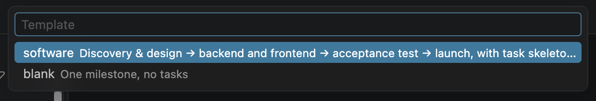
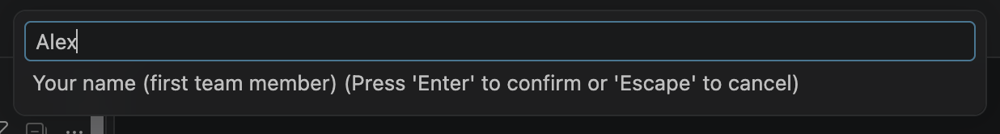
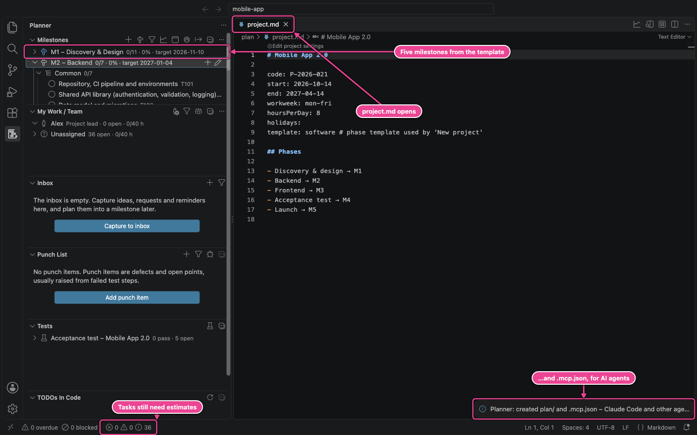
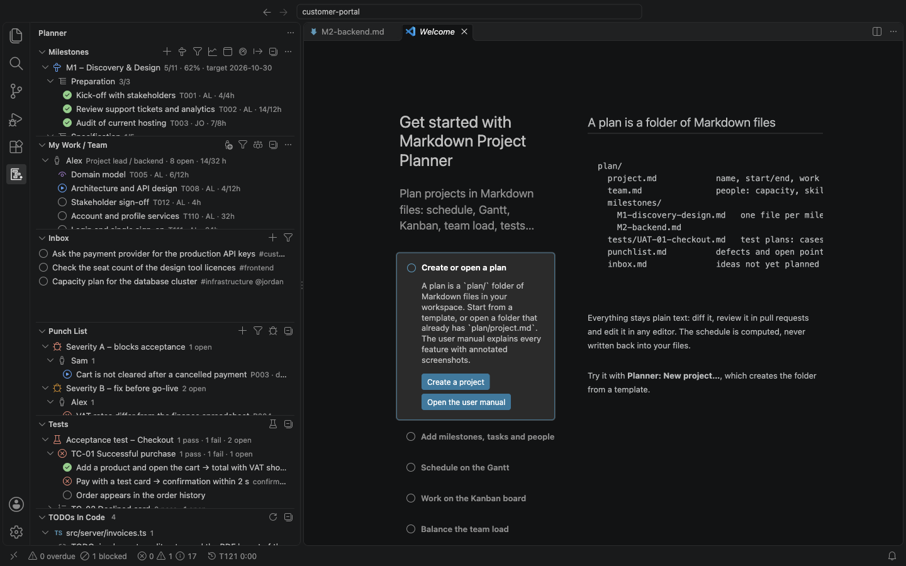

# 1. Getting started

## What you need

| Requirement                     | Needed for                                                                                                        |
| ------------------------------- | ----------------------------------------------------------------------------------------------------------------- |
| VS Code 1.95 or later           | Everything.                                                                                                       |
| Microsoft Edge or Google Chrome | PDF export only. Without a browser you get the HTML report.                                                       |
| An AI provider (optional)       | The AI commands: GitHub Copilot (or another VS Code model) or a Claude API key. Everything else works without AI. |
| Node.js 20 or later (optional)  | The command-line tool in CI. VS Code itself needs no Node.js.                                                     |

The extension works offline. It makes no network calls except to the AI provider you choose, and
only when you run an AI command.

## Install the extension

From the Visual Studio Marketplace:

1. Open the **Extensions** view (Cmd+Shift+X).
2. Search for `Markdown Project Planner` (publisher ACRO) and click **Install**.

Or from a terminal:

```sh
code --install-extension acro.md-planner
```

To install from a `md-planner-<version>.vsix` file instead (for example one built with
`npm run package`), click **…** (Views and More Actions) at the top of the Extensions view and
choose **Install from VSIX…**.

After installing you see a new **Planner** icon in the activity bar on the left.

## Try the sample project first

The fastest way to see what the extension does is the sample project `examples/customer-portal`. It
is the release of a customer portal with five milestones, a team of five people, two acceptance
test plans, a punch list and a few TODOs in the code. The sample is part of the extension's source repository, not of the
installed extension; if you do not have the source, skip ahead to
[Create your own plan](#create-your-own-plan).

1. **File → Open Folder…** and choose the `examples/customer-portal` folder (open the folder itself,
   not the repository root, so that its `plan/` folder is at the top of the workspace).
2. Click the **Planner** icon. The Milestones, My Work / Team, Inbox, Punch List, Tests and TODOs in
   Code views fill with data.
3. Open `plan/milestones/M2-backend.md`. Grey CodeLens lines above the heading and every
   task show the computed schedule.
4. Click the **Open Gantt** button in the editor title bar.

Every screenshot in this manual comes from this sample, so you can follow along. Work on a copy if
you want to keep the original untouched.

## Create your own plan

When the workspace has no plan yet, the Milestones view says so and offers a button:



Click **New project** (or run **Planner: New project…**). The command asks six questions in a row
at the top of the window. Press Enter to accept each answer, Escape to cancel the whole command.

1. **Project name**, for example `Mobile App 2.0`. It becomes the `#` heading of
   `project.md` and the title of reports.

   

2. **Project code** (optional), for example an order number `P-2026-021`. Leave it empty to skip it.
3. **Start date**: defaults to today. Dates are always `YYYY-MM-DD`.

   

4. **End date**: defaults to six months after the start.
5. **Template**: the folder structure to start from.

   

   | Template   | Creates                                                                                                                                                                                                                                              |
   | ---------- | ---------------------------------------------------------------------------------------------------------------------------------------------------------------------------------------------------------------------------------------------------- |
   | `software` | Five milestones (Discovery & Design → Backend and Frontend in parallel → Acceptance Test → Launch) with typical task skeletons and dependencies, an acceptance test plan, inbox and punch list. Milestone targets are spread over the project dates. |
   | `blank`    | One milestone without tasks, plus the other files.                                                                                                                                                                                                   |
   | your own   | Any folder in `planner.templatesFolder` (see [Custom templates](17-power-user-guide.md#custom-project-templates)).                                                                                                                                   |

6. **Your name**: the first person in `team.md` (default: your user name).

   

The extension creates the plan folder in one undoable edit, opens `project.md` and shows the new
milestones:



The **Problems** counter in the status bar already shows 36 messages: the template has tasks but
no estimates and no owners yet, because those are specific to your project. The
[Tutorial](02-tutorial.md) fills them in, with forms: you do not need to learn the file format
first ([Add and edit from the UI](03-add-and-edit.md)).

New project also writes `.mcp.json`, so an AI agent such as Claude Code, started in this folder,
can build and update the plan for you: describe the project in plain text and let it create the
team, milestones, tasks and dependencies ([MCP server](15-mcp-and-cli.md#let-an-agent-build-the-plan-from-text)).

> [!NOTE]
> The command refuses to run when `plan/project.md` already exists, so it never overwrites a plan.
> When the plan folder already holds other plan files, it lists them and what it would add, and
> asks first; existing files are never overwritten. In a workspace with several folders it uses
> the one with the plan folder, or asks which one.

## What was created

```text
plan/
  project.md                 name, code, dates, work week, hours per day, holidays
  team.md                    one "##" section per person: capacity, skills, time off
  inbox.md                   quick-capture list of things that are not planned yet
  punchlist.md               defects and open points (P001, P002 …)
  milestones/
    M1-discovery-design.md   one file per milestone, with sections and tasks
    M2-backend.md
    M3-frontend.md
    M4-acceptance-test.md
    M5-launch.md
  tests/
    UAT-01.md                an acceptance test plan with test cases and steps
  .gitignore                 ignores .planner/ and reports/
```

Later the extension adds three folders by itself:

| Folder       | Contents                                             | Commit to git? |
| ------------ | ---------------------------------------------------- | -------------- |
| `.planner/`  | `schedule.json`, a cache of the computed schedule    | No (ignored)   |
| `reports/`   | Exported reports and data files                      | No (ignored)   |
| `baselines/` | Saved schedule snapshots, one JSON file per baseline | Yes            |

## A plan in another folder

The plan folder is `plan/` at the root of the workspace. To use another folder, set
**`planner.planFolder`** in the workspace settings (relative to the workspace folder, or an
absolute path):

```json
{
  "planner.planFolder": "docs/project-plan"
}
```

Run **Planner: Refresh** after changing it, or reload the window.

## Tell the planner who you are

Set **`planner.me`** to your person id from `team.md`. My Work / Team shows you first, the test
runner fills you in as the tester, and reports use your name as the author:

```json
{
  "planner.me": "alex"
}
```

Without this setting the first person in `team.md` counts as you.

## The getting-started walkthrough

VS Code's welcome page has a guided walkthrough with one step per feature and a button that runs
each command. Open it with **Help → Welcome**, or run **Welcome: Open Walkthrough…** and choose
**Get started with Markdown Project Planner**.



---

[← Contents](README.md) · [Next: Tutorial →](02-tutorial.md)
