# 2. Tutorial: plan a project end to end

This tutorial takes the empty "Mobile App 2.0" project from [Getting started](01-getting-started.md)
to a scheduled plan with a team, and then walks through a normal week: daily updates, a baseline
and a status report. Each step links to the chapter with all the details.

Steps 1 to 6 use the planner's forms, so you never have to type Markdown. Each step also shows
what the planner wrote into the files: that is the file format, and you can always edit it by hand.
From step 7 on, the screenshots come from the sample project, which is a few weeks further along
and therefore has more to show.

> [!TIP]
> You never have to save to see the effect of a change. The planner reads the open editors and
> recomputes the schedule about 300 ms after a change. Edits made from forms and views are saved for
> you (`planner.autoSave`) and can be undone with Cmd+Z in the file.

## Step 1 – Set the calendar

`project.md` is open after **New project**. Above its heading is the clickable CodeLens **Edit
project settings**; the same command is in the **…** menu of the Milestones toolbar. It opens the
project form with the values New project wrote.

Add the holidays: choose **Holidays** → **Add a holiday…**, pick **Other date…** and type
`2026-12-25` as the first day and `2026-12-26` as the last day. Add `2027-01-01` the same way and
choose _only this day_ as the last day.

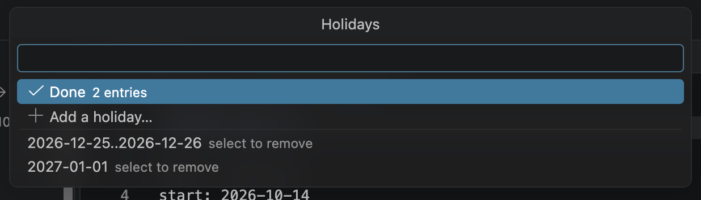

Choose **Done**. Back in the form, the changed field has a ● ; press **Enter** to save.

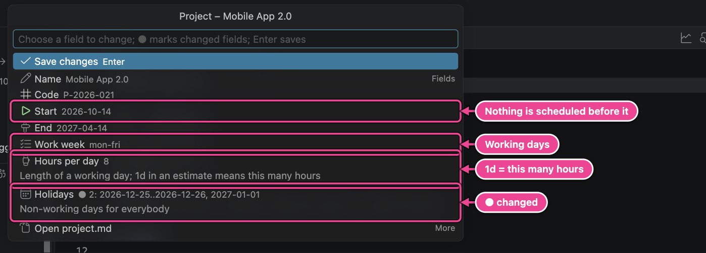

The planner wrote the `holidays` line of the **property block**, the `key: value` lines directly
under the heading (text after `#` is a comment):

```markdown
# Mobile App 2.0

code: P-2026-021
start: 2026-10-14
end: 2027-04-14
workweek: mon-fri
hoursPerDay: 8
holidays: 2026-12-25..2026-12-26, 2027-01-01
template: software # phase template used by 'New project'
```

| Field         | Meaning                                                                                   |
| ------------- | ----------------------------------------------------------------------------------------- |
| Start         | Nothing is scheduled before this date.                                                    |
| End           | The planned end date; the dashboard compares the forecast finish with it.                 |
| Work week     | Working days of the project, e.g. `mon-fri`, `mon-thu`, `sun-thu`.                        |
| Hours per day | Length of a working day. `1d` in an estimate means this many hours; `1w` means five days. |
| Holidays      | Non-working days for everybody: single dates and ranges `from..to`.                       |

→ All properties: [Plan files › project.md](04-plan-files.md#projectmd).

## Step 2 – Add your team

New project added you as the project lead. Add a colleague with **Add person…**, the 👤+ button in
the **My Work / Team** toolbar. Type the name, `Sam`, and press Enter. The form proposes the id
`sam`, which is what you will write in `@owner:sam`.

This is where the schedule gets realistic: capacity, part-time work and time off all limit when
work can happen. Fill in:

- **Role**: `Backend developer`.
- **Capacity**: `32h/week` (or _Full time_, the default: hours per day × working days).

  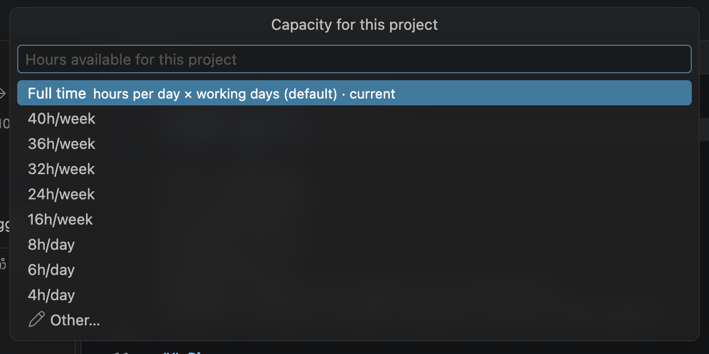

- **Time off**: **Add time off…**, first day `2026-11-16`, last day `2026-11-20`.
- **Colour**: `green`, their colour on the Gantt, the Kanban board and the team load.

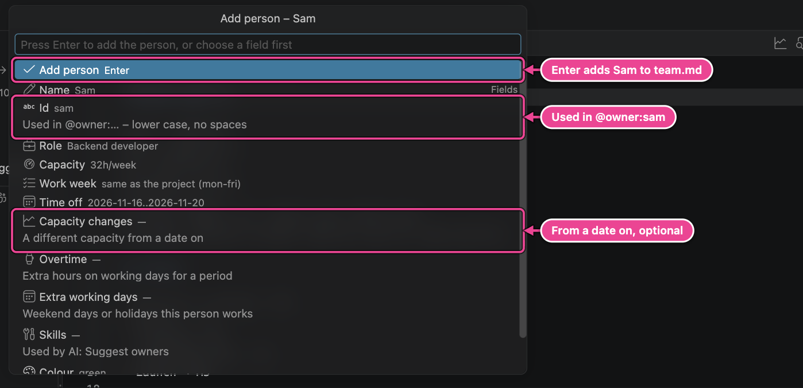

Press **Enter**. The planner adds a section to `team.md`:

```markdown
## Sam

id: sam
role: Backend developer
capacity: 32h/week
color: green
off: 2026-11-16..2026-11-20
```

- **Capacity changes** handle people who join part-time and work more later: _from 2027-01-01
  32h/week_ becomes `capacityFrom: 2027-01-01 32h/week`.
- **Work week** gives a person their own working days, for example `mon-thu`.
- **Skills** help the AI suggest owners.
- Later, change anything with ✎ on the person's row, and add holidays with the 📅 button. Renaming
  a person keeps their id, so their tasks stay assigned.

The planner takes the first person in `team.md` to be you, and New project put you there, so My
Work / Team already lists your tasks first. If someone else ever comes first, set your id in
**Settings → Workspace → Planner: Me** ([Tell the planner who you are](01-getting-started.md#tell-the-planner-who-you-are)).

→ All properties: [Plan files › team.md](04-plan-files.md#teammd).

## Step 3 – Shape the milestones

The template created five milestones, one file each in `milestones/`. Click one in the Milestones
view to open it, for example `milestones/M1-discovery-design.md`:

```markdown
# M1 – Discovery & Design

id: M1
target: 2026-11-06
status: active

Goals, users and scope, the architecture and the UX concept, reviewed and signed off by the
stakeholders.

## Preparation

- [ ] Kick-off with stakeholders #meeting ^T001
- [ ] Review the current product, analytics and support tickets ^T002
      …
```

- **Target** is the date the milestone is due. The planner forecasts when it will really finish and
  flags it late when the forecast is after the target.
- **Status** is planned, active, done or cancelled. A cancelled milestone cancels its tasks.
- **Depends on** makes every task of the milestone wait until the other milestones are finished.
- `##` headings are **sections**: work packages such as a feature or a component.

Change these with ✎ on the milestone's row or **Edit milestone** above its heading.

**Add a milestone** with the milestone button in the Milestones toolbar. Type `Documentation` and
press Enter. In the form, set the **Target date** to `2027-04-09`. **Depends on** already holds M5,
the last milestone, so the documentation is planned after the launch (clear it for work that runs
in parallel):

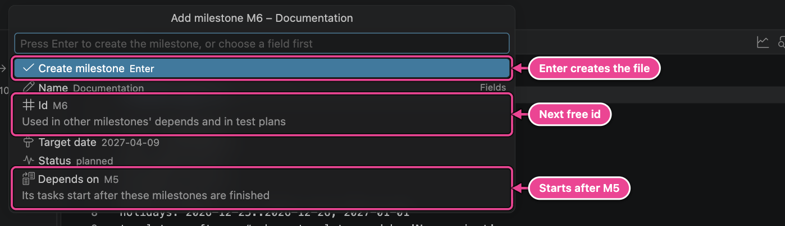

Press **Enter**. The planner creates `milestones/M6-documentation.md`:

```markdown
# M6 – Documentation

id: M6
target: 2027-04-09
status: planned
depends: M5
```

The new milestone appears in the tree with an **Add a task…** row, ready for step 6:

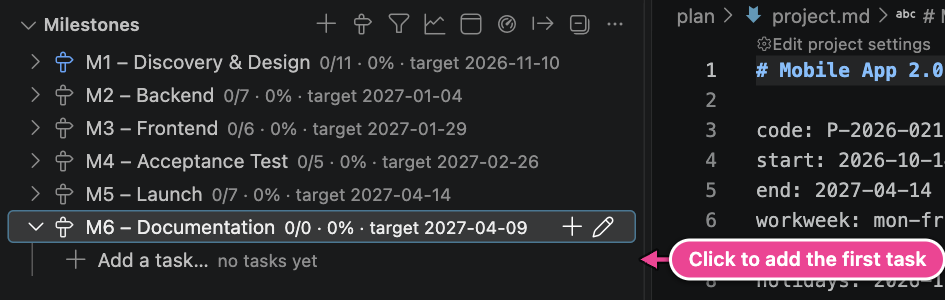

Add sections with right-click → **Add section…** on the milestone. To retire a milestone, set its
status to _cancelled_ (it stays on record); to remove it completely, right-click → **Delete
milestone…**.

→ [Plan files › Milestone files](04-plan-files.md#milestone-files).

## Step 4 – Estimate the tasks

The template's tasks have no estimate yet, so each one is scheduled with 0 hours, has a blue
information squiggle in the editor and a message in the Problems panel: _Leaf task without an
estimate (@est); it is scheduled with 0 hours._

Give each task an estimate in one of these ways:

- Right-click the task in the Milestones view → **Set estimate…**, or ✎ on its row → **Estimate**.
- In the editor, put the cursor on the task and press **Cmd+.** (Quick Fix). Pick an estimate, or
  **Add estimate…** to type your own:

  

Estimates are hours (`4h`, `12h`), days (`2d` = 2 × hoursPerDay) or weeks (`1w` = 5 days);
decimals work (`1.5d`). The planner writes them as `@est:2d` on the task line.

If you prefer typing, write ` @` at the end of a task line and the editor suggests every
attribute:


> [!TIP]
> With an AI provider set up, **Planner: AI: Estimate** proposes estimates for all unestimated
> tasks of the file at once, as a diff you accept or reject. See [AI assistant](14-ai-assistant.md).

## Step 5 – Assign owners

Click the 👤 button on a task's row in the Milestones view (or **Assign owner** above the task in
the editor) and choose a person. The list shows names, roles and skills from `team.md`:

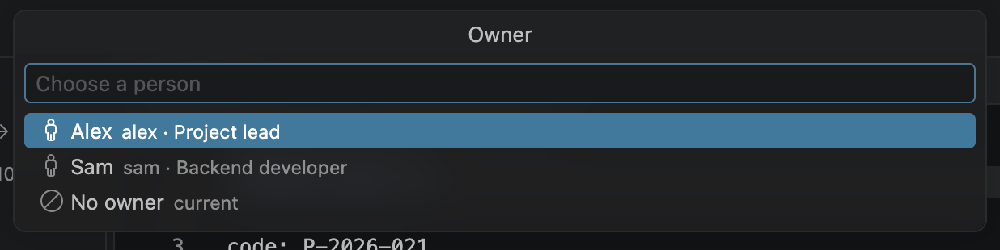

The planner writes `@owner:sam`. Subtasks without an owner inherit their parent's owner. Tasks
without any owner run in a virtual **Unassigned** pool (40 h/week by default) and appear under
_Unassigned_ in My Work / Team.

Typing works too: `@owner:` lists the people, with their roles and skills:


## Step 6 – Add tasks, subtasks and dependencies

Click **Add a task…** under M6 (or **+** on any milestone or section row). Type the title,
`User guide`, and press Enter. In the form, set **Estimate** to `3d` and **Owner** to Sam:

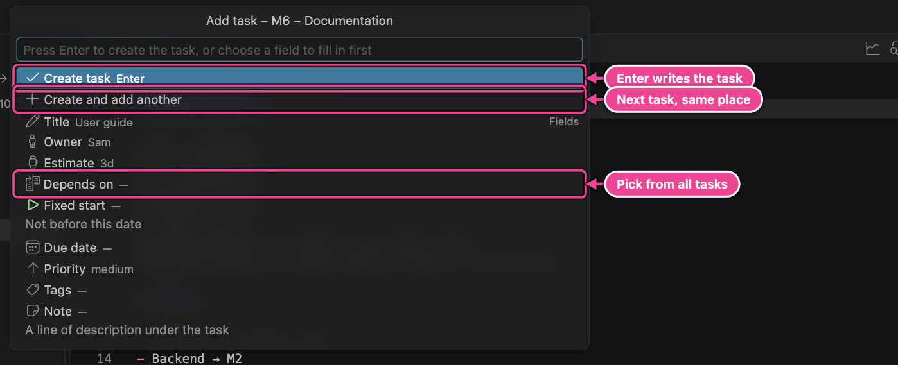

Press **Enter**. The task is written with its id, and the CodeLens above it shows when it is
scheduled, its owner (click to change) and **Edit** for every other field:

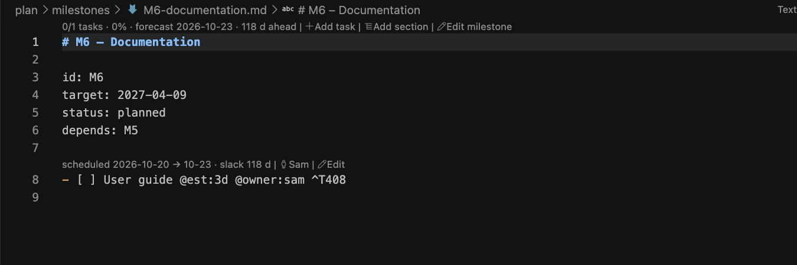

- **Create and add another** creates the task and asks for the next title in the same place: the
  fastest way to enter a list of tasks.
- **Depends on** means _start after these tasks are finished_. Tick them in the list; current
  dependencies are at the top. In the file, several dependencies are separated by commas
  (`@dep:T102,T105`), and a lag adds working days after the predecessor finishes (`@dep:T303+2d`).
- **Fixed start** and **Due date** offer _today_, _next Monday_, _end of month_ and more.
- **Subtasks**: right-click a task → **Add subtask…**. A parent without an estimate of its own
  adds up its subtasks'; a parent's own estimate is a budget its subtasks share
  ([Subtasks and notes](04-plan-files.md#subtasks-and-notes)). In the file, subtasks are checkbox lines indented under the task; **notes** are
  indented lines that are not checkboxes:

  ```markdown
  - [ ] Order state machine @owner:sam ^T102
    - [ ] State transitions @est:6h ^T103
    - [ ] Order events schema @est:6h ^T104
          Use the CloudEvents format.
  ```

- **Move** a task to another milestone or section, or **delete** it, with right-click. Deleting
  also removes the dependencies on it.

If you type tasks yourself, the editor completes `@dep:` with every task id and title, and dates
with _today_, _tomorrow_, _next Monday_ and more:


When you **save** a file with typed tasks, every task without an id gets the next free one, written
at the end of the line. Ids never change afterwards, so dependencies stay valid:

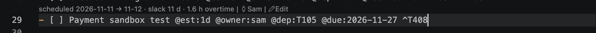

→ Every place to add and edit: [Add and edit from the UI](03-add-and-edit.md). Every attribute:
[Plan files › Tasks](04-plan-files.md#tasks). Editor help: [The editor](05-editor.md).

## Step 7 – Read the schedule

The schedule is computed from estimates, dependencies, capacity and time off. It is never written
into your files; it shows up in three places.

**CodeLens in the editor.** Above each milestone heading: tasks done, % complete, the forecast and
how far ahead or behind the target it is. Above each task: its scheduled dates and slack (how many
working days it can slip before it delays the last milestone).


**The Milestones view.** Late milestones get a red icon and `⚠ 3 d late`; late or overdue tasks get
`⚠ late` or `⚠ overdue` in their description.

**The Gantt chart.** Click **Open Gantt** in the Milestones toolbar or the editor title bar:


Red outlines mark the **critical path**: the chain of tasks that sets the end date. Drag a bar to
give it a fixed start date, drag its right end to change the estimate, or drag the dot behind a bar
onto another bar to add a dependency. Every drag is a small, undoable edit of the Markdown.

**When a milestone is late**, you have these levers, from the cheapest to the most invasive:

1. Check the estimates on the critical path (they may be too pessimistic).
2. Move work from an overloaded person to someone with room (`@owner`).
3. Raise the priority of critical tasks (`@prio:high`) so they get capacity first.
4. Remove or shorten dependencies and lags that are not real.
5. Split a long task into parallel subtasks with different owners.
6. Move the target, or cut scope (`[-]` cancels a task).

→ [Gantt chart](07-gantt.md) and [How scheduling works](16-how-scheduling-works.md).

## Step 8 – Balance the team

Open **Team load** from the toolbar of My Work / Team. Each cell is one person in one ISO week:
scheduled hours against capacity, green below 80 %, yellow up to 100 %, hatched for time off.
Click a cell to see the tasks behind it.

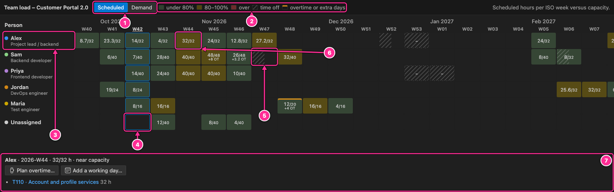

The scheduler never books anyone beyond capacity; instead, work moves later. Switch to **Demand**
to see where work piles up if everything started as early as possible. Red cells there are the
weeks to discuss with the team.

If a date cannot move, select the cell and plan **overtime** or an **extra working day** (a
Saturday, a holiday) for that week. The cell gets an orange line, the schedule uses the extra
hours at once, and the dashboard adds up the planned overtime.

→ [Team load](09-team-load.md).

## Step 9 – Save a baseline

When the plan is agreed (for example after the kick-off), freeze it: run **Planner: Save
baseline…** and give it a name.


The planned dates of every task and milestone are stored in `baselines/<date>-<name>.json`. From
then on the Gantt draws a thin baseline bar under each task with `+3d` slip markers, and the
dashboard shows how much each milestone has moved. Commit baseline files to git.

→ [Dashboard and baselines](10-dashboard-and-baselines.md#baselines).

## Step 10 – Daily work

**Your task list** is My Work / Team, with your own tasks first, in the order they are scheduled.

**Change a status** in any of these ways:

- Hover the checkbox in the editor and click the new status.
- Press **Cmd+Option+X** (Ctrl+Alt+X) with the cursor on a task. Each press moves the task one
  step: to do `[ ]` → in progress `[/]` → review `[?]` → done `[x]` → to do. The planner writes
  `@started` and `@done` dates for you:

  
  

- Click ↻ on the task's row in the Milestones or My Work / Team view (one step per click).
- Right-click a task in a view or in the editor → **Set status**.
- Drag the card on the **Kanban board**. Dropping a card on **Blocked** asks for the reason.

**Track time** if you want actual hours: right-click a task → **Start timer**. The status bar shows
the running timer; click it to stop, and the time is added to `@act`.

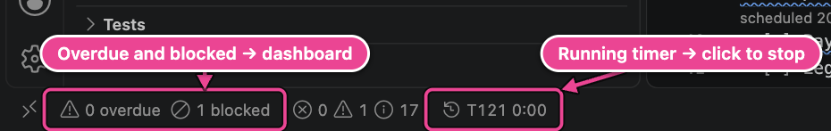

→ [The sidebar](06-sidebar.md), [Kanban board](08-kanban.md), [Time tracking](11-time-tracking.md).

## Step 11 – The weekly status report

Open the **dashboard** (Milestones toolbar, or click the overdue/blocked counter in the status bar)
for the overview: completion, forecast finish, late milestones, blocked work and slip since the
baseline.


Then run **Planner: Export…**, keep **HTML status report** selected and press Enter twice. You can
type a short summary (or let the AI draft one). The report is written to
`plan/reports/2026-10-14-status-report.html`: one self-contained file you can e-mail or print.


→ [Reports and export](13-reports-and-export.md).

## Step 12 – Test and launch

When the project reaches its acceptance test, write the test plan in `tests/` (the template
created `UAT-01.md`), open it in the **test runner**, record pass, fail or n.a. per step, raise
punch items from failures and export the signed test report.

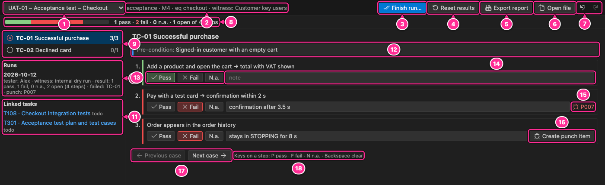

→ [Tests and punch list](12-tests-and-punch-list.md).

## Where to go next

You have now used every main feature once. Continue with the reference chapters when you need more
detail, and read the [Power-user guide](17-power-user-guide.md) for routines, recipes and the
complete command and settings lists.

---

[← Getting started](01-getting-started.md) · [Contents](README.md) · [Next: Add and edit from the UI →](03-add-and-edit.md)
