# 3. Add and edit from the UI

You can build and maintain the whole plan without typing Markdown: tasks, subtasks, sections,
milestones, people, time off, the project calendar, inbox notes and punch items. Every action ends
in a small edit of the right plan file, so the files stay the single source of truth. You can open
them at any time, and typing in them works as before ([Plan files](04-plan-files.md)).

This chapter shows where each action is and how the forms work. The [tutorial](02-tutorial.md)
uses them step by step.

## Where to find each action

Most actions can be started from several places. Use whichever is closest to where you are.

| To …                           | In the sidebar                                                                                           | In a plan file (CodeLens, right-click)                               | On the boards                                                                     |
| ------------------------------ | -------------------------------------------------------------------------------------------------------- | -------------------------------------------------------------------- | --------------------------------------------------------------------------------- |
| Add a task                     | **+** in the Milestones toolbar, **+** on a milestone or section row, or **Add a task…** in an empty one | **Add task** above the milestone heading                             | **+** in a Kanban column; Gantt: right-click a milestone or section → Add task…   |
| Add a subtask                  | Right-click a task → **Add subtask…**                                                                    | Right-click the task line → **Add subtask…**                         | Right-click a card or bar → Add subtask…                                          |
| Edit every field of a task     | ✎ on the task row                                                                                        | **Edit** above the task; right-click → **Edit task…**                | Double-click a card or press F2; Gantt edit dialog → **All fields…**; right-click |
| Change the owner               | 👤 on the task row                                                                                       | The owner (**Sam** or **Assign owner**) above the task               | Click the owner on a card; Gantt edit dialog                                      |
| Change the status              | ↻ on the task row (next status); right-click → **Set status**                                            | Hover the checkbox; Cmd+Option+X; right-click → Set status           | Drag the card to another column                                                   |
| Move a task                    | Right-click → **Move task to…**; drag it onto a task, section or milestone                               | Right-click → **Move task to…**                                      | Right-click → Move task to…                                                       |
| Reorder, make a subtask        | Right-click → **Reorganize ▸**; Option+↑ / ↓ / → / ←                                                     | Option+↑ / Option+↓ on the task line; right-click → **Reorganize ▸** | –                                                                                 |
| Delete a task                  | Right-click → **Delete task…**                                                                           | Right-click → **Delete task…**                                       | Right-click → Delete task…                                                        |
| Add a section                  | Right-click a milestone → **Add section…**                                                               | **Add section** above the milestone heading                          | Gantt: right-click a milestone → Add section…                                     |
| Add a milestone                | The milestone button in the Milestones toolbar                                                           | –                                                                    | –                                                                                 |
| Edit a milestone               | ✎ on the milestone row                                                                                   | **Edit milestone** above the milestone heading                       | Gantt: right-click a milestone → Edit milestone…                                  |
| Delete a milestone             | Right-click a milestone → **Delete milestone…**; More in the milestone form                              | –                                                                    | Gantt: right-click a milestone → Delete milestone…                                |
| Add a person                   | 👤+ in the My Work / Team toolbar                                                                        | **Add person** above `# Team` in `team.md`                           | –                                                                                 |
| Edit a person, add time off    | ✎ and 📅 on the person row                                                                               | **Edit person** and **Add time off** above each person               | –                                                                                 |
| Remove a person                | Right-click a person → **Remove from team…**; More in the person form                                    | –                                                                    | –                                                                                 |
| Plan overtime or a working day | Right-click a person → **Plan overtime…** / **Add a working day…**                                       | **Plan overtime** and **Add working day** above each person          | Team load: select a cell → **Plan overtime…** / **Add a working day…**            |
| Change the project calendar    | **…** in the Milestones or My Work / Team toolbar → **Edit project settings…**                           | **Edit project settings** in `project.md`                            | –                                                                                 |
| Capture an idea                | **+** in the Inbox toolbar                                                                               | **Capture to inbox** in `inbox.md`                                   | –                                                                                 |
| Plan an inbox item             | → on the inbox row                                                                                       | **Plan into milestone…** above the item                              | –                                                                                 |
| Add a punch item               | **+** in the Punch List toolbar                                                                          | **Add punch item** in `punchlist.md`                                 | **+** in a column of the punch-list board                                         |

Every action is also a command: open the Command Palette (Cmd+Shift+P) and type `planner add` or
`planner edit`. Commands that need a task use the one at the cursor in the editor.

### Row buttons

Hover a row in the Milestones or My Work / Team view and its buttons appear (the selected row keeps
them):

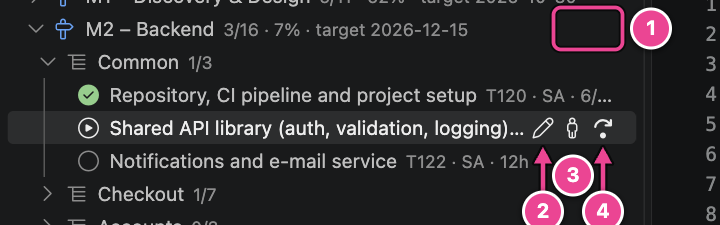

| #   | Button(s)                 | What it does                                                                         |
| --- | ------------------------- | ------------------------------------------------------------------------------------ |
| 1   | Add task · Edit milestone | On milestone rows. Section rows have **Add task** only (into that section).          |
| 2   | Edit task                 | Opens the task form with every field.                                                |
| 3   | Assign owner              | Picks a person from `team.md`.                                                       |
| 4   | Cycle status              | One status step: to do → in progress → review → done. Writes `@started` and `@done`. |

Person rows have **Add time off** and **Edit person**; inbox rows have **Plan into milestone…**.

## How the forms work

Adding or editing anything opens a **form** at the top of the window. This is the form of an
existing task (✎ on its row):

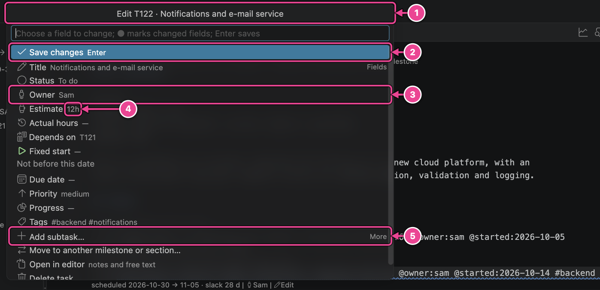

| #   | Part          | What it does                                                                                               |
| --- | ------------- | ---------------------------------------------------------------------------------------------------------- |
| 1   | Title         | What you are editing (or where the new item goes).                                                         |
| 2   | Main action   | Selected from the start, so **Enter** runs it: _Save changes_, _Create task_, _Add person_ …               |
| 3   | Fields        | Click a field (or type its name and press Enter) to change it. Its own picker opens and then returns here. |
| 4   | Current value | What is in the file now; **—** means not set. Some fields have a hint on a second line.                    |
| 5   | More          | Further actions: add a subtask, move, open the line in the editor for notes and free text, delete.         |

Typing filters the list: `own` + Enter opens **Owner**, `dep` + Enter opens **Depends on**.

### Changed fields and saving

A changed field gets a **●**. Nothing is written until you choose the main action, and then all
changes go into the file as one edit (one Cmd+Z undoes them all).

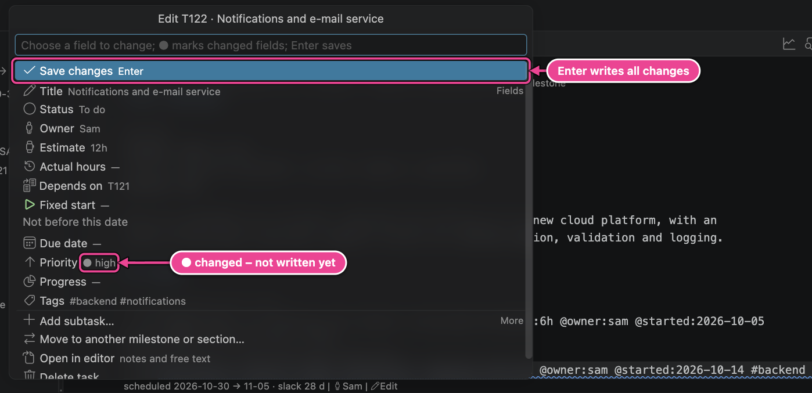

Pressing **Escape** in a field's picker keeps the old value and brings you back to the form.
Pressing Escape on the form itself closes it; if you changed something, the planner asks first:

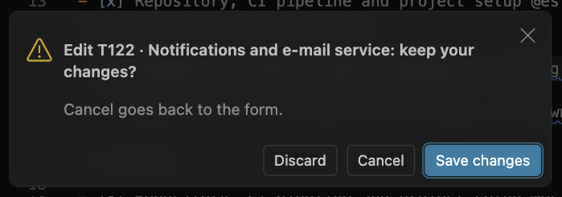

**Cancel** returns to the form.

### Pickers

| Field                                        | How you choose                                                                                                                                                                                       |
| -------------------------------------------- | ---------------------------------------------------------------------------------------------------------------------------------------------------------------------------------------------------- |
| Owner                                        | A list of the people in `team.md` with id, role and skills. **No owner** removes `@owner`; a subtask then inherits its parent's owner (shown as "from the parent").                                  |
| Depends on                                   | Tick the tasks that must finish first. Current dependencies are at the top. The task's own subtasks and tasks that would create a loop are not offered. Lags typed in the file (`T303+2d`) are kept. |
| Dates (fixed start, due, target, time off …) | Suggestions such as _today_, _next Monday_, _end of month_ (and the milestone target for due dates), **Other date…** to type `YYYY-MM-DD`, or **No date** to remove it.                              |
| Estimate, actual hours                       | Type `4h`, `1.5d` or `1w`. Empty removes it.                                                                                                                                                         |
| Status                                       | The six statuses. **Blocked** asks for the reason (`@blocked:"…"`).                                                                                                                                  |
| Tags, skills                                 | Tick known values, or type a new one and tick **New tag: …**.                                                                                                                                        |
| Lists (time off, holidays, capacity changes) | **Done**, **Add…**, or choose an entry to remove it.                                                                                                                                                 |

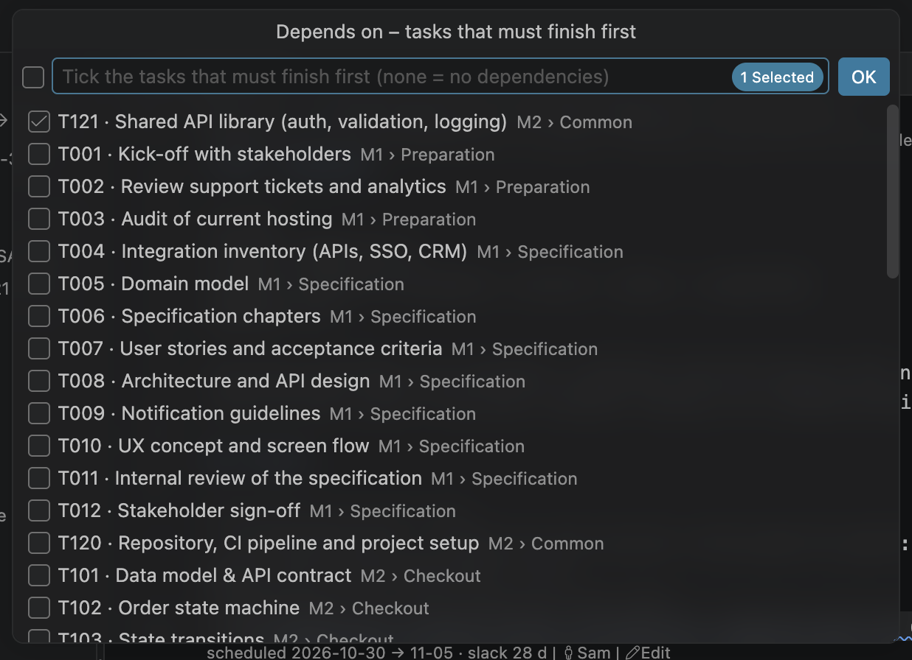

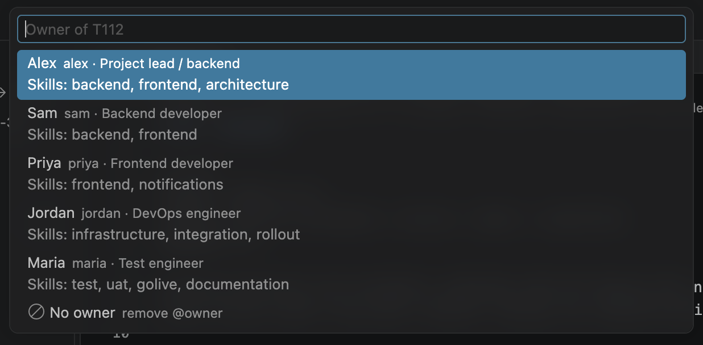

## Tasks

### Add a task

Click **+** on a section row (or any other place from the table above), type the title and press
Enter:

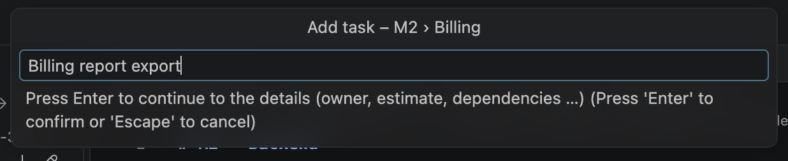

The form opens with the title filled in. Press **Enter** to create the task right away, or fill in
fields first. **Create and add another** creates it and asks for the next title in the same place,
which is the fastest way to enter a list of tasks.

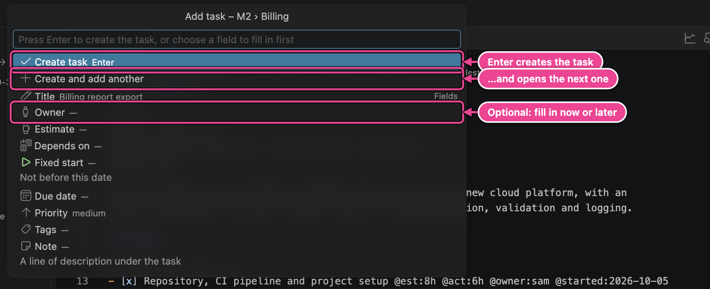

Where the task goes:

- From a **milestone or section row**, the CodeLens or the Gantt: there.
- From **+ in the Milestones toolbar**: next to the selected row. A selected section or task means
  that section; a selected milestone means that milestone (you choose the section).
- With nothing selected, and from the **Command Palette**: you choose the milestone and the section
  (an existing one, _No section_, or a new one). When a milestone file is open in the editor, its
  milestone is used.
- From a **Kanban column**: the task gets the column's status. When the board is filtered on one
  owner or one milestone, those are used too.

The task gets its id (`^T408`) immediately, and attributes are written in a fixed order:

```markdown
- [ ] Billing report export @est:4h @owner:sam @dep:T113 #billing ^T408
```

A task created as _in progress_ or _done_ gets `@started` or `@done` with today's date, as if you
had moved it there.

### Edit a task

✎ on the row, **Edit** in the CodeLens, double-click on a Kanban card, or **All fields…** in the
Gantt's edit dialog all open the same form. Its fields:

| Field          | Writes                                                                              |
| -------------- | ----------------------------------------------------------------------------------- |
| Title          | The text of the line.                                                               |
| Status         | The checkbox, plus `@started` / `@done` dates.                                      |
| Blocked reason | `@blocked:"…"` (shown while the status is Blocked).                                 |
| Owner          | `@owner` (shows the inherited owner when the task has none).                        |
| Estimate       | `@est`.                                                                             |
| Actual hours   | `@act`.                                                                             |
| Depends on     | `@dep`.                                                                             |
| Fixed start    | `@start`: the task is not scheduled before this date.                               |
| Due date       | `@due`: a deadline; the task is flagged late when its scheduled finish is after it. |
| Priority       | `@prio:high` or `@prio:low` (medium is the default and is not written).             |
| Progress       | `@progress` (a percentage); leave it empty to use actual hours instead.             |
| Tags           | `#tags`.                                                                            |

Only the characters that change are touched: comments, unknown attributes and notes stay as they
are. Notes and free text are edited in the file: **More → Open in editor**.

### Subtasks, move and delete

- **Add subtask…** (right-click, or More in the task form) adds a checkbox line indented under the
  task, with the same form as a new task.
- **Move task to…** moves the task with its subtasks and notes to another milestone or section.
  Its id stays, so dependencies stay valid.
- **Reorganize ▸** has **Move task up**, **Move task down**, **Indent task** (it becomes the last
  subtask of the task above) and **Outdent task** (it moves out of its parent, right after it). In
  the Milestones view the same moves are Option+↑, Option+↓, Option+→ and Option+←. A task always
  moves with its notes and subtasks, and only among the tasks at its level, so the outline below
  it stays as it was.
- **Option+↑ / Option+↓ in a plan file** on a task line do the same as Move task up / down. VS
  Code's own Move Line Up/Down would move only that line and hand the subtasks to another task;
  on other lines they work as usual. Turn this off with `planner.editor.moveTasksAsBlocks`.
- **Drag a task in the Milestones view** onto a section or milestone to move it there, or onto a
  task: a list asks whether it goes before it, after it, or as its subtask, so nothing becomes a
  subtask by accident.
- A move that would make the plan invalid asks first, for example a task that would depend on its
  own new parent, or a dependency loop through the milestones' `depends:`. **Move anyway** still
  moves it, and the problem is listed in the Problems panel.
- **Delete task…** asks first and tells you what else changes:

  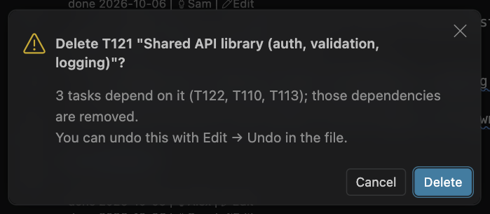

  Subtasks and notes are deleted with the task, and every `@dep` on it is removed, so no broken
  dependency is left behind. Cmd+Z in the file brings everything back.

## Milestones and sections

**Add a milestone** with the milestone button in the Milestones toolbar: type the name, then press
Enter to create it or set the target date, status and dependencies first. The planner proposes the
next free id (`M6`) and creates `milestones/M6-documentation.md`.

**Edit a milestone** with ✎ on its row or **Edit milestone** above its heading:

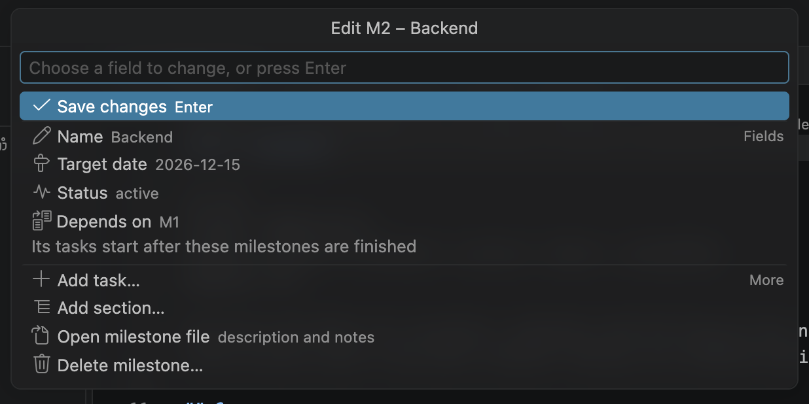

The name keeps its id prefix (`M2 – `). Setting the status to _cancelled_ cancels its tasks; this
is also the way to retire a milestone and keep it for the record.

**Delete a milestone** with right-click → **Delete milestone…** on its row (also on a Gantt
milestone row, or More in the milestone form). The confirmation says what goes with it:

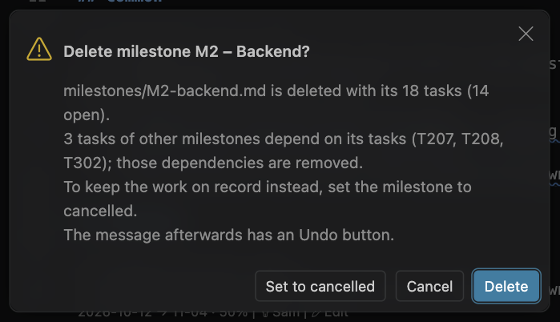

Its file and tasks are deleted, `depends:` on it is removed from other milestones and `@dep` on its
tasks from tasks elsewhere, so nothing is left pointing at it. Test plans keep their `milestone:`
line. When it still has open tasks, **Set to cancelled** keeps the milestone on record instead.
The message after the delete has an **Undo** button that brings the file and the dependencies back.

**Add a section** with right-click → **Add section…** on a milestone, or **Add section** above the
milestone heading. A new, empty section shows **Add a task…** until it has a task:

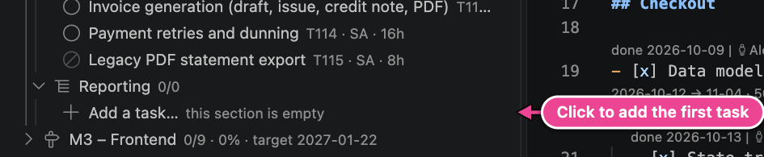

Empty sections that contain text, such as `## Notes`, are not shown in the tree.

## People and time off

**Add a person** with 👤+ in the My Work / Team toolbar. **Edit a person** with ✎ on their row:

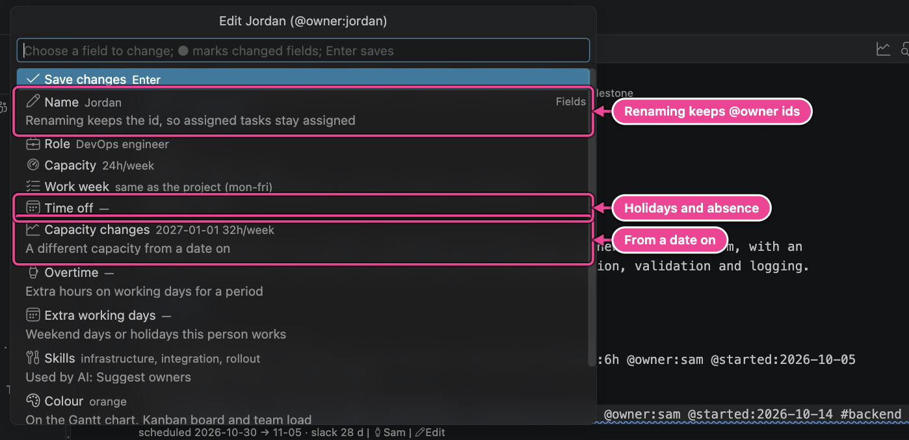

| Field              | Writes                                                                                                                  |
| ------------------ | ----------------------------------------------------------------------------------------------------------------------- |
| Name               | The `##` heading. Renaming keeps the person id (an `id:` line is added when needed), so `@owner` references stay valid. |
| Id                 | `id:` (new people only): what you write in `@owner:…`. Proposed from the name.                                          |
| Role               | `role:`.                                                                                                                |
| Capacity           | `capacity:` such as `32h/week` or `6h/day`; _Full time_ removes it.                                                     |
| Work week          | `workweek:` when the person's working days differ from the project's.                                                   |
| Time off           | One `off:` line per period: a day or `from..to`.                                                                        |
| Capacity changes   | One `capacityFrom:` line per change, for example from 2027-01-01 32h/week.                                              |
| Overtime           | One `overtime:` line per period: extra hours on working days, for example `2026-11-02..2026-11-13 +8h/week`.            |
| Extra working days | One `workday:` line per day (or range) worked on a weekend or holiday, for example `2026-11-28 6h`.                     |
| Skills             | `skills:` (the AI uses them to suggest owners).                                                                         |
| Colour             | `color:` on the Gantt, Kanban and team load.                                                                            |

Lists such as time off and capacity changes open a small list editor:

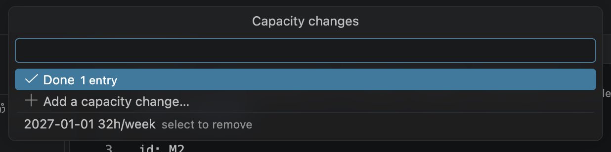

**Add time off** (📅 on the person row) asks for the first and the last day and adds an `off:` line.

**Plan overtime…** (right-click a person, or in the team load) asks for the period and the extra
hours:

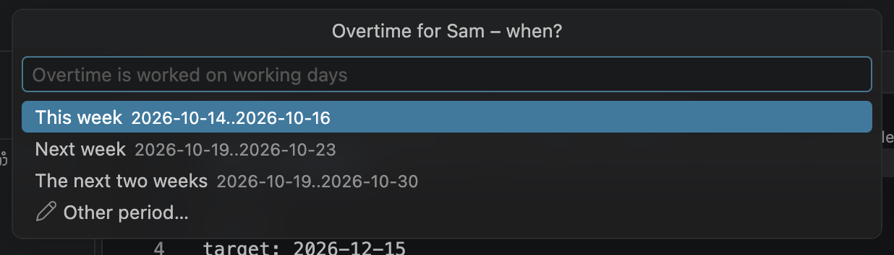

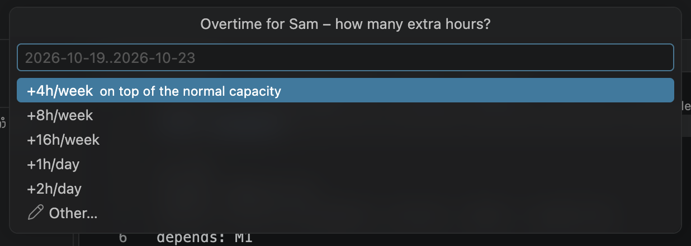

**Add a working day…** offers the coming weekend days and holidays, then how long the person works
that day:

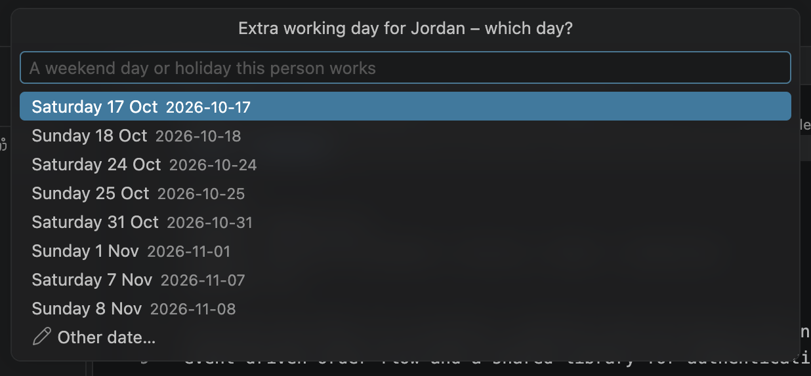

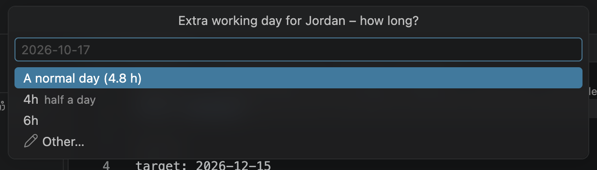

The same actions are above each person in `team.md`:

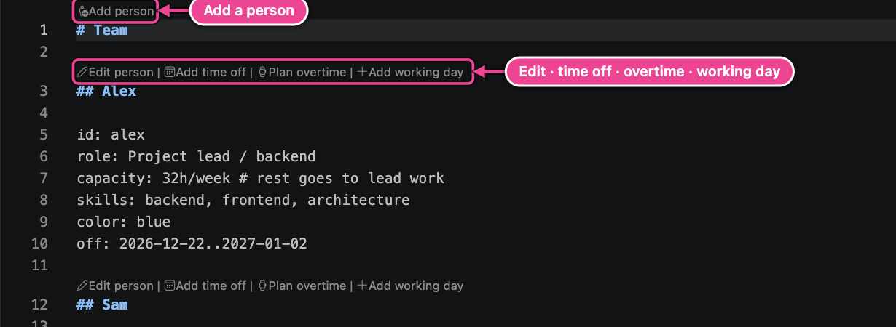

**Remove a person** with right-click → **Remove from team…** on their row (or More in the person
form). When they own tasks, punch or inbox items, choose who takes them over, or **Nobody** to
leave them unassigned:

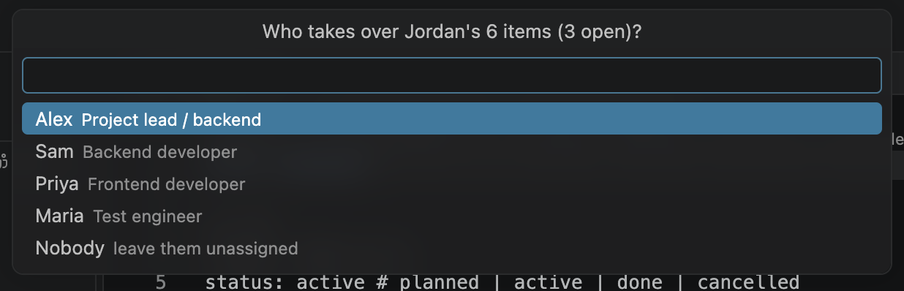

After a confirmation, their section in `team.md` is deleted and their items get the new owner (done
items too, so no task names someone who is not on the team). The message afterwards has an
**Undo** button.

## The project calendar

**Edit project settings…** is in the **…** menu of the Milestones and My Work / Team toolbars and
above the heading of `project.md`:

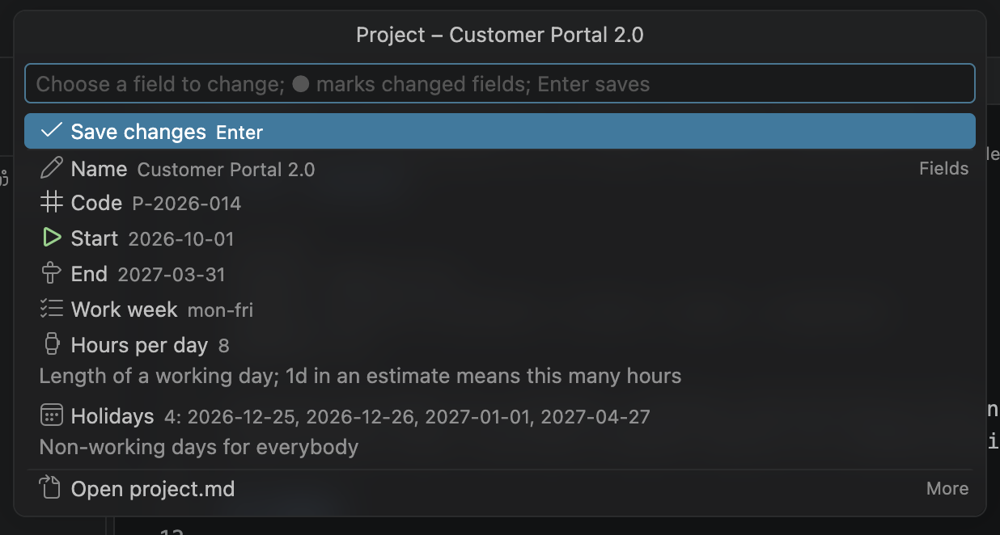

Name, code, start and end date, work week, hours per day and holidays. Holidays are single days or
ranges `from..to`, written as one comma-separated `holidays:` line. Every change reschedules the
plan at once.

## Inbox and punch items

- **Capture to inbox** (**+** in the Inbox toolbar) adds a line to `inbox.md`; `#tags` in the text
  become tags. **Plan into milestone…** later turns it into a task
  ([The sidebar › Inbox](06-sidebar.md#inbox)).
- **Add punch item** (**+** in the Punch List toolbar, or in a column of the punch-list board)
  asks for the title, then severity, owner, due date, the test case it came from, tags and status.
  It gets the next `^P…` id. Punch items found during a test are best raised from the
  [test runner](12-tests-and-punch-list.md#raise-a-punch-item).

## Undo, saving and the files

- Every action is one edit of the Markdown, made through VS Code: **Cmd+Z** in the file undoes it.
- Deleting a milestone or removing a person changes several files at once: use the **Undo** button
  in the message that follows (it refuses when one of the files was changed in between).
- `planner.autoSave` (on by default) saves the file right after an edit from the UI. Turn it off
  to review changes before saving.
- New files (a milestone, `team.md`, `inbox.md`, `punchlist.md`) are created when needed.
- The clickable CodeLens actions can be hidden with `planner.codeLens.actions`; the schedule
  CodeLens stays.

---

[← Tutorial](02-tutorial.md) · [Contents](README.md) · [Next: Plan files →](04-plan-files.md)
