# 5. The editor

Plan files are ordinary Markdown files, but inside the plan folder the editor understands them:
it completes ids and names, shows details on hover, navigates between tasks, checks the plan as
you type and shows the computed schedule inline. This chapter covers every editor feature.

All features work in any Markdown file inside the plan folder.

## Completion

Completion pops up by itself after `@`, `:`, `#` and `,`, and anywhere with **Ctrl+Space**.

| You type                               | You get                                                                              |
| -------------------------------------- | ------------------------------------------------------------------------------------ |
| `@`                                    | The attributes that fit the item: tasks, punch items, inbox items or test steps.     |
| `@owner:`                              | People from `team.md` with role and skills.                                          |
| `@dep:` (and after `,`)                | Every task id with its title, milestone and section. Search by id or by title words. |
| `@start:` `@due:` `@started:` `@done:` | Dates: today, tomorrow, next Monday, end of week, end of next week, end of month.    |
| `@est:`                                | `2h`, `4h`, `1d`, `2d`, `1w`.                                                        |
| `@prio:`                               | `high`, `med`, `low`.                                                                |
| `@progress:`                           | `25%`, `50%`, `75%`, `90%`.                                                          |
| `@test:`                               | Test plan ids.                                                                       |
| `@eq:`                                 | Equipment paths already used in the plan.                                            |
| `@sev:` (punch list)                   | `A`, `B`, `C` with their meaning.                                                    |
| `@from:` (punch list)                  | Every test case as `UAT-01/TC-01`.                                                   |
| `@result:` `@punch:` (test steps)      | `pass`, `fail`, `na`; punch item ids.                                                |
| `#`                                    | Tags already used in the plan, with the number of tasks.                             |
| `status:` (milestones)                 | `planned`, `active`, `done`, `cancelled`.                                            |
| `depends:` `milestone:`                | Milestone ids.                                                                       |
| `type:` (test plans)                   | `acceptance`, `FAT`, `SAT`, `IT`, `unit`.                                            |
| `workweek:`                            | `mon-fri`, `mon-thu`, `sun-thu`, `mon-sat`.                                          |
| `target:` `start:` `end:` `off:`       | Dates.                                                                               |
| `workday:` (team.md)                   | The coming weekend days and holidays of that person.                                 |
| `overtime:` (team.md)                  | Next week or the next two weeks with `+8h/week`, or next week with `+2h/day`.        |
| `color:` (team)                        | `blue`, `green`, `purple`, `orange`, `yellow`, `red`.                                |

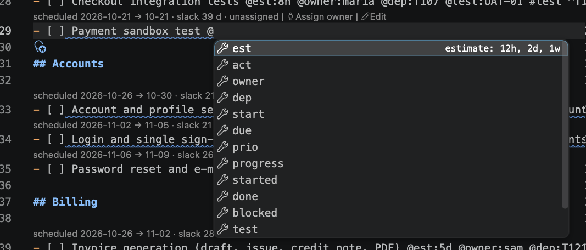

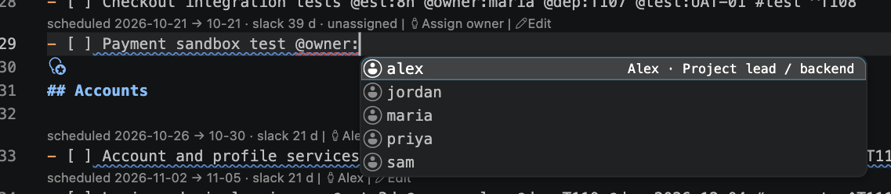

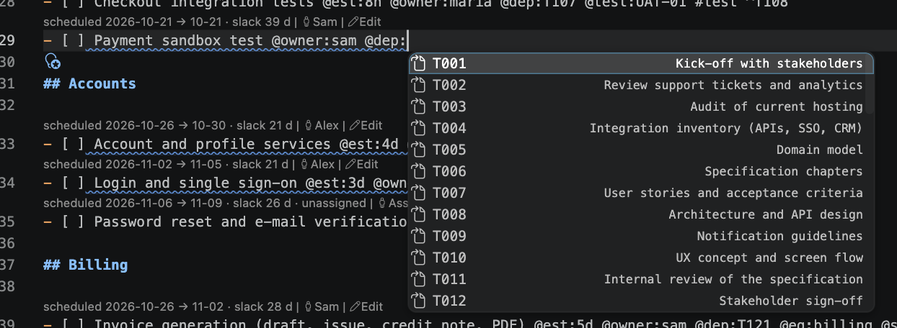

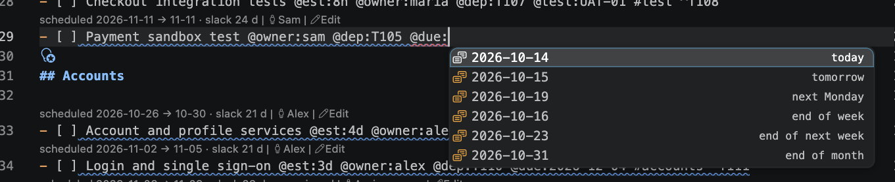

Choosing an attribute that takes a value (such as `owner`) inserts `owner:` and opens the value
list straight away.

## Hovers

Hold the mouse over a reference to see what it points to.

| Hover over                                   | Shows                                                                                                     |
| -------------------------------------------- | --------------------------------------------------------------------------------------------------------- |
| A task id: `^T105`, `@dep:T105`              | Title, status, milestone and section, owner, estimate/actual/remaining, scheduled dates, slack, deadline. |
| A punch id: `^P007`, `@punch:P007`           | The punch item, with severity and due date.                                                               |
| `@owner:sam`                                 | Role, capacity, open tasks and remaining hours, this week's load, skills.                                 |
| `@test:UAT-01`, the plan part of `@from:`    | Cases and steps with pass/fail/open counts.                                                               |
| The case part of `@from:UAT-01/TC-01`        | The test case with its pre-condition.                                                                     |
| A milestone id in `depends:` or `milestone:` | Tasks done, % complete and target.                                                                        |
| `#tag`                                       | Number of tasks with the tag.                                                                             |
| `@src:path#L8`                               | The source file and line (Cmd+click opens it).                                                            |

Unknown ids, owners and test plans show a warning instead.

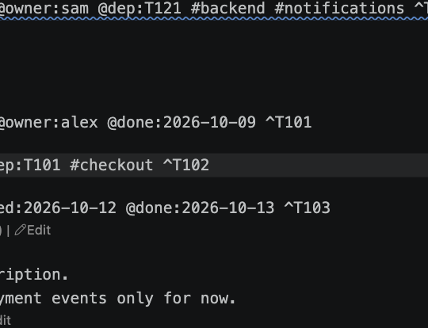

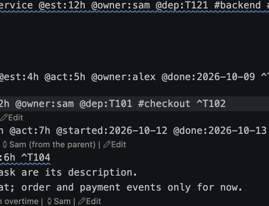

## Navigate

| Action              | Shortcut          | Works on                                                                                                                                                                                                                                                                                         |
| ------------------- | ----------------- | ------------------------------------------------------------------------------------------------------------------------------------------------------------------------------------------------------------------------------------------------------------------------------------------------ |
| Go to Definition    | F12, or Cmd+click | Task and punch ids → their line; owner → the person in `team.md`; test plan and case → the file and heading; milestone id → its file; `@src` → the code line.                                                                                                                                    |
| Go to References    | Shift+F12         | Task ids: the task and every `@dep` that points to it. Punch ids: the item and the test steps that raised it. Owners: every `@owner` of that person. Test plans and cases: linked `@test` tasks and `@from` punch items. Milestone ids: `depends:` and test plans that name it. Tags: every use. |
| Find All References | Shift+Option+F12  | The same, in the References view.                                                                                                                                                                                                                                                                |

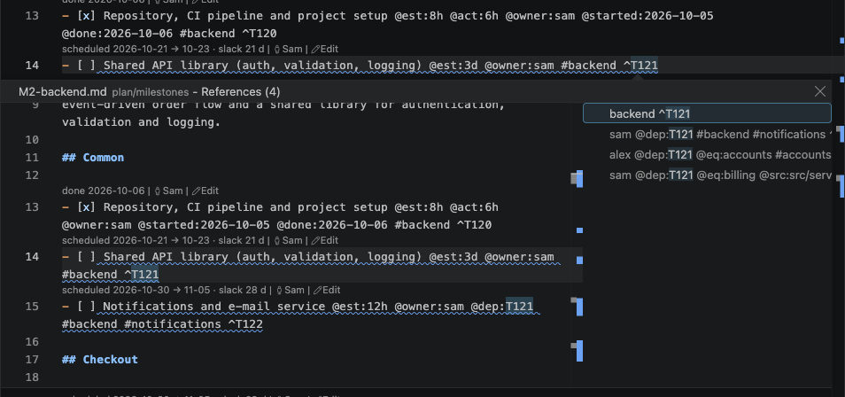

## Rename a task id

Put the cursor on a task id (`^T105` or an id inside `@dep:`) and press **F2**. Type the new id and
press Enter. The task's id and every `@dep` that refers to it, in every milestone file, change in
one undoable edit. The new id must look like an id (letters and digits, such as `T142`) and must
not be in use.

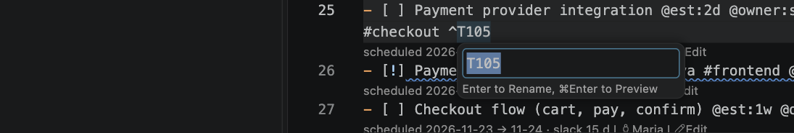

## Diagnostics

The planner checks the plan continuously and reports problems as squiggles and in the **Problems**
panel (Cmd+Shift+M). Click a message to jump to it.

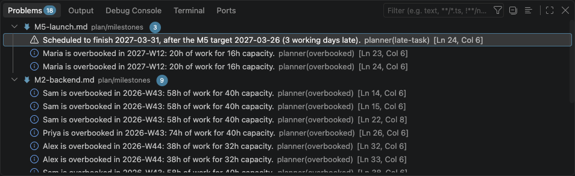

| Code                             | Severity        | Reported when                                                                                                                                                                                                                                                                                                                                           | Quick fix                                                                                                                                   |
| -------------------------------- | --------------- | ------------------------------------------------------------------------------------------------------------------------------------------------------------------------------------------------------------------------------------------------------------------------------------------------------------------------------------------------------- | ------------------------------------------------------------------------------------------------------------------------------------------- |
| `unknown-dep`                    | Error           | `@dep` points to an id that does not exist.                                                                                                                                                                                                                                                                                                             | Remove the dependency                                                                                                                       |
| `circular-dep`                   | Error           | Tasks or milestones depend on each other in a loop. They are not scheduled. Shown on each dependency the loop is made of.                                                                                                                                                                                                                               |                                                                                                                                             |
| `family-dep`                     | Error           | A task depends on itself, its own parent or its own subtask. It is not scheduled. Not reported for cancelled work, whose dependencies are ignored.                                                                                                                                                                                                      | Remove the dependency                                                                                                                       |
| `duplicate-id`                   | Error           | Two items (or test plans) have the same id. A copied task line that was given another title gets a new id on save, and so do its copied subtasks.                                                                                                                                                                                                       | Give this task (or item) a new id                                                                                                           |
| `duplicate-person`               | Error           | Two people in `team.md` have the same id.                                                                                                                                                                                                                                                                                                               |                                                                                                                                             |
| `unknown-milestone`              | Error / Warning | `depends:` (error) or a test plan's `milestone:` (warning) names a missing milestone.                                                                                                                                                                                                                                                                   |                                                                                                                                             |
| `invalid-date`                   | Error           | A date is not `YYYY-MM-DD`.                                                                                                                                                                                                                                                                                                                             |                                                                                                                                             |
| `invalid-duration`               | Error           | A duration has no unit or is not a number (`@est:12` instead of `@est:12h`).                                                                                                                                                                                                                                                                            |                                                                                                                                             |
| `invalid-value`                  | Error / Warning | A value is not allowed: priority, progress, severity, work week, test type, an empty `@owner` …                                                                                                                                                                                                                                                         |                                                                                                                                             |
| `unknown-owner`                  | Warning         | `@owner` is not a person in `team.md`. The task runs in the unassigned pool.                                                                                                                                                                                                                                                                            | Change owner to …                                                                                                                           |
| `unknown-test`                   | Warning         | `@test` or `@from` names a missing test plan.                                                                                                                                                                                                                                                                                                           |                                                                                                                                             |
| `unknown-punch`                  | Warning         | A test step's `@punch` names a missing punch item.                                                                                                                                                                                                                                                                                                      |                                                                                                                                             |
| `unknown-status`                 | Warning         | The checkbox has an unknown character, such as `[z]`. Treated as to do.                                                                                                                                                                                                                                                                                 |                                                                                                                                             |
| `not-a-task`                     | Warning         | A line looks like a task but is not read as one: `- []`, `-[ ]`, `- [ ]Title`, `[ ] Title`.                                                                                                                                                                                                                                                             | Make it a task                                                                                                                              |
| `duplicate-attr`                 | Warning         | The same attribute appears twice; only the first counts.                                                                                                                                                                                                                                                                                                |                                                                                                                                             |
| `late-task`                      | Warning         | The task is scheduled to finish after its `@due` or its milestone's target. The message names what holds it back: a fixed start (often a wrong date) or an owner's other work, followed through the dependencies.                                                                                                                                       |                                                                                                                                             |
| `date-outside-project`           | Warning         | A `@start` or `@due` (or a milestone target, or a date or period of `capacityFrom`, `off`, `overtime` or `workday` in `team.md`) is after the project end, or a `@due` before its start: often a wrong year. A `team.md` period that starts in the project but lasts over a year is flagged too.                                                        | Change to the same day in the year that fits (a whole period at once); remove                                                               |
| `start-after-started`            | Warning         | A task in progress has a fixed `@start` after its `@started`: the rest of the work waits until then.                                                                                                                                                                                                                                                    | Remove `@start`                                                                                                                             |
| `start-after-target`             | Warning         | A fixed `@start` is after the milestone target, so the task cannot finish on time.                                                                                                                                                                                                                                                                      | Remove `@start`                                                                                                                             |
| `due-after-target`               | Warning         | `@due` is after the milestone target: the task is not reported late until its due date, although the milestone is late by then.                                                                                                                                                                                                                         | Change `@due` to the target; remove                                                                                                         |
| `done-before-started`            | Warning         | `@done` is before `@started`.                                                                                                                                                                                                                                                                                                                           |                                                                                                                                             |
| `parent-estimate-unscheduled`    | Warning         | A parent's `@est` is more than its subtasks add up to, and every subtask has an estimate: the rest is not scheduled.                                                                                                                                                                                                                                    | Add a subtask for the remaining hours; set `@est` to the subtasks' total; remove `@est`                                                     |
| `done-parent-open-subtasks`      | Warning         | A done task still has open subtasks; they are no longer scheduled.                                                                                                                                                                                                                                                                                      | Mark the open subtasks done; reopen the task                                                                                                |
| `unschedulable`                  | Warning         | The owner has no working hours for it, for example after `capacityFrom: 2026-12-24 0h/week`: the message says whose hours end and when.                                                                                                                                                                                                                 |                                                                                                                                             |
| `blocked-by-unschedulable`       | Warning         | The task waits for a task that cannot be scheduled; the message names that task and why.                                                                                                                                                                                                                                                                |                                                                                                                                             |
| `blocked-by-cycle`               | Warning         | The task waits for tasks in a circular dependency.                                                                                                                                                                                                                                                                                                      |                                                                                                                                             |
| `missing-estimate`               | Info            | An open leaf task has no `@est`; it is scheduled with 0 hours. Not reported for cancelled work.                                                                                                                                                                                                                                                         | Add estimate (2h … 1w, or type one); make the next task a subtask of this one (for a group whose tasks were not indented; asks like Indent) |
| `missing-blocked-reason`         | Info            | A task is `[!]` without `@blocked:"…"`.                                                                                                                                                                                                                                                                                                                 |                                                                                                                                             |
| `stale-started`                  | Info            | A to-do task has `@started` but no time logged, left from an earlier status. It is ignored.                                                                                                                                                                                                                                                             | Remove `@started`                                                                                                                           |
| `missing-done`                   | Info            | A done task has no `@done`, so it has no place on the timeline or in the burn-up.                                                                                                                                                                                                                                                                       | Add `@done` with today's date                                                                                                               |
| `cancelled-dep`                  | Info            | `@dep` names a cancelled task (or one in a cancelled milestone); the dependency is ignored.                                                                                                                                                                                                                                                             | Remove the dependency                                                                                                                       |
| `started-early`                  | Info            | A task is in progress while a milestone its milestone depends on is not finished.                                                                                                                                                                                                                                                                       | Put it back to To do                                                                                                                        |
| `milestone-started-early`        | Info            | A milestone is `active` while a milestone it depends on is not finished.                                                                                                                                                                                                                                                                                | Set the milestone status to planned                                                                                                         |
| `floating-milestone`             | Info            | Nothing ties a milestone to earlier ones (no `depends:`, no `@dep` on their tasks, and no earlier milestone waits for it) and its work starts before the milestone before it finishes.                                                                                                                                                                  | Add `depends:` on the milestone before it                                                                                                   |
| `parent-estimate-exceeded`       | Info            | The subtasks add up to more than the parent's `@est`; their estimates are used.                                                                                                                                                                                                                                                                         | Set `@est` to the subtasks' total; remove `@est`                                                                                            |
| `open-parent-all-done`           | Info            | All subtasks are done, but the parent is still open.                                                                                                                                                                                                                                                                                                    | Mark this task done                                                                                                                         |
| `cancelled-parent-open-subtasks` | Info            | A cancelled task has open subtasks: they are cancelled with it and not scheduled (often a task typed or moved under a cancelled one).                                                                                                                                                                                                                   | Cancel the open subtasks too; move the subtask out (outdent); reopen the task                                                               |
| `overbooked`                     | Info            | On a person in `team.md`, when their workload makes tasks late: their open work, how many weeks that is with the capacity in force (or how much fits before their working hours end), until when it is planned, and the tasks that finish after their deadline because the person has other work first. Turn off with `planner.diagnostics.overbooked`. |                                                                                                                                             |
| `missing-id`                     | Hint            | A task has no id. Only shown when `planner.autoAssignIds` is off.                                                                                                                                                                                                                                                                                       | Assign id; assign ids to all tasks in this file                                                                                             |
| `implied-dep`                    | Hint            | A dependency another one in the same list already covers: a subtask of a listed task, or a task another listed task waits for. Only dependencies on open work count.                                                                                                                                                                                    | Remove the implied dependencies                                                                                                             |

## Quick fixes

When the cursor is on a line with a fixable diagnostic, a light bulb appears. Press **Cmd+.** to
open the menu:

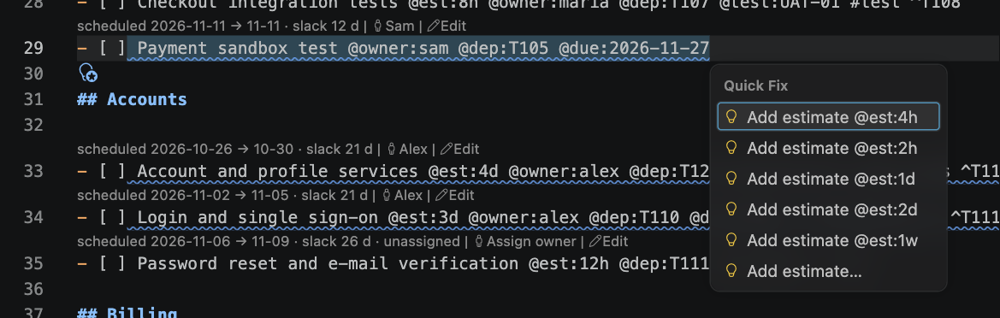

- **Add estimate `@est:4h`** (the preferred fix), `2h`, `1d`, `2d`, `1w`, or **Add estimate…** to
  type any duration.
- **Remove broken dependency T999**.
- **Change owner to sam (Sam)** – one entry per person in `team.md`.
- **Assign id ^T123** or **Assign ids to all N tasks in this file** (when automatic ids are off).
- **Make it a task: `- [ ] Title`** for a line that was almost a task.
- **Give this task a new id** for a duplicate id (a punch item gets a new P id).
- **Change `@start` to 2026-10-19** when a date is outside the project and the same day a year
  earlier (or later) fits (in `team.md`, a whole period moves); **Remove `@start`** / **Remove
  `@due`** for dates that cannot work.
- **Remove `@started`** on a to-do task, **Add `@done:<today>`** on a done task without a date.
- **Remove the dependency on T12** for dependencies on cancelled work, on the task itself, its
  parent or its subtask.
- **Add a subtask for the remaining 36h** or **Set `@est` to the subtasks' total** when a parent's
  estimate and its subtasks disagree.
- **Mark the open subtasks done**, **Reopen this task** or **Mark this task done** when a parent's
  status disagrees with its subtasks; **Cancel the open subtasks too**, **Move T12 out of this
  task** or **Reopen this task** for open subtasks of a cancelled task.
- **Make the next task (T12) a subtask of this one** for a task without an estimate that is really
  a group. Like every quick fix it is an edit in the editor (not saved), and it asks first like
  Indent when the move would take work out of the schedule.
- **Remove the implied dependencies** when a `@dep` list repeats what its other entries already
  cover (hints are shown as dots under the text, not in the Problems panel).

## CodeLens: the schedule and actions inline

Grey CodeLens lines show the computed schedule without leaving the file, next to clickable actions.
Click the schedule part to reveal the milestone or task in the Milestones view.

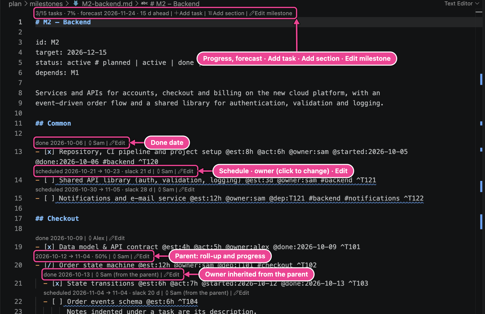

| CodeLens                                             | Where             | Meaning                                                                                                         |
| ---------------------------------------------------- | ----------------- | --------------------------------------------------------------------------------------------------------------- |
| `3/15 tasks · 7% · forecast 2026-11-24 · 15 d ahead` | Milestone heading | Tasks done/total, hours-weighted progress, forecast finish, working days ahead of (or late against) the target. |
| `scheduled 2026-10-21 → 10-23 · slack 21 d`          | Open leaf task    | Scheduled start and finish, and how many working days it can slip before it delays the last milestone.          |
| `… · critical`                                       | Open leaf task    | The task is on the critical path.                                                                               |
| `… · ⚠ late (due 2026-11-20)`                        | Open leaf task    | Scheduled after its deadline.                                                                                   |
| `… · unassigned`                                     | Open leaf task    | No owner: it runs in the unassigned pool.                                                                       |
| `done 2026-10-06`                                    | Done task         | Completion date.                                                                                                |
| `2026-10-12 → 11-05 · 50%`                           | Parent task       | Roll-up of its subtasks: span and hours-weighted progress.                                                      |
| `not scheduled: …`                                   | Any task          | Why it has no dates (circular dependency, no capacity …).                                                       |
| `… · 4.8 h overtime`                                 | Open leaf task    | Hours of planned overtime or extra working days the task uses (the tooltip says on which days).                 |

The actions next to them:

| Action                                            | Where                  | What it does                                                                    |
| ------------------------------------------------- | ---------------------- | ------------------------------------------------------------------------------- |
| **Add task**, **Add section**                     | Milestone heading      | A new task or section in this milestone.                                        |
| **Edit milestone**                                | Milestone heading      | Name, target date, status, dependencies.                                        |
| **Sam** / **Assign owner**                        | Every task             | The owner; click to change. _(from the parent)_ sams an inherited owner.        |
| **Edit**                                          | Every task             | The task form with every field ([Edit a task](03-add-and-edit.md#edit-a-task)). |
| **Add person**, **Edit person**, **Add time off** | `team.md`              | See [People and time off](03-add-and-edit.md#people-and-time-off).              |
| **Edit project settings**                         | `project.md`           | See [The project calendar](03-add-and-edit.md#the-project-calendar).            |
| **Capture to inbox**, **Plan into milestone…**    | `inbox.md`             | A new inbox line; turn a line into a task.                                      |
| **Add punch item**, owner, **Edit**               | `punchlist.md`         | A new punch item; change an item.                                               |
| **Open in test runner**                           | Test plans in `tests/` | Opens the [test runner](12-tests-and-punch-list.md#the-test-runner).            |

Hide the actions with `planner.codeLens.actions`, the task lines with `planner.codeLens.tasks`, or
all CodeLens with `planner.codeLens.enabled`.

## Change the status

- **Hover the checkbox** (`[ ]`): the hover shows the status and a link for every other status.
  Click one. The change is an edit like typing: it is not saved until you save, and Cmd+Z undoes
  it.
- **Cmd+Option+X** (Ctrl+Alt+X) cycles the status of the task under the cursor (**Planner: Cycle
  status**): to do → in progress → review → done → to do; blocked → in progress; cancelled → to do.

  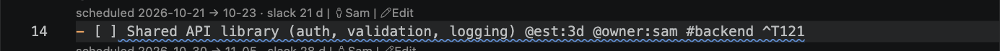
  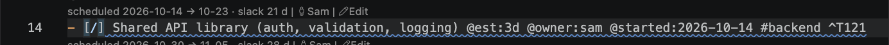

- **Right-click → Set status →** _To do_, _In progress_, _Review / test_, _Blocked…_, _Done_,
  _Cancelled_ sets a status directly. _Blocked…_ asks for an optional reason.
- The same commands are in the Command Palette: **Planner: Set status…**, **Planner: Done** …

The dates described in [Plan files › Status](04-plan-files.md#status) are written for you. Edits
made from the editor stay unsaved like normal typing.

A click inside the checkbox does not change the status: a click meant to place the cursor changed
tasks by accident. If you prefer clicking, turn on `planner.editor.toggleOnClick`; each click then
moves the task one step, like Cmd+Option+X.

## The editor context menu

Right-click in a plan file:

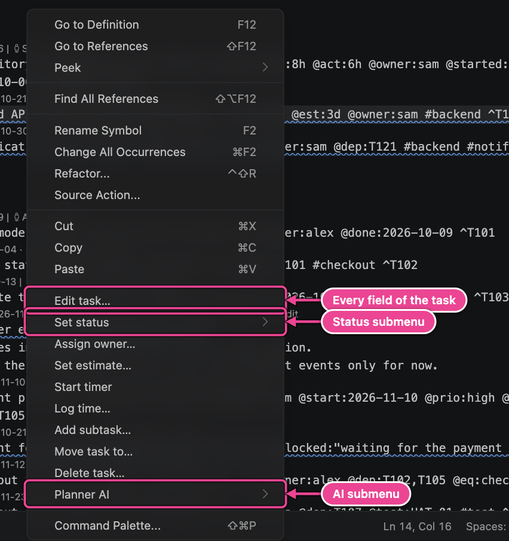

| Item          | What it does                                                                                           |
| ------------- | ------------------------------------------------------------------------------------------------------ |
| Edit task…    | The task form with every field ([Edit a task](03-add-and-edit.md#edit-a-task)).                        |
| Set status ▸  | Sets the status of the task under the cursor.                                                          |
| Assign owner… | Picks a person (or _No owner_) and writes `@owner`.                                                    |
| Set estimate… | Asks for a duration and writes `@est`.                                                                 |
| Start timer   | Starts the timer on the task ([Time tracking](11-time-tracking.md)).                                   |
| Log time…     | Adds hours to `@act`.                                                                                  |
| Add subtask…  | A new task indented under the task.                                                                    |
| Move task to… | Moves the task with its subtasks and notes to another milestone or section.                            |
| Reorganize ▸  | Move task up / down, Indent task, Outdent task, always with its notes and subtasks.                    |
| Delete task…  | Deletes the task, its subtasks and notes, and the dependencies on it, after asking.                    |
| Planner AI ▸  | Break down task, Estimate, Suggest owners ([AI assistant](14-ai-assistant.md)). Hidden when AI is off. |

In source files outside the plan folder, the context menu has **Promote to task…** instead, for the
TODO comment under the cursor ([TODOs in Code](06-sidebar.md#todos-in-code)).

## Move tasks with Option+↑ / Option+↓

On a task line, **Option+↑** and **Option+↓** (Alt on Windows and Linux) move the task with its notes
and subtasks past the task above or below it at the same level, and the cursor goes with it. On
any other line they are VS Code's Move Line Up / Down as usual. VS Code's own line move would take
only the task line and hand its subtasks to another task. Turn this off with
`planner.editor.moveTasksAsBlocks`.

With several cursors, or a selection over several task lines, every selected task moves
(neighbouring tasks together), and the selections stay on them. If one of the cursors is on
another line, they all move as lines (VS Code's Move Line). A selection over tasks at different
levels is refused with a message in the status bar. Within a file only the moved lines change.

## Automatic ids on save

Saving a milestone file or the punch list adds missing ids (`planner.autoAssignIds`, on by
default). A task line you copied with its id and gave another title gets a new id at the same time,
so dependencies keep pointing at the original. Copied with its subtasks, they get new ids too, and
dependencies among the copied lines follow them. A copy that kept its id is still a task of its
own: status changes, the task form and the other commands change the line under the cursor, not
the first task with that id. With VS Code's delayed auto-save, ids are added only if
`planner.autoAssignIdsOnAutoSave` is on, so they do not appear while you are still typing.
**Planner: Assign IDs** adds missing ids to the active file (or to all plan files when no plan file
is active).

## The editor title button

The **Open Gantt** button (chart icon) in the editor title bar is available in every plan file.

---

[← Plan files](04-plan-files.md) · [Contents](README.md) · [Next: The sidebar →](06-sidebar.md)
