# 6. The sidebar

Click the **Planner** icon in the activity bar to open the sidebar. It has six views; collapse the
ones you do not need by clicking their title, drag a title to reorder them, or drag a view into
another sidebar or panel. Every view updates as soon as a plan file changes.

## Milestones

The plan as a tree: milestone → section → task → subtask.

### Toolbar

The buttons in the view title (always visible, or on hover depending on your VS Code settings):

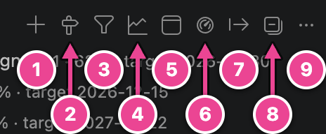

| #   | Button         | What it does                                                                                                               |
| --- | -------------- | -------------------------------------------------------------------------------------------------------------------------- |
| 1   | Add task…      | Adds a task next to the selected row, or asks for the milestone and section ([Add a task](03-add-and-edit.md#add-a-task)). |
| 2   | Add milestone… | Creates a milestone file ([Milestones and sections](03-add-and-edit.md#milestones-and-sections)).                          |
| 3   | Filter…        | Shows only matching tasks ([Filters](#filters)). A **Clear filter** button appears next to it while a filter is active.    |
| 4   | Open Gantt     | Opens the [Gantt chart](07-gantt.md).                                                                                      |
| 5   | Open Kanban    | Opens the [Kanban board](08-kanban.md).                                                                                    |
| 6   | Open dashboard | Opens the [dashboard](10-dashboard-and-baselines.md).                                                                      |
| 7   | Export…        | Starts the [export](13-reports-and-export.md).                                                                             |
| 8   | Collapse All   | Collapses the tree.                                                                                                        |
| 9   | …              | More actions (below).                                                                                                      |

When the sidebar is narrow, VS Code moves the last buttons into the **…** menu. That menu always
has:

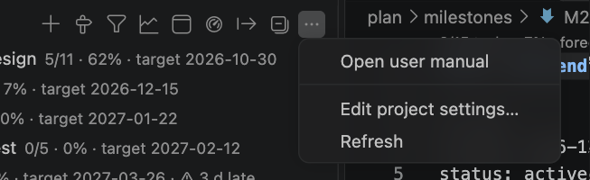

- **Open user manual**: opens this manual.
- **Edit project settings…**: name, dates, work week, hours per day and holidays
  ([The project calendar](03-add-and-edit.md#the-project-calendar)).
- **Refresh**: reloads the plan folder (useful after changing `planner.planFolder`).

When the workspace has no plan, the toolbar shows **New project…** instead.

### What a row tells you

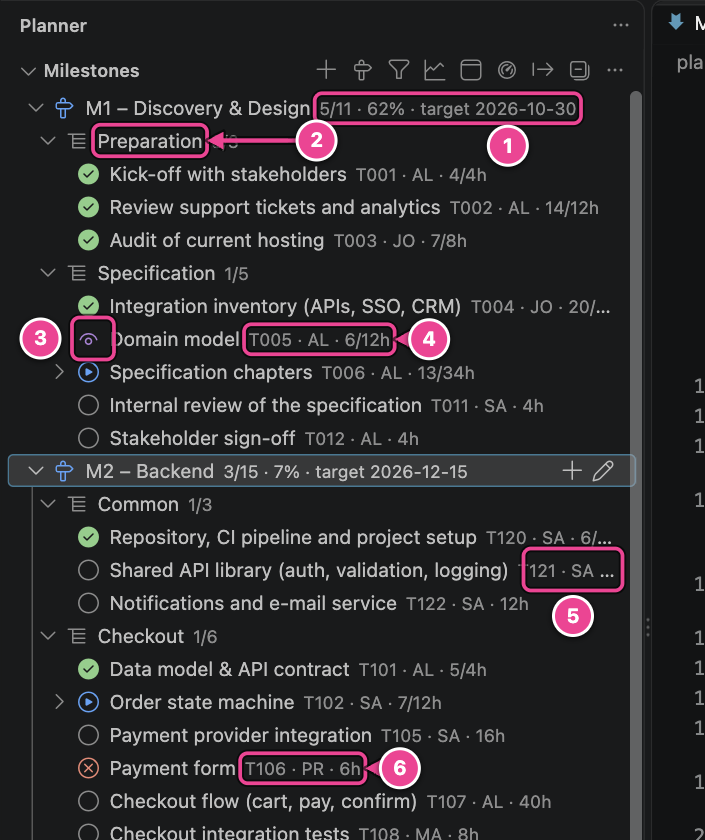

| #   | Element               | Meaning                                                                                                                                                                                                                                                           |
| --- | --------------------- | ----------------------------------------------------------------------------------------------------------------------------------------------------------------------------------------------------------------------------------------------------------------- |
| 1   | Milestone description | Tasks done/total · % complete (hours-weighted) · target date · `⚠ 3 d late` when the forecast misses the target, or `⚠ overdue` when the target has passed with open tasks. The milestone icon is green when done, red when late, blue when active.               |
| 2   | Section               | A `##` section, with tasks done/total.                                                                                                                                                                                                                            |
| 3   | Status icon           | ○ to do · ▶ in progress (blue) · 👁 review (purple) · ⊗ blocked (red) · ✓ done (green) · ⊘ cancelled.                                                                                                                                                              |
| 4   | Task description      | Id · owner initials · hours (`actual/estimate`, or the estimate alone) · `⚠ overdue`, `⚠ late` or `⚠ not scheduled`.                                                                                                                                              |
| 5   | Row buttons           | Appear on hover: **Edit task**, **Assign owner** and **Cycle status** (one status step: to do → in progress → review → done). Milestone rows have **Add task** and **Edit milestone**, section rows **Add task** ([Row buttons](03-add-and-edit.md#row-buttons)). |
| 6   | Blocked task          | Red ⊗ icon; its reason is in the tooltip.                                                                                                                                                                                                                         |

**Click** a task to open its line in the editor; click a milestone to open its file. An empty
milestone or a new, empty section shows an **Add a task…** row.

**Hover** a task for a tooltip with every detail: status, owner, estimate, actual, remaining,
dates, dependencies, priority, blocked reason, equipment, custom fields, tags, the scheduled dates
with slack, and the first lines of its notes.

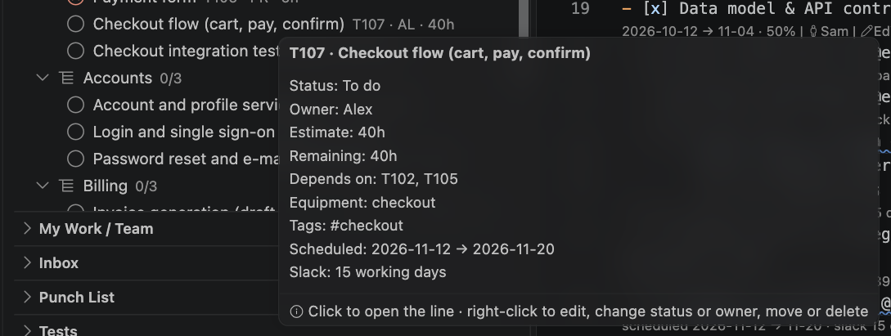

### Context menu

Right-click a task:

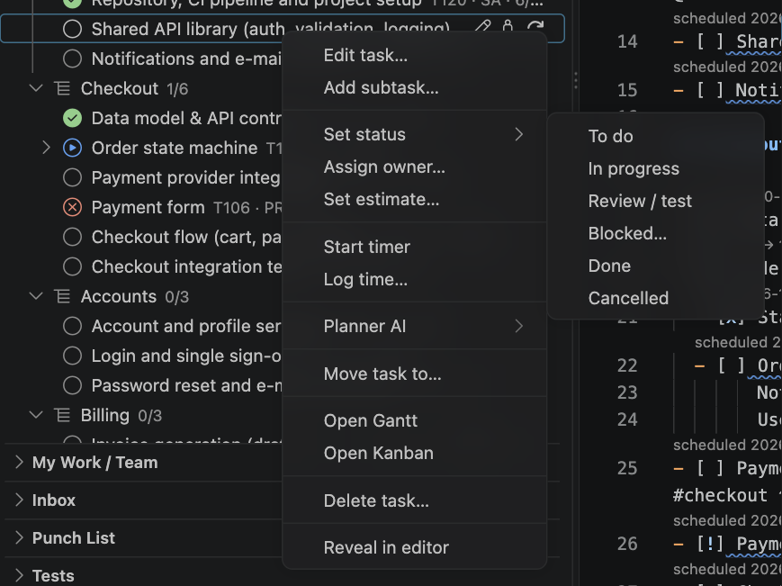

| Item             | What it does                                                                            |
| ---------------- | --------------------------------------------------------------------------------------- |
| Edit task…       | The form with every field ([Edit a task](03-add-and-edit.md#edit-a-task)).              |
| Add subtask…     | A new task indented under this one.                                                     |
| Set status ▸     | To do, In progress, Review / test, Blocked… (asks for a reason), Done, Cancelled.       |
| Assign owner…    | Picks a person from `team.md`, or _No owner_ to remove `@owner`.                        |
| Set estimate…    | Writes `@est` (`4h`, `1.5d`, `1w` …).                                                   |
| Start timer      | Starts timing this task ([Time tracking](11-time-tracking.md)).                         |
| Log time…        | Adds hours to `@act`.                                                                   |
| Planner AI ▸     | Break down task, Estimate, Suggest owners. Hidden when `planner.ai.provider` is `none`. |
| Move task to…    | Moves the task (with subtasks and notes) to another milestone or section; its id stays. |
| Reorganize ▸     | Move task up / down, Indent task (subtask of the task above), Outdent task.             |
| Open Gantt       | Opens the Gantt with this task selected and scrolled into view.                         |
| Open Kanban      | Opens the board with this card focused.                                                 |
| Delete task…     | Deletes the task, its subtasks and notes, and the dependencies on it, after asking.     |
| Reveal in editor | Opens the task's line.                                                                  |

Right-click a **milestone** for Add task…, Add section…, Edit milestone…, Open milestone file and
Delete milestone…; right-click a **section** for Add task….

**Drag and drop** a task to reorganize the plan: onto a section or a milestone moves it there (a
milestone with sections asks which one); onto another task asks whether it goes before it, after
it, or as its subtask. With a task selected, Option+↑ / Option+↓ move it among its siblings and
Option+→ / Option+← indent and outdent it. A task always moves with its notes and subtasks.
Dropping open work under a cancelled or done task, or onto a cancelled milestone, asks first, as
it would leave the schedule.

Edits made from views are saved automatically (`planner.autoSave`) and can be undone with Cmd+Z
in the file.

## Filters

The Milestones, My Work / Team, Inbox and Punch List views each have their own filter, kept per
workspace. Click **Filter…** and choose what to filter on:

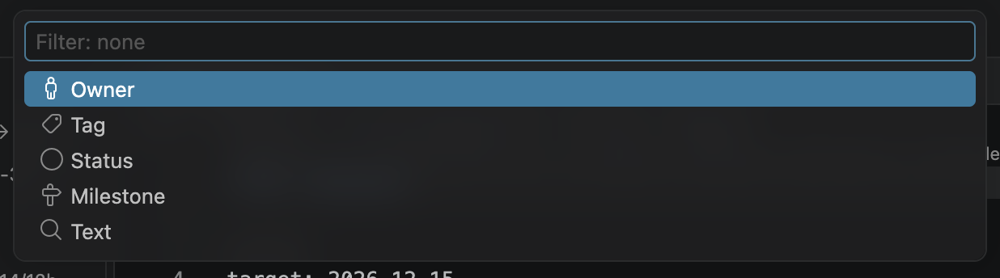

| Dimension | Matches                                                                                    |
| --------- | ------------------------------------------------------------------------------------------ |
| Owner     | Tasks of the chosen people (including inherited owners). _Unassigned_ = tasks without one. |
| Tag       | Tasks with at least one of the chosen tags.                                                |
| Status    | Tasks in the chosen statuses.                                                              |
| Milestone | Tasks in the chosen milestones.                                                            |
| Text      | Tasks whose title, id, notes or tags contain **all** the words you type.                   |

Owner, tag, status and milestone let you pick several values (tick them, then **OK**). Values
within one dimension are combined with _or_, dimensions with _and_.

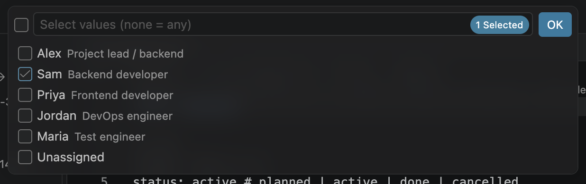

The active filter is shown at the top of the view. In the Milestones view a parent stays visible
when one of its subtasks matches. Click **Clear filter** in the toolbar (or choose _Clear filter_
in the Filter… menu) to show everything again.

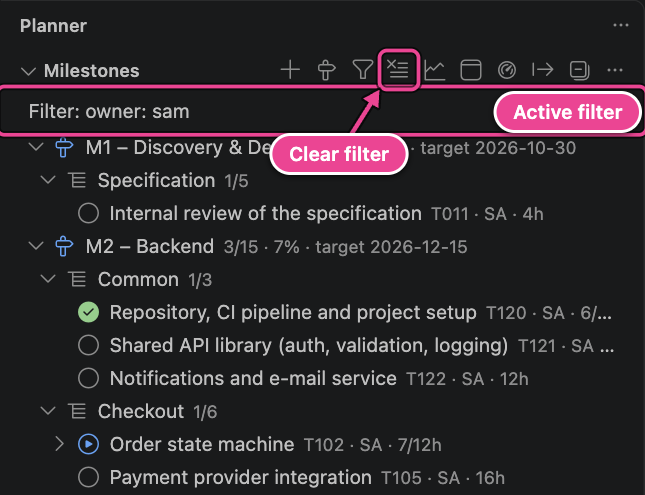

The Kanban board uses the same filter rules, and so does the MCP server's `list_tasks` tool.

## My Work / Team

Each person's open tasks, ordered by scheduled start, so the top of your list is what you should
work on next.

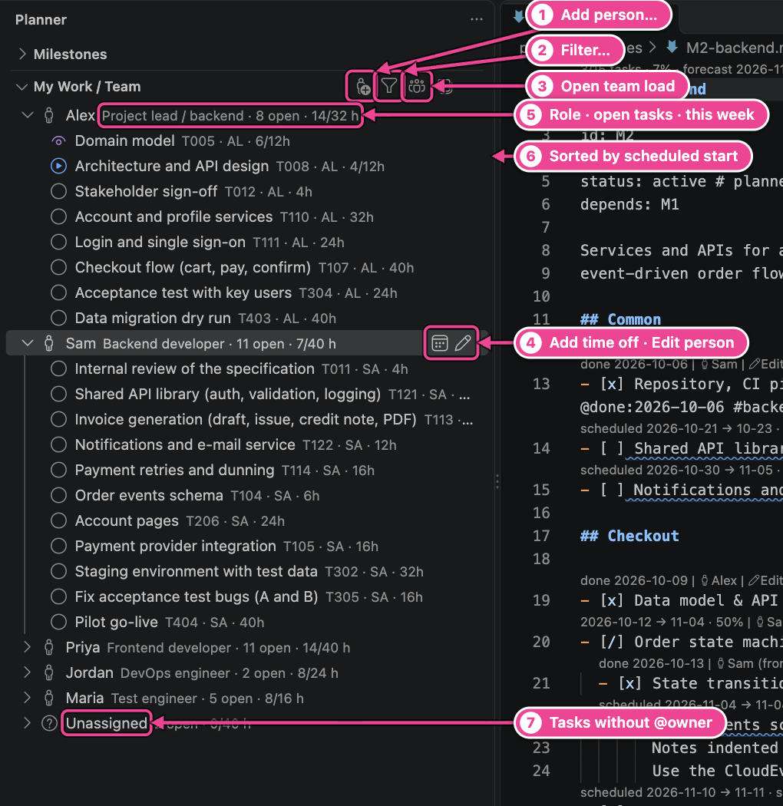

| #   | Element            | Meaning                                                                                                                                                                            |
| --- | ------------------ | ---------------------------------------------------------------------------------------------------------------------------------------------------------------------------------- |
| 1   | Add person…        | Adds a person to `team.md` ([People and time off](03-add-and-edit.md#people-and-time-off)). The **…** menu has **Edit project settings…**.                                         |
| 2   | Filter…            | Filter on tag, status, milestone or text (and owner to show only some people).                                                                                                     |
| 3   | Open team load     | Opens the [team-load heatmap](09-team-load.md).                                                                                                                                    |
| 4   | Person buttons     | On hover: **Add time off** and **Edit person** (role, capacity, work week, time off, capacity changes, skills, colour). Also in the context menu, with **Remove from team…**.      |
| 5   | Person description | Role · number of open tasks · this week's scheduled hours against capacity (`14/32 h`). The person icon turns red when the week is over capacity; `off this week` during time off. |
| 6   | Tasks              | Open tasks (to do, in progress, review, blocked) in scheduled order, with the same descriptions, buttons, tooltips and context menu as in the Milestones view.                     |
| 7   | Unassigned         | Open tasks without an owner, in the unassigned pool.                                                                                                                               |

You (`planner.me`, or the first person in `team.md`) come first and are expanded. Owners that are
not in `team.md` get their own entry with a warning icon, so their work is not lost.

## Inbox

Unplanned items from `inbox.md`: ideas, customer requests, things to check. They are not
scheduled.

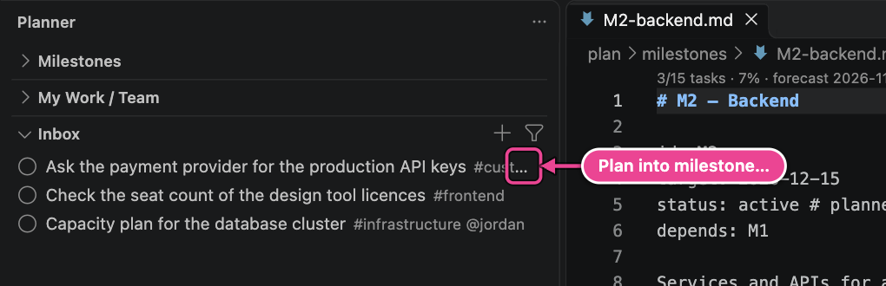

**+** in the toolbar captures a new item (**Capture to inbox…**). Right-click an item to delete
it. To plan an item, click the **→ Plan into milestone…** button on its row (or right-click →
**Plan into milestone…**):

1. Choose the milestone (only milestones that are not done or cancelled are offered).

   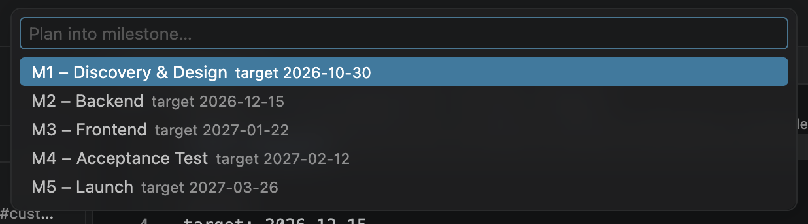

2. Choose the section: an existing one, **No section** (directly under the milestone heading), or
   **New section…** to create one.

   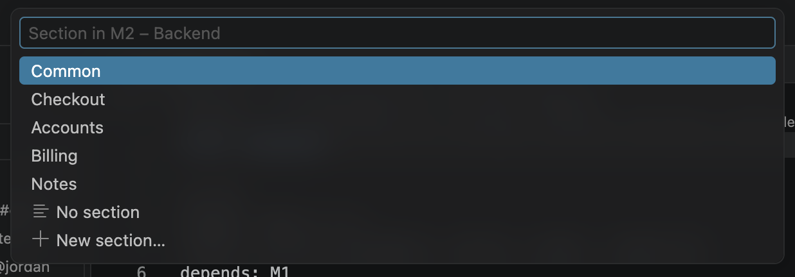

The line moves out of `inbox.md` into the milestone file, gets a task id and is scheduled from
then on. Its attributes, tags and notes move with it. Both files change in one undoable edit.

## Punch List

Open punch items grouped by severity, then by owner, sorted by due date.

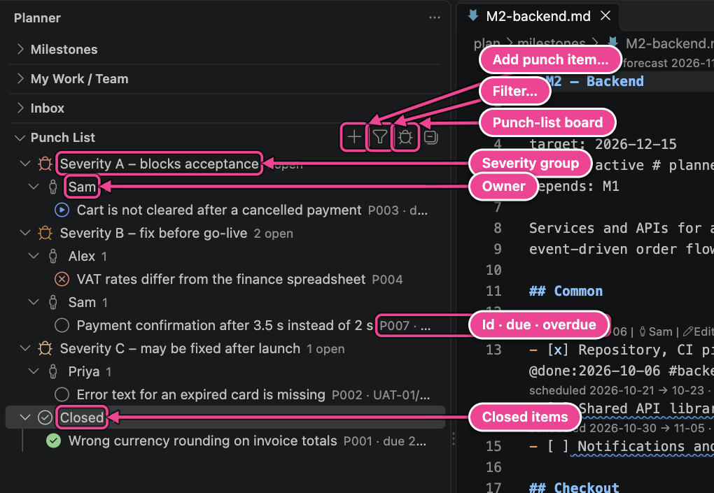

- **Severity groups**: A (red) blocks acceptance, B (orange) must be fixed before SAT, C (yellow)
  may be fixed after handover, and _No severity_.
- **Item description**: id · due date · the test case it came from · `⚠ overdue`.
- **Closed** (collapsed) holds done and cancelled items.
- The toolbar has **Add punch item…** (**+**), **Filter…** and **Open punch-list board** (the
  Kanban board for punch items).
- Items have the **Edit** and **Assign owner** buttons on hover. The context menu offers Edit, Set
  status, Assign owner, Start timer, Log time, Open Kanban, Delete and Reveal in editor.

## Tests

Test plans → test cases → steps, with result counts.

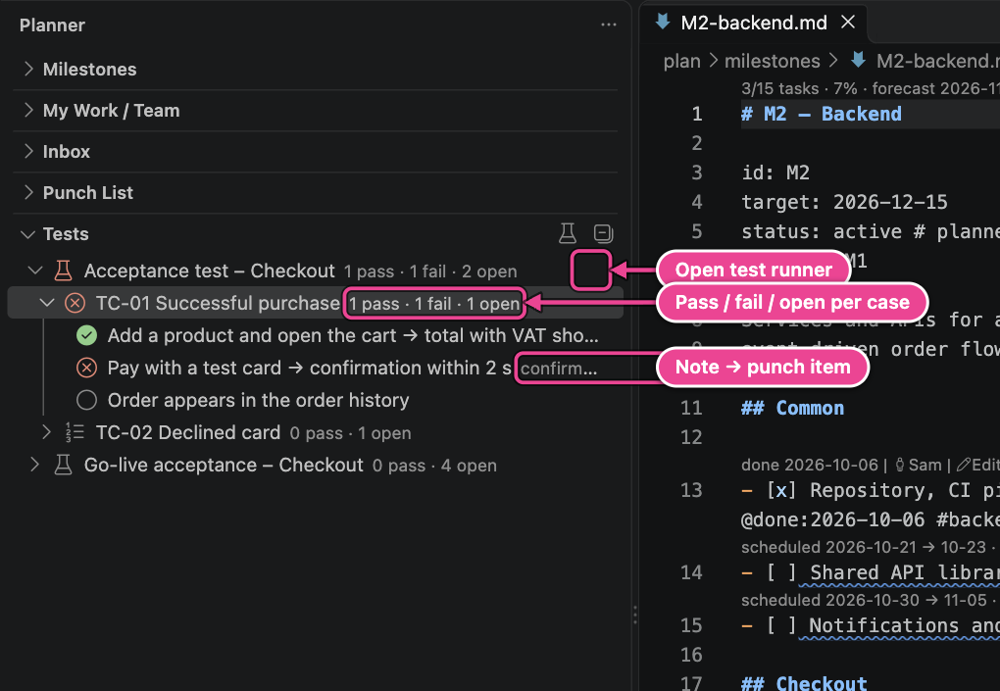

- The plan's beaker icon turns red when a step failed and green when every step has a result.
- Step icons: ✓ pass (green), ⊗ fail (red), ⊘ n.a. (purple), ○ open. The description shows the
  note and the linked punch item (`→ P007`).
- **Click a test plan** (or the beaker button on its row, or the toolbar button) to open it in the
  [test runner](12-tests-and-punch-list.md#the-test-runner). Click a step to open its line.

## TODOs in Code

`TODO`, `FIXME` and `HACK` comments found in your source code, per file. Click one to open the
code line.

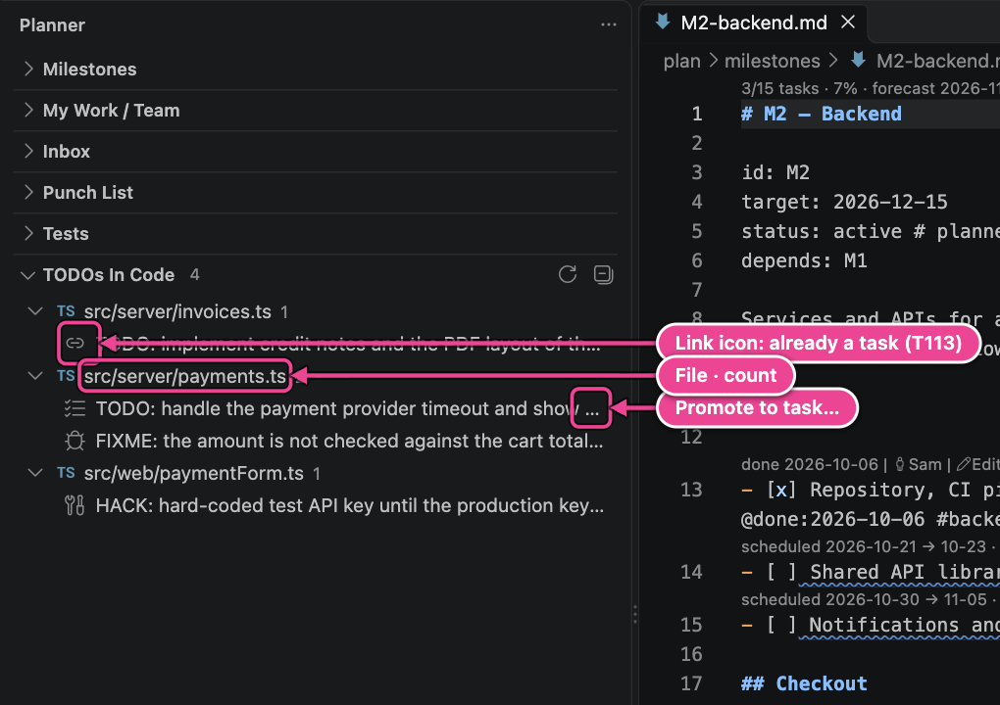

**Promote a TODO to a task** with the ↑ button on its row, the context menu, or by right-clicking
the comment in the editor and choosing **Promote to task…**:

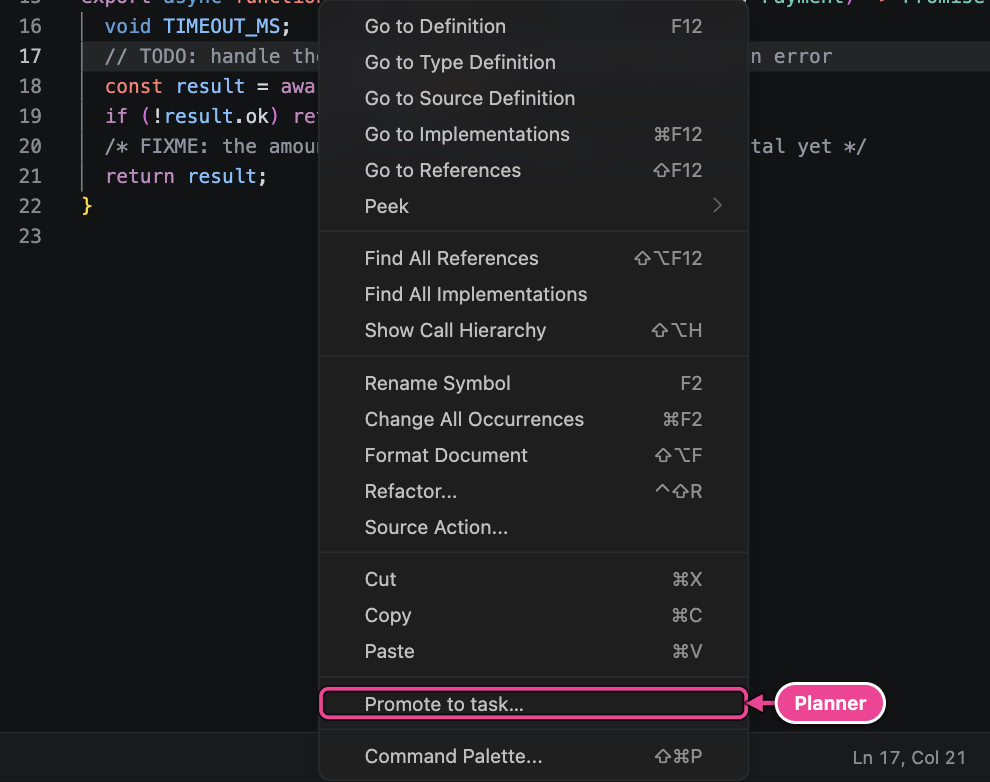

Choose a milestone and section (as for inbox items). The planner then, in one undoable edit:

- adds a task to the milestone with the comment text as title and `@src:path#L<line>` pointing
  back to the code, and
- writes the new id into the comment: `// TODO: handle timeout` becomes
  `// TODO(T142): handle timeout`.

A promoted comment shows a link icon and the task's status (`→ T113 to do`). Cmd+click on `@src` in
the plan opens the code line.

What is scanned is configurable:

| Setting                  | Default                                                                                                 | Meaning                                                              |
| ------------------------ | ------------------------------------------------------------------------------------------------------- | -------------------------------------------------------------------- |
| `planner.todos.keywords` | `["TODO", "FIXME", "HACK"]`                                                                             | Upper-case keywords, whole words, followed by `:`, `(…)` or a space. |
| `planner.todos.include`  | `**/*.{ts,tsx,js,jsx,mjs,cjs,vue,svelte,py,java,kt,cs,go,rs,rb,php,swift,c,h,cpp,hpp,sql,sh,md,scl,st}` | Files to scan. The plan folder is never scanned.                     |
| `planner.todos.exclude`  | `**/{node_modules,.git,dist,out,build,target,coverage,vendor,.venv,.vscode-test}/**`                    | Files never scanned.                                                 |
| `planner.todos.maxFiles` | `2000`                                                                                                  | Upper limit of scanned files.                                        |

Files are rescanned as you edit them and when they change on disk; changing a `planner.todos.*`
setting rescans everything. **Rescan TODOs** in the toolbar does the same by hand.

---

[← The editor](05-editor.md) · [Contents](README.md) · [Next: Gantt chart →](07-gantt.md)
