# 7. Gantt chart

The Gantt chart shows the computed schedule: bars for tasks, roll-ups for parents, sections and
milestones, diamonds for milestone targets, arrows for dependencies, the critical path and the
baseline. You can also plan on it: drag bars, resize them, link them and edit them, and every
change is written to the Markdown as a small, undoable edit.

## Open the Gantt

- **Open Gantt** in the Milestones view toolbar, or in the editor title bar of any plan file.
- **Open Gantt** in a task's context menu: the chart opens with that task selected and scrolled
  into view.
- **Planner: Open Gantt** in the Command Palette, or the **Gantt** button on the dashboard.

The chart opens as an editor tab, so you can split it next to a milestone file (drag the tab to
the side) and watch it update while you type.

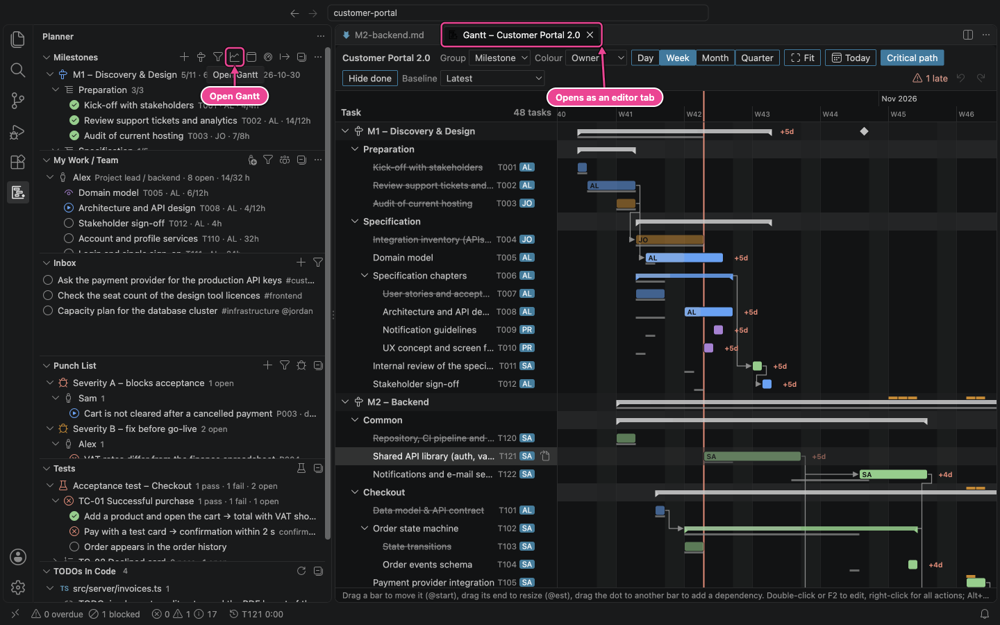

## The layout

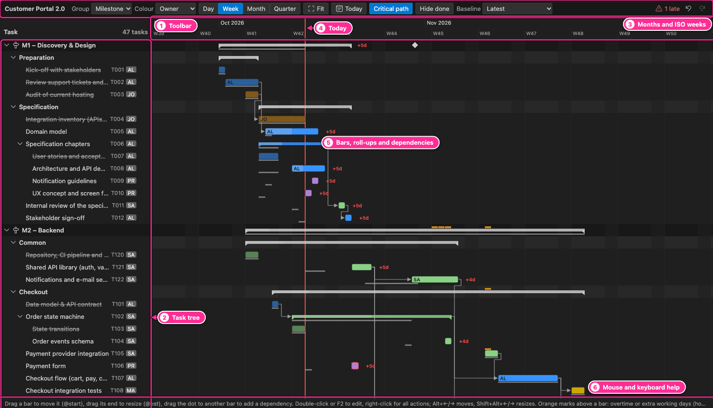

| #   | Area            | What it is                                                                           |
| --- | --------------- | ------------------------------------------------------------------------------------ |
| 1   | Toolbar         | Grouping, colours, zoom, view options and undo/redo (below).                         |
| 2   | Task tree       | Groups and tasks with ids and owner initials; click to select, double-click to edit. |
| 3   | Timeline header | Months on top, ISO week numbers below (or days and weeks, depending on the zoom).    |
| 4   | Today line      | The red vertical line.                                                               |
| 5   | Chart           | Bars, roll-ups, diamonds and dependency arrows.                                      |
| 6   | Help line       | A reminder of the mouse and keyboard actions.                                        |

## The toolbar

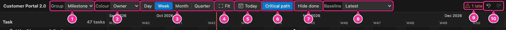

| #   | Control       | What it does                                                                                                                                                                                                                                                    |
| --- | ------------- | --------------------------------------------------------------------------------------------------------------------------------------------------------------------------------------------------------------------------------------------------------------- |
| 1   | Group         | **Milestone**: milestone → section → task, with milestone rows and diamonds. **Section**: one group per section (`M2 › Checkout`). **Owner**: one group per person. **Tag**: one group per tag; a task goes under its first (or inherited) tag only.            |
| 2   | Order         | **Schedule** (the default): rows in the order the work starts, at every level (milestones, sections, tasks, subtasks), so the chart reads as a cascade from top left to bottom right. **Files**: in the order of the plan files. The files are never reordered. |
| 3   | Colour        | Colour bars by **Owner** (the person's `color`), **Status** or **Milestone**.                                                                                                                                                                                   |
| 4   | Zoom          | **Day**, **Week**, **Month** or **Quarter**. Pinch on the trackpad, or hold Ctrl (Cmd on a Mac) and scroll, to zoom in and out smoothly around the pointer.                                                                                                     |
| 5   | Fit           | Zooms so that the whole project fits the window.                                                                                                                                                                                                                |
| 6   | Today         | Scrolls to today.                                                                                                                                                                                                                                               |
| 7   | Critical path | Highlights the critical path (bars and arrows in red). On by default.                                                                                                                                                                                           |
| 8   | Hide done     | Hides finished tasks.                                                                                                                                                                                                                                           |
| 9   | Baseline      | **None**, **Latest** or a specific baseline to draw under the bars. Only shown when a baseline exists.                                                                                                                                                          |
| 10  | `⚠ 1 late`    | The number of milestones forecast after their target.                                                                                                                                                                                                           |
| 11  | Undo / Redo   | Undo or redo the last edit made in the Gantt (also Cmd+Z / Cmd+Shift+Z).                                                                                                                                                                                        |

While a dependency arrow is selected, a **Remove dependency** button appears before Undo.

The chosen grouping, colours, zoom (also a pinch zoom) and options are remembered for the
workspace.

## Reading the chart

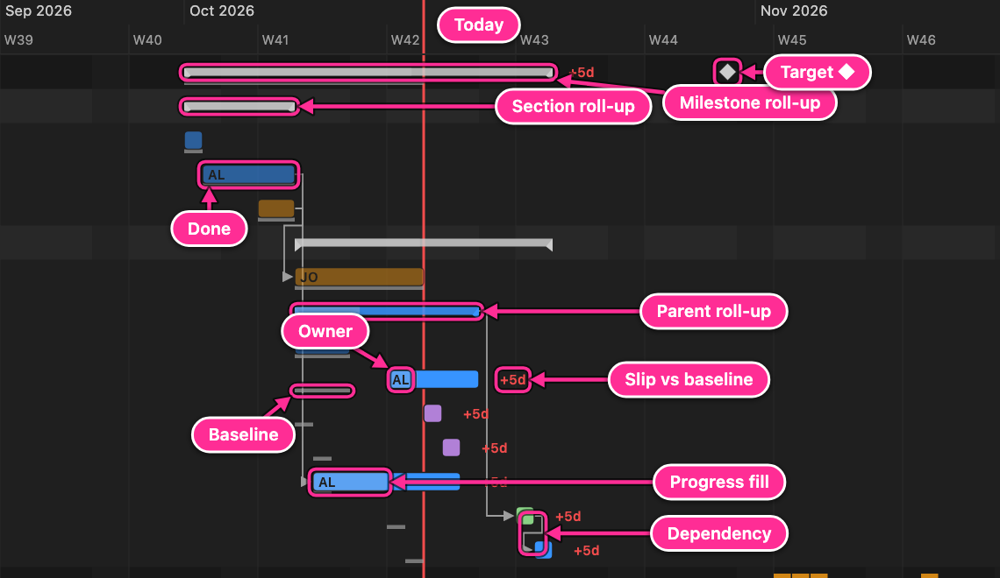

| Element             | Looks like                                                 | Meaning                                                              |
| ------------------- | ---------------------------------------------------------- | -------------------------------------------------------------------- |
| Task bar            | Coloured bar, owner initials inside when it is wide enough | A scheduled leaf task, from its scheduled start to finish.           |
| Done task           | Darker bar in the past                                     | From `@started` to `@done`.                                          |
| Progress fill       | Lighter part at the start of a bar                         | Share of the estimate already done (actual hours, or `@progress`).   |
| Parent roll-up      | Thin bar with end caps                                     | Span of a parent's subtasks; the fill shows hours-weighted progress. |
| Section roll-up     | Thin grey bar with end caps                                | Span of a section's tasks.                                           |
| Milestone roll-up   | Thin bar on the milestone row                              | Span of all the milestone's tasks.                                   |
| Target ◆            | White diamond on the milestone row                         | The milestone's `target` date. Red when the milestone is late.       |
| Forecast ◆ and slip | Second diamond joined by a red line                        | Only for late milestones: the forecast finish, after the target.     |
| Critical path       | Red outline and red arrows                                 | Tasks with the least slack: any delay moves the end date.            |
| Blocked task        | Red dashed outline                                         | Status `[!]`. Still scheduled as if it were not blocked.             |
| Deadline marker     | Short red vertical line after a bar                        | The task's deadline, shown when the task is scheduled after it.      |
| Pin ▼               | Small triangle above the start of a bar                    | A fixed start (`@start`): the task never starts earlier.             |
| Dependency          | Grey arrow from a bar's end to another bar's start         | `@dep` (finish-to-start).                                            |
| Baseline            | Thin grey bar under a task                                 | Where the task was planned in the chosen baseline.                   |
| `+5d`               | Red label after a bar or milestone                         | Slip against the baseline, in working days.                          |
| Weekend / holiday   | Shaded columns                                             | Non-working days of the project calendar (Day and Week zoom).        |
| `not scheduled`     | Text instead of a bar                                      | The task has no dates; the tooltip and the CodeLens say why.         |

Hover a bar for its details. A late task's tooltip says what holds it back, following the
dependencies to the cause: for example "Held back by the fixed start 2027-10-19 of T461 (via M1)"
for every task after a mistyped date, or "Held back by Sam having other work first". A fixed
start is named only when it really holds the task back: when the people after it would be busy with
other work anyway, that work is named instead (and counted in the person's workload note in
`team.md`). Delays are counted in working days of the project, so a part-timer's week weighs as much
as anyone's.

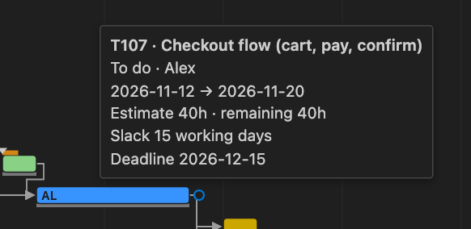

### Overtime and extra working days

When `team.md` plans overtime or extra working days ([Team load](09-team-load.md#overtime-and-extra-working-days)),
orange marks above a bar show the days on which that task uses them. Summary bars (milestones,
sections, parents, owners) carry the marks of all their tasks, and their tooltip names the tasks:

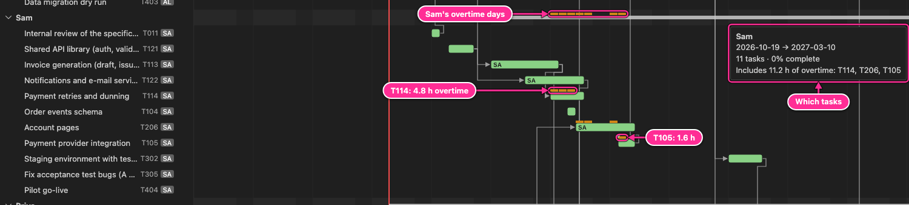

A task's tooltip gives the hours and days, for example _4.8 h overtime on 2026-11-02, 2026-11-03,
2026-11-04_ or _4 h on extra working day 2026-11-27_. A person's hours of a day go to their tasks
in priority order, so the overtime of a day belongs to the tasks that got its last hours (and every
hour of an extra working day is overtime).

### The critical path and late milestones

In Month zoom with done tasks hidden and the first milestones collapsed, the end of the sample
project shows the critical path into M5, whose forecast is three working days after its target:

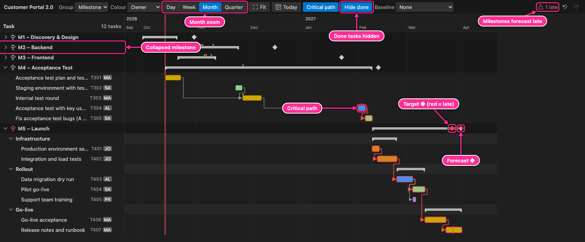

## The task tree

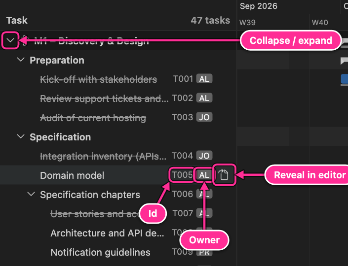

- Click the chevron (or press ← / →) to collapse or expand a group, milestone or parent.
- Each task shows its id and owner initials. Hover a row for the **Reveal in editor** button.
- Click a row to select it. Double-click an open task to edit it; double-click a done task to open
  its line in the editor.

## Planning on the chart

Only **open leaf tasks** can be changed on the chart (not parents, done or cancelled tasks, and
not milestone rows).

### Move a bar → `@start`

Drag a bar left or right. A ghost bar shows the new dates while you drag, in working days (a bar
moved onto a Saturday starts on Monday, and keeps its number of working days):

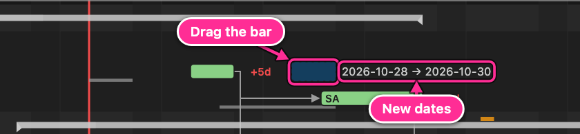

On release the task gets `@start:<date>` (snapped forward to a working day), a "not before"
constraint, and a pin ▼ marks it. The pin stays when the plan changes: the task will not move
earlier, even when its dependencies finish sooner. A notice says so the first time; to let the
scheduler place the task again, right-click the bar → **Remove fixed start**. If the task cannot
start on that day, the scheduler places it later, and the notice says why: what it waits for (a
task, a milestone's `depends:`, a parent's fixed start), or the owner's other work or time off.

A pinned task goes first in its owner's day, so it can become shorter (it no longer shares the
person with other work).

A task already in progress keeps its bar's start at `@started`; a drag (or Alt+← / Alt+→) moves
the rest of its work, counted from the first day of that remaining work, and the notice says
"the rest of its work starts no earlier than …".

Other tasks can move too, also ones that do not depend on the dragged task. The notice after the
drag gives the new dates and says what else moves and why, with **Undo**:

- **Which wait for it**: tasks that depend on it, directly or further down the chain.
- **The person's other work**: a person works on one thing after another, so moving a task later
  frees their time and their next tasks move up (−), and a pinned task takes its day first, so
  others move later (+).
- **Tasks of a later milestone**: `depends: M1` makes every task of M2 wait for every task of M1,
  so moving an M1 task past the end of M1 moves M2 (and what waits for M2).
- **More after those**: tasks that wait for one of the above.

For example: "Ends Tue 2026-12-01. Also moves T430 (+2 d), which waits for it; Sam's other work:
T515 (−5 d) and T516 (−5 d); 25 tasks of M2–M5, which wait for M1 to finish."

A press only becomes a drag after the pointer has moved a few pixels, so a click with a slight
wobble selects the bar and changes nothing. At Month and Quarter zoom a day is only a few pixels
wide: zoom in to move a bar by a single day.

### Resize a bar → `@est`

Drag the right end of a bar (the last third of it at most; very short bars have no resize handle,
so they can only be moved):

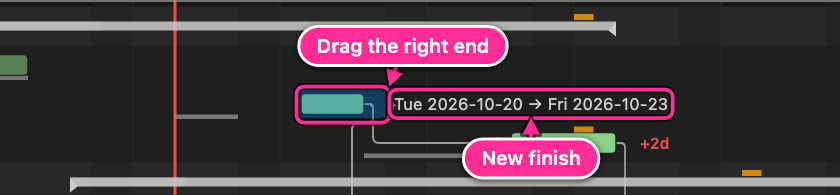

The bar ends on the day you drop it on (on a weekend: the Friday before). The planner works out how
many hours the owner can spend on the task up to that day next to their other work, time off and
dependencies, by trying estimates near the current one with the scheduler, and writes the largest
one it finds that still ends there, rounded down to half hours. Hours already spent (`@act`) are added on top; with `@progress`
set, the estimate is scaled so that the remaining part fits. When a shorter bar does not end on that
day even with only the work it gets up to then (less work can make what it waits for less urgent,
so it waits longer), nothing is written and the notice says why, such as "T3 cannot end by Tue
2026-10-06 with only the work it gets by that day: then it waits longer for T1, as Sam's other work
comes first." More work can make the bar start earlier (what it
waits for becomes more urgent); the notice then says where it starts. The notice gives the new end
and the tasks that move with it, and why, such as "T121: estimate 3d → 32h, ends Fri 2026-10-23.
Also moves T122 (+1 d), which waits for it; Sam's other work: T206 (+2 d)".

A subtask without its own `@est` gets a share of its parent's `@est`. Resizing it changes the
parent's `@est` by as much, in the same edit, so the other subtasks keep their hours, and the notice
says so ("T1: estimate 40h → 32h, so T2 keeps its hours").

Bars whose id another task also has cannot be moved, resized, edited or linked: give each task its
own id first (the duplicate id has a quick fix). An arrow out of such a bar can still be removed.

### Link two bars → `@dep`

Hover a bar: a small dot appears after its right end. Drag the dot onto another task's bar. While
you drag, the bar under the pointer is outlined and a label says what the link will mean, such as
"T202 waits for T201"; releasing anywhere else adds nothing:

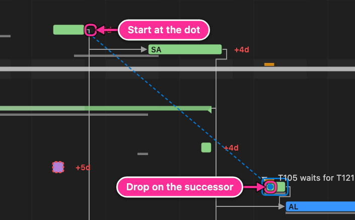

The task you drop on gets `@dep:<id of the first task>`. If the first task has no id yet, it gets
one. Links that would create a circular dependency are refused with a message.

### Follow and remove dependencies

Click an arrow to select it. It is drawn on top in the accent colour, the two bars it connects are
outlined (and their rows in the task tree highlighted), the other arrows fade, and the help line at
the bottom says what it means, such as "T122 waits for T121". To remove the dependency, click
**Remove dependency** in the toolbar or press Delete or Backspace:

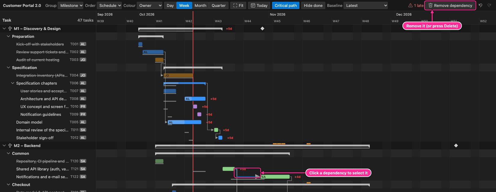

Click a bar, or select a row in the task tree (also with ↑ / ↓), to highlight the arrows into and
out of that task in the same way; the help line lists them, such as "T491 waits for T411, T413;
T416 waits for T491". Hover an arrow to see which tasks it connects. Press Esc or click an empty
part of the chart to show all arrows again.

Arrows from tasks that finish on the same day run in separate lanes, a few pixels apart, and their
corners are rounded, so a bend is not mistaken for a crossing.

### Edit title, owner and estimate

Double-click a bar or a task row, or select it and press **F2**:

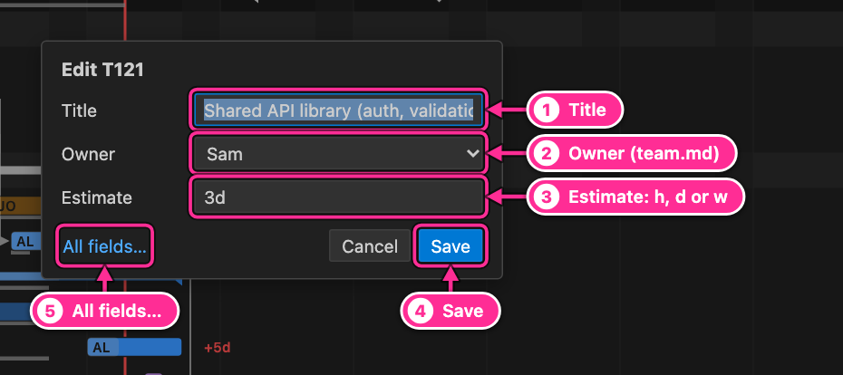

| #   | Field       | Writes                                                                                                                                                |
| --- | ----------- | ----------------------------------------------------------------------------------------------------------------------------------------------------- |
| 1   | Title       | The task title (attributes, tags and id stay where they are).                                                                                         |
| 2   | Owner       | `@owner` (choose _— none —_ to remove it).                                                                                                            |
| 3   | Estimate    | `@est`: a number with `h`, `d` or `w`.                                                                                                                |
| 4   | Save        | All changes as one edit. Escape or **Cancel** closes without changes.                                                                                 |
| 5   | All fields… | Closes the dialog and opens the full task form: status, dependencies, dates, priority, tags and more ([Edit a task](03-add-and-edit.md#edit-a-task)). |

Save writes only the fields you changed in the dialog, so a change made meanwhile in the editor or
by an agent is kept. When the task itself changes while the dialog is open (another title, or its
line now holds another task), the dialog closes and writes nothing. A subtask that shares its
parent's estimate shows its share (`10h (share of T1's estimate)`); giving it its own estimate
raises the parent's by as much, as dragging the bar's end does, so its siblings keep their hours.

### The right-click menu

Right-click a bar or a row of the task list for every task action: edit, add a subtask, status,
owner, estimate, timer, move, delete and reveal in the editor. Pinned bars also offer **Remove
fixed start**. Milestone and section rows offer
**Add task…**, and milestones also **Add section…**, **Edit milestone…** and **Delete milestone…**.

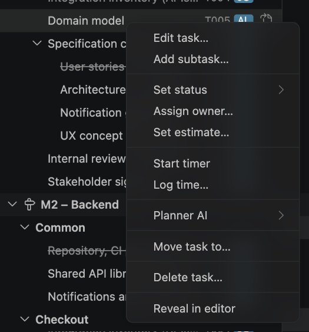

### Undo

Every change on the chart is a normal edit of the milestone file: Cmd+Z in the file undoes it. The
Gantt's own **Undo** and **Redo** buttons (and Cmd+Z / Cmd+Shift+Z while the chart has focus) undo
and redo the chart's edits even when the file is not in front, and refuse if the file was changed
in between (a file renamed or deleted since counts as changed). Ids added to the file when it was
saved do not stop an undo: it removes them, and the next save adds the same ids again.

After every drag, link, unlink or dialog edit, a message at the bottom of the chart says exactly
what changed, such as "T417: estimate 80h → 122.5h.", with an **Undo** button, so a drag you did
not mean is noticed at once. That button undoes only its own change: when another edit came after
it (on the Kanban board, say), it says so and leaves both. A drag that changes nothing (a bar dropped on its own fixed start, a
resize that cannot end any closer) says so, without an **Undo** button. **Remove fixed start**
shows the same in a notification. The undo history does not survive closing VS Code or reloading
the window.

## Other groupings

Group by **Owner** and colour by **Status** to see each person's sequence of work, with done
(green), in progress (blue), review (purple) and to-do (grey) bars:

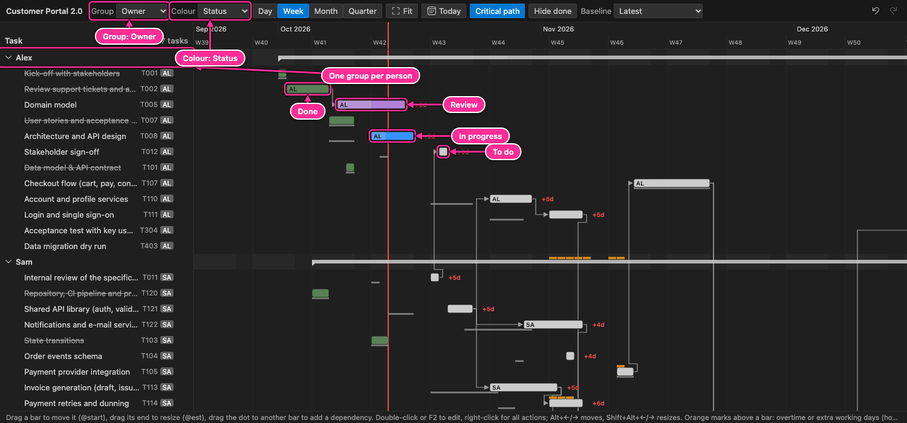

## Keyboard

Click a row in the task tree first.

| Keys                | Action                                                    |
| ------------------- | --------------------------------------------------------- |
| ↑ / ↓, Home / End   | Select the previous / next / first / last row.            |
| ← / →               | Collapse / expand a group or parent.                      |
| Space               | Collapse or expand a group or parent.                     |
| Enter               | Reveal the task in the editor (or toggle a group).        |
| F2                  | Edit the selected task.                                   |
| Option+← / Option+→ | Move the task one working day earlier / later (`@start`). |
| Shift+Option+← / →  | Make the task one working day shorter / longer (`@est`).  |
| Delete / Backspace  | Remove the selected dependency.                           |
| Esc                 | Show all dependency arrows again.                         |
| Cmd+Z / Cmd+Shift+Z | Undo / redo the last Gantt edit.                          |

---

[← The sidebar](06-sidebar.md) · [Contents](README.md) · [Next: Kanban board →](08-kanban.md)
