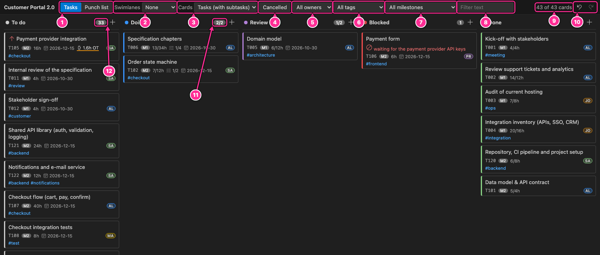
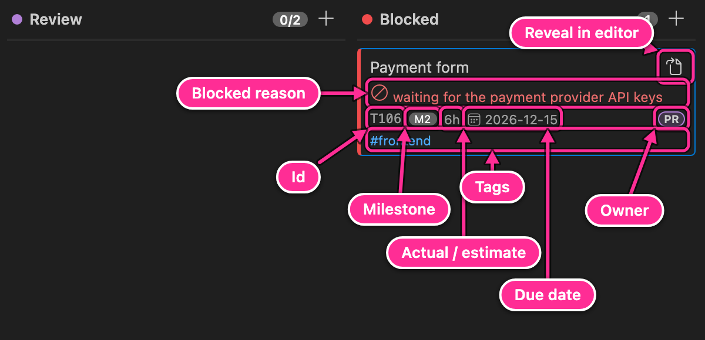
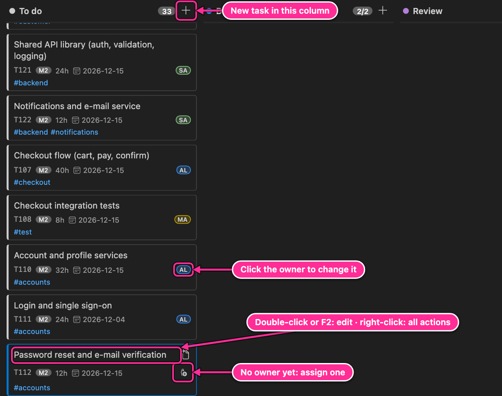
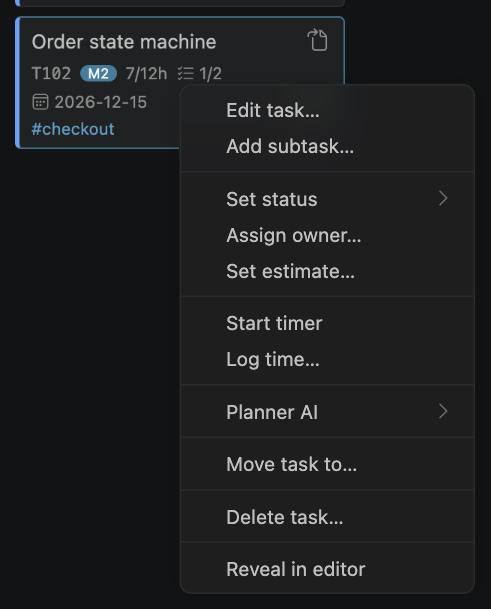
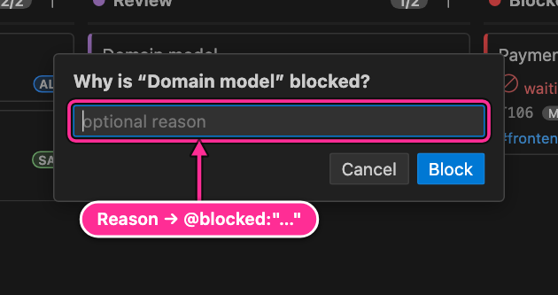
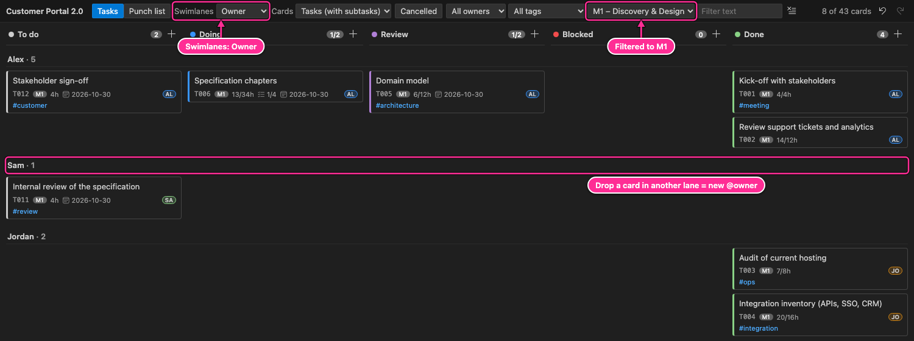
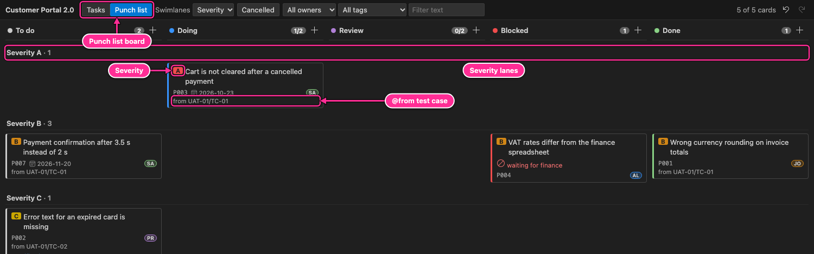

# 8. Kanban board

The Kanban board shows tasks as cards in one column per status. Moving a card changes the
checkbox in the Markdown file and writes the start, done and blocked information for you. A second
board shows the punch list.

## Open the board

- **Open Kanban** in the Milestones view toolbar, or **Planner: Open Kanban**.
- **Open Kanban** in a task's context menu: the board opens with that card focused. For a punch
  item it opens the punch-list board.
- **Open punch-list board** in the Punch List view toolbar, or **Planner: Open punch-list board**.
- The **Kanban** button on the dashboard, and **Board** in its punch-item panel.

## The board



| #   | Control            | What it does                                                                                                                                        |
| --- | ------------------ | --------------------------------------------------------------------------------------------------------------------------------------------------- |
| 1   | Tasks / Punch list | Switches between the task board and the punch-list board.                                                                                           |
| 2   | Swimlanes          | **None**, **Owner** or **Milestone** (punch board: **None**, **Severity** or **Owner**).                                                            |
| 3   | Cards              | **Tasks (with subtasks)**: one card per top-level task, with a subtask counter. **Every subtask**: one card per leaf task, with its parent's title. |
| 4   | Cancelled          | Shows a **Cancelled** column with cancelled cards (hidden by default).                                                                              |
| 5   | Owner filter       | All owners, one person, or _Unassigned_.                                                                                                            |
| 6   | Tag filter         | All tags or one tag.                                                                                                                                |
| 7   | Milestone filter   | All milestones or one (task board only).                                                                                                            |
| 8   | Filter text        | Cards whose title, id, notes or tags contain all the words. A **Clear filter** button appears while any filter is set.                              |
| 9   | Card count         | Cards shown out of the total.                                                                                                                       |
| 10  | Undo / Redo        | Undo or redo the last board edit (also Cmd+Z / Cmd+Shift+Z).                                                                                        |
| 11  | WIP count          | Cards in the column / its work-in-progress limit (`2/2`). The header turns red when the column is over its limit.                                   |
| 12  | Column count       | Number of cards in the column (columns without a limit).                                                                                            |

The board's filters work exactly like the sidebar filters and are remembered per board.

## Cards



| Element           | Meaning                                                                                  |
| ----------------- | ---------------------------------------------------------------------------------------- |
| Title             | The task title.                                                                          |
| Blocked reason    | The `@blocked` text, in red, on blocked cards.                                           |
| Id                | The task id.                                                                             |
| Milestone         | The milestone id chip (task board).                                                      |
| Actual / estimate | `6/12h` when actual hours are logged, or just the estimate (`6h`).                       |
| Due date          | The deadline (`@due`, inherited, or the milestone target). Red when the task is late.    |
| Owner             | Initials in the person's colour. Hover for the name; click to change the owner.          |
| Tags              | The task's tags.                                                                         |
| Overtime          | `⏱ 4.8h OT` when the task (or its subtasks) uses planned overtime or extra working days. |
| Reveal in editor  | Appears on hover: opens the task's line (Enter does the same).                           |

Also on cards (see the board picture above): a red ↑ for `@prio:high` and a ↓ for `@prio:low`,
a checklist counter `1/4` for subtasks done/total, and on punch cards the severity badge
(**A**, **B**, **C**) and the test case it came from.

Within a column, cards are ordered by priority (high first), then by their order in the files. On
the punch-list board, severity comes first (A, B, C).

## Add and edit cards



- **+** in a column header adds a task with that column's status (on the punch-list board, a punch
  item). When the board is filtered on one owner or one milestone, the new task gets them too;
  otherwise you choose the milestone and section. See
  [Add a task](03-add-and-edit.md#add-a-task).
- **Click the owner** on a card to choose another person. Cards without an owner show an
  **Assign owner** button on hover.
- **Double-click a card** (or press **F2**) to open the task form with every field.
- **Right-click a card** for every task action:

  

## Move cards

Drag a card with the mouse:

| You drop a card …                     | The planner writes                                                                                                                                                                                                                                                                                                          |
| ------------------------------------- | --------------------------------------------------------------------------------------------------------------------------------------------------------------------------------------------------------------------------------------------------------------------------------------------------------------------------- |
| in another column                     | The new checkbox, plus `@started` (to Doing or Review), `@done` (to Done), or removes `@done` / `@blocked` when the card leaves those columns. A parent card follows its subtasks (`planner.parentStatus`), and dropping a card with open subtasks on Done asks whether to finish them too, cancel them or leave them open. |
| in **Blocked** (task board)           | Asks for the reason first and writes `@blocked:"…"` (the reason is optional).                                                                                                                                                                                                                                               |
| higher or lower in the same column    | The priority of the card it lands next to: dropping above a high-priority card makes it `@prio:high`. `med` is the default, so it is written by removing `@prio`. A card dropped in another column or lane keeps its priority, wherever it lands.                                                                           |
| in another **owner** lane             | `@owner` of that lane (or no owner in the _Unassigned_ lane).                                                                                                                                                                                                                                                               |
| in another milestone or severity lane | Nothing: dragging is refused. Use right-click → **Move task to…** (milestone) or **Edit task…** (severity).                                                                                                                                                                                                                 |



WIP limits are soft: you can drop a card into a full column, its header just turns red. Set the
limits in the settings:

```json
{
  "planner.kanban.wipLimits": { "doing": 3, "review": 2 }
}
```

Keys are `todo`, `doing`, `review`, `blocked` and `done`.

Every move is a normal edit of the plan file: undo it with the board's **Undo** button, Cmd+Z on the
board, or Cmd+Z in the file.

## Swimlanes

With **Swimlanes: Owner**, each person gets a row; drag a card to another person's row to reassign
it. **Milestone** lanes group the cards per milestone. Combine lanes with a filter to focus, for
example one milestone per person:



## The punch-list board

Click **Punch list** (or open it from the Punch List view) for a board of punch items, here with
severity lanes:



It works like the task board, with severity or owner lanes. Dropping a punch card on Blocked does
not ask for a reason.

## Keyboard

Press Tab to reach the cards.

| Keys                | Action                                         |
| ------------------- | ---------------------------------------------- |
| Tab / Shift+Tab     | Next / previous card.                          |
| Enter               | Reveal the task in the editor.                 |
| F2                  | Edit every field of the task.                  |
| Option+← / Option+→ | Move the card to the previous / next column.   |
| Option+↑ / Option+↓ | Raise / lower the priority (low → med → high). |
| Cmd+Z / Cmd+Shift+Z | Undo / redo the last board edit.               |

---

[← Gantt chart](07-gantt.md) · [Contents](README.md) · [Next: Team load →](09-team-load.md)
