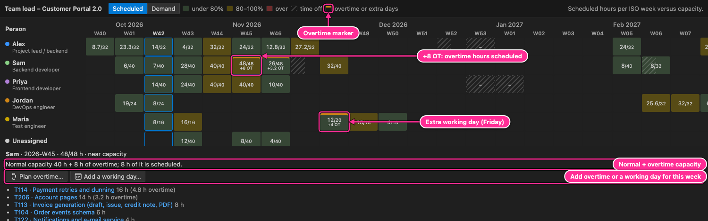
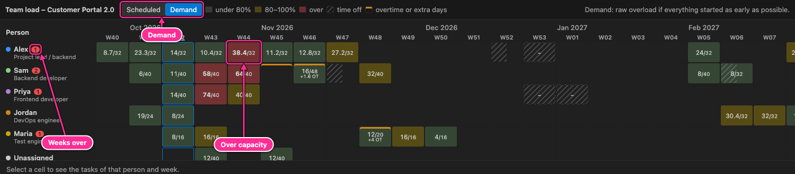

# 9. Team load

The team-load heatmap shows, for every person and ISO week, how many hours of work are scheduled
against the hours they have. Use it to spot overload early and to find someone with room.

## Open it

- **Open team load** in the My Work / Team view toolbar.
- **Planner: Open team load** in the Command Palette.
- The **Team load** button on the dashboard.

## Reading the heatmap

| #   | Element            | Meaning                                                                                                                                                                                                        |
| --- | ------------------ | -------------------------------------------------------------------------------------------------------------------------------------------------------------------------------------------------------------- |
| 1   | Scheduled / Demand | Which schedule to show (see below).                                                                                                                                                                            |
| 2   | Legend             | Green: under 80 % of capacity. Yellow: 80–100 %. Red: over capacity. Hatched: time off. Orange top line: overtime or extra working days.                                                                       |
| 3   | Person             | Colour dot, name and role. A red number counts the weeks over capacity.                                                                                                                                        |
| 4   | Current week       | This week's column is outlined, its header underlined.                                                                                                                                                         |
| 5   | Time off           | Fully hatched when every working day of the week is off, partly hatched for some days. A `–` means no capacity at all that week.                                                                               |
| 6   | Cell               | Scheduled hours / capacity of that week, for example `32/32`. Empty cells have no work.                                                                                                                        |
| 7   | Details            | Click a cell: the person, ISO week, hours, load level and time off, **Plan overtime…** and **Add a working day…** for that person and week, and the tasks with their hours that week. Click a task to open it. |

Capacity per week follows `team.md`: weekly or daily capacity, personal work weeks, `capacityFrom`
changes, `off` days, project holidays, and planned overtime and extra working days. The view starts two weeks before the current week;
scroll sideways for the rest of the project. The _Unassigned_ row shows the virtual pool that runs
tasks without an owner.

## Overtime and extra working days

When a deadline cannot move, plan extra hours where the work piles up:

- A cell with planned overtime or an extra working day has an **orange line** at the top. Its
  capacity includes the extra hours (`48/48` for a 40-hour week with 8 hours of overtime), and
  **+8 OT** shows how many of them the schedule actually uses.
- The details of the cell say how the capacity is made up: _normal capacity 40 h + 8 h of
  overtime; 8 h of it is scheduled_, and the task list shows which tasks use it
  (_T114 · Payment retries and dunning 16 h (4.8 h overtime)_). The Gantt marks the same days on those
  tasks' bars ([Gantt › Overtime](07-gantt.md#overtime-and-extra-working-days)).
- **Plan overtime…** adds extra hours for that person, with the selected week offered first. Choose
  the period (that week, the next two weeks, or any period) and the extra hours (`+8h/week`,
  `+2h/day` …).
- **Add a working day…** offers the weekend days and holidays of that week; choose one and how
  long (a normal day or fewer hours).

Both write a line into the person's section of `team.md` (`overtime:` or `workday:`), which you can
change or remove later in the person's form (✎ on their row in My Work / Team) or in the file. The
schedule, the dashboard's **Planned overtime** figure and the status report update at once, so you
can see whether the milestone is back on time and how much overtime it takes.

## Scheduled and Demand

**Scheduled** shows the real schedule. The scheduler never books a person beyond capacity:
when there is too much work, tasks simply move later. So in this mode cells are at most full; the
price of overload shows up as late tasks and milestones instead. (Only past weeks can exceed
capacity, when more actual hours were logged than planned.)

**Demand** shows what happens if every task started as early as its dependencies and fixed start
dates allow, ignoring capacity. Red cells are where work piles up:

The same demand calculation produces the "more work than capacity" lines in the risks section of
the status report. Demand above capacity is normal for someone with a queue of work: the schedule
spreads it over the following weeks. What matters is whether tasks end up late. When someone's
workload does that, their heading in `team.md` gets one plain message
([Diagnostics](05-editor.md#diagnostics)), for example: "Sam has 88h of open work, about 3 weeks
at 40h a week, then 20h a week from 2026-10-26, planned until 2026-11-02. This task finishes after
the deadline because Sam has other work first: T2 (1 working day late)." The weeks follow the
person's capacity changes, time off and holidays; when their hours end first, it says how much
fits before then ("but only about 64h fit before Sam's working hours end on 2026-10-26").

## Resolving overload

When a person is red in Demand mode, or their tasks are late in the Scheduled view:

1. Click the red cell to see which tasks cause it.
2. Move one of them to someone with room in that week (👤 on the task's row in the sidebar, click
   the owner on its Kanban card, or drag the card to another owner lane).
3. If the order matters, raise the priority of the important task (`@prio:high`) so it gets the
   person's hours first, and let the less urgent one move.
4. Give a task a later fixed start (`@start`) if it does not need to happen now.
5. Check the person's capacity and time off (✎ on their row in My Work / Team): part-time work and
   holidays are often the real cause.
6. If the date cannot move and nobody else can help, plan **overtime** or an **extra working day**
   for that week (the buttons under the selected cell).

Then switch back to **Scheduled** and check the milestones on the dashboard.

## Keyboard

The grid has one tab stop. Arrow keys move between cells, Home and End jump to the first and last
week, and Enter or Space selects the cell and shows its tasks.

---

[← Kanban board](08-kanban.md) · [Contents](README.md) · [Next: Dashboard and baselines →](10-dashboard-and-baselines.md)
