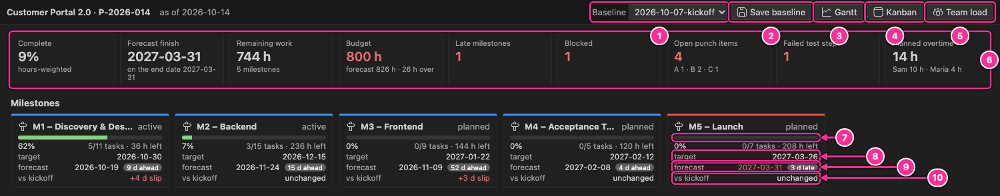
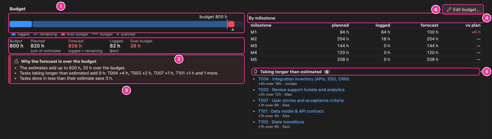
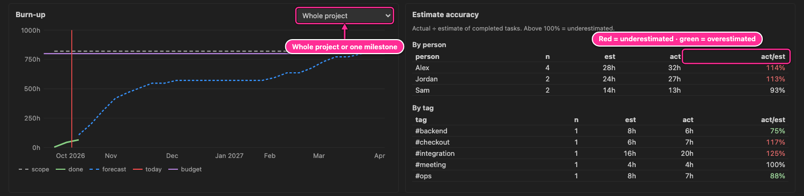
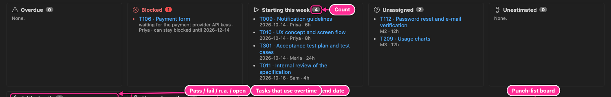
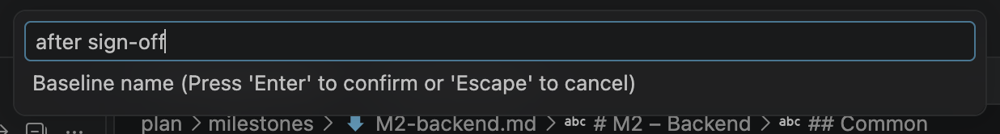

# 10. Dashboard and baselines

The dashboard answers the questions a project lead asks every week: are we on track, what is late
or blocked, how good are our estimates, and how much has the plan moved since we agreed it.
Baselines are the snapshots that make the last question answerable.

## Open the dashboard

- **Open dashboard** in the Milestones view toolbar, or **Planner: Open dashboard**.
- Click the **overdue / blocked** counter in the status bar.

## Key figures and milestones

| #   | Element       | Meaning                                                                                                |
| --- | ------------- | ------------------------------------------------------------------------------------------------------ |
| 1   | Baseline      | The baseline the trends compare with (default: the latest). _none saved_ until you save one.           |
| 2   | Save baseline | Saves the current schedule as a new baseline ([below](#baselines)).                                    |
| 3   | Gantt         | Opens the Gantt chart.                                                                                 |
| 4   | Kanban        | Opens the Kanban board.                                                                                |
| 5   | Team load     | Opens the team-load heatmap.                                                                           |
| 6   | Key figures   | See the table below. Figures that need attention are red.                                              |
| 7   | Progress bar  | Hours-weighted progress of the milestone, with tasks done/total and hours left.                        |
| 8   | Target        | The milestone's `target`.                                                                              |
| 9   | Forecast      | When its last task is scheduled to finish, with `N d ahead`, `on target` or `N d late` (working days). |
| 10  | vs baseline   | How far the forecast moved since the baseline: `+7 d slip`, `2 d gained` or `unchanged`.               |

A late milestone card has a red top border, like M5 in the picture.

| Key figure        | How it is computed                                                                                                                                                                                         |
| ----------------- | ---------------------------------------------------------------------------------------------------------------------------------------------------------------------------------------------------------- |
| Complete          | Each task's progress weighted by its estimate: done tasks count fully, open tasks by the share already worked (`@act` or `@progress`). Cancelled tasks are left out. Big tasks count more than small ones. |
| Forecast finish   | The last scheduled finish of the project, compared with `end` in `project.md`.                                                                                                                             |
| Remaining work    | Remaining hours of all open tasks, and the number of milestones.                                                                                                                                           |
| Budget            | The project's `budget` and the forecast hours against it: `N h left` or, in red, `N h over` ([Budget](#budget)). _not set_ when `project.md` has no budget.                                                |
| Late milestones   | Milestones whose forecast is after their target.                                                                                                                                                           |
| Blocked           | Tasks with status `[!]`, and how many tasks (and hours) wait for them.                                                                                                                                     |
| Open punch items  | Open punch items with the count per severity. Red when any A item is open.                                                                                                                                 |
| Failed test steps | Test steps with `@result:fail`.                                                                                                                                                                            |
| Planned overtime  | Hours of overtime and extra working days the schedule uses from this week on, with the people who work them ([Team load](09-team-load.md#overtime-and-extra-working-days)).                                |

## Budget

Set the project's budget in hours with **Edit budget…** (or **Set budget…**) in this panel, the
**Budget** field of the project form, or `budget: 800h` in `project.md` (days and weeks work too:
`100d`, `20w`).

| #   | Element         | Meaning                                                                                                                                                                                                                                                                      |
| --- | --------------- | ---------------------------------------------------------------------------------------------------------------------------------------------------------------------------------------------------------------------------------------------------------------------------- |
| 1   | Meter           | The forecast as one bar: hours logged (blue), work done without logged hours (hatched, at its estimate), hours still to do (light blue), the part over the budget (red). The purple line is the budget, ▲ the planned hours. Hover a part for its hours.                     |
| 2   | Figures         | **Budget**; **Planned**: the sum of the estimates; **Forecast**: what the work will take, hours logged plus work done without logged hours plus the remaining work; **Done, not logged** when there is such work; **Logged**: the `@act` hours; **Left** or **Over budget**. |
| 3   | Why over budget | Only when the forecast is over the budget: whether the estimates already add up to more, which tasks take longer than estimated (blocked ones say so), hours logged on cancelled tasks and on tasks without an estimate, and open tasks without an estimate.                 |
| 4   | By milestone    | Planned, logged and forecast hours per milestone, and the forecast against the plan: where an overrun comes from.                                                                                                                                                            |
| 5   | Taking longer   | Tasks whose logged (or logged plus remaining) hours are above their estimate, and parents whose own logged hours go past theirs, most first. Click one to open it.                                                                                                           |
| 6   | Edit budget…    | Opens the project form.                                                                                                                                                                                                                                                      |

How the forecast is counted, per task: a done task counts its `@act` (or its estimate when no
time was logged); an open task its `@act` (or the share done with `@progress`) plus its remaining
work; a cancelled task (or a task in a cancelled milestone) the hours logged on it before it was
cancelled. Hours logged on a parent task count once, in Planned as far as its own `@est` covers
them. Open tasks without an
estimate count 0 until they get one, and the panel says how many there are. The budget covers the
milestone tasks; punch-list and inbox items are not counted.

When the forecast is over the budget, `project.md` gets a warning on the `budget` line with the same
reasons, and the status report lists it as a risk.

## Burn-up and estimate accuracy

The **burn-up** shows, in hours:

- **scope** (grey dashed): the current total estimate. It has no history: when you add work, the
  whole line moves up.
- **done** (green): hours of tasks completed, by their `@done` date.
- **forecast** (blue dashed): the scheduled finishes plus work already done, up to the end.
- **today** (red).
- **budget** (purple): the project's budget, when there is one (whole project only).

Choose **Whole project** or one milestone in the selector.

**Estimate accuracy** compares actual hours with estimates for completed tasks that have both
`@est` and `@act`, per person and per tag (a parent's tags count for its subtasks). `act/est` above
100 % (red when over 110 %) means the work took longer than estimated; below 100 % (green under
90 %) means it took less. `n` is the number of tasks: trust a ratio more when `n` is larger. The
same statistics drive **AI: Calibrate estimates** ([AI assistant](14-ai-assistant.md)).

## Lists, tests and punch items

| List               | Contains                                                                                                                     |
| ------------------ | ---------------------------------------------------------------------------------------------------------------------------- |
| Overdue            | Open leaf tasks whose deadline (`@due`, inherited `@due`, or the milestone target) has passed.                               |
| Blocked            | Blocked tasks with their reason and owner, what waits for them and how long they can stay blocked ([below](#blocked-tasks)). |
| Starting this week | Tasks scheduled to start in the current ISO week, with start date, owner and hours.                                          |
| Unassigned         | Open tasks without an owner.                                                                                                 |
| Unestimated        | Open leaf tasks without an estimate.                                                                                         |
| Critical path      | The chain of tasks that sets the end date, with their dates and owners.                                                      |
| Planned overtime   | Tasks that use overtime or extra working days from this week on: hours, owner and ISO weeks (only shown when there are any). |

Each list shows its count and up to twelve items; click an item to open it in the editor.

### Blocked tasks

The schedule plans a blocked task as if it could go ahead, so the forecast does not show the delay
yet. The **Blocked** list says what it costs:

- **N tasks (H h) wait for it**: the open work that depends on it, directly or further down the
  chain (also through its parent and through milestone `depends:`).
- **can stay blocked until 2026-12-14**: the last day it can stay blocked without moving anything
  (its latest start minus one working day, from its slack). On the critical path it adds that after
  that day the end date moves. When the working hours of its owner, or of a colleague whose work
  waits for it, end (`capacityFrom: … 0h`), the date also leaves them the time for that work next
  to their other work, and says so: "(Alex has no working hours from 2026-10-19 on)". **must be
  unblocked now** means it only just fits; **already too late** that it, or the work that waits for
  it, no longer fits before their hours end. The status report lists a blocked task as a risk when
  it has no more room than the critical path, or already holds the plan up.
- **already delaying the plan** (or **the end date**): it has no slack left, so every day it stays
  blocked moves its milestone (or the end of the project).

A blocked task costs budget hours only when people log time on it while it is blocked; then it
shows up under **Taking longer than estimated**, marked as blocked.

**Tests** shows one bar per test plan: pass (green), fail (red), n.a. and open, with the date of the
last run. **Open punch items** shows the split by severity, the open, closed and overdue counts, and
a **Board** button for the punch-list board.

## Baselines

A baseline is a snapshot of the plan's dates at a moment you choose: after the kick-off, after the
stakeholders sign off the specification, after a re-plan. Comparing with it shows how far each task and milestone
has moved.

### Save a baseline

Run **Planner: Save baseline…** (or click **Save baseline** on the dashboard) and type a name:

The planner writes `baselines/<today>-<name>.json` with the scheduled start, finish and hours of
every task (by id) and the forecast of every milestone. Saving with a name that already exists
today asks before overwriting. The file creation is undoable, and the file is meant to be committed
to git together with the plan.

> [!TIP]
> Baselines record tasks by id, so give every task an id before you save one (ids are added on
> save by default).

### Compare with a baseline

| Where     | How                                                                                                                                                      |
| --------- | -------------------------------------------------------------------------------------------------------------------------------------------------------- |
| Gantt     | **Baseline** in the toolbar: _Latest_ or a specific one. A thin bar under each task shows the baseline dates, and `+Nd` labels the slip in working days. |
| Dashboard | **Baseline** in the toolbar. Each milestone card shows `vs <baseline>`: slip or gain of its forecast.                                                    |
| Report    | The status report's milestone table has a `vs <baseline>` column, from the latest baseline.                                                              |

To delete a baseline, delete its JSON file.

---

[← Team load](09-team-load.md) · [Contents](README.md) · [Next: Time tracking →](11-time-tracking.md)
