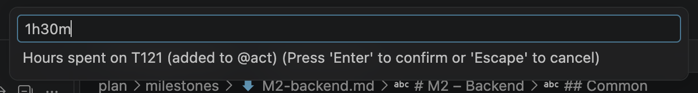

# 11. Time tracking

Actual hours (`@act`) make the plan honest: remaining work becomes estimate minus actual, the
dashboard measures how good your estimates are, and the AI can calibrate new estimates against
them. You can type `@act` yourself, or let the timer and **Log time** add it.

## The timer

Start a timer on a task in any of these ways:

- Right-click the task in the Milestones, My Work / Team or Punch List view → **Start timer**.
- Right-click the task line in the editor → **Start timer**.
- Put the cursor on the task and run **Planner: Start timer**.

The status bar shows the task id and the elapsed time, updated every half minute:

Rules:

- **One timer at a time.** Starting a timer on another task stops the running one first and logs
  its time.
- **Starting work moves the task to in progress.** A task that is still to do becomes `[/]` with
  `@started:<today>`.
- **The timer survives a reload** of the window: it is kept with the workspace.

Stop the timer by clicking it in the status bar or running **Planner: Stop timer**. The elapsed
time is rounded **up** to `planner.time.roundingMinutes` (15 minutes by default) and added to the
task's `@act`. Less than one minute is discarded with a message, and a task the timer moved to in
progress goes back to to do (a timer started by mistake leaves no trace).

## Log time by hand

Right-click a task → **Log time…** (or **Planner: Log time…** with the cursor on a task) and type
how long you worked:

| You type | Means         |
| -------- | ------------- |
| `1.5`    | 1.5 hours     |
| `1.5h`   | 1.5 hours     |
| `90m`    | 90 minutes    |
| `1h30m`  | 1 hour 30 min |
| `1:30`   | 1 hour 30 min |

The hours are added to the existing `@act` (it is created when missing).

## How actual hours are used

| Where                   | Effect                                                                        |
| ----------------------- | ----------------------------------------------------------------------------- |
| Scheduler               | Remaining work = `@est` − `@act` (never below zero), scheduled from today.    |
| Views                   | `6/12h` (actual/estimate) in the sidebar and on cards.                        |
| Progress                | Open tasks count as partly done in milestone and project progress.            |
| Dashboard               | Estimate accuracy per person and tag, from done tasks with `@est` and `@act`. |
| AI: Calibrate estimates | Adjusts open estimates by each person's or tag's historical ratio.            |
| Reports                 | Hours in "done this period", Excel and MS Project exports.                    |

> [!TIP]
> When a task has taken all its estimated hours but is not finished, its remaining work is zero
> and the schedule lets it finish as soon as it is ready. Raise `@est`, or set `@progress:70%`: with
> `@progress`, remaining work is estimate × (1 − progress), regardless of the hours logged.

---

[← Dashboard and baselines](10-dashboard-and-baselines.md) · [Contents](README.md) · [Next: Tests and punch list →](12-tests-and-punch-list.md)
