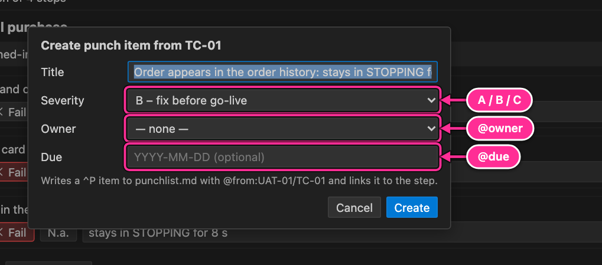
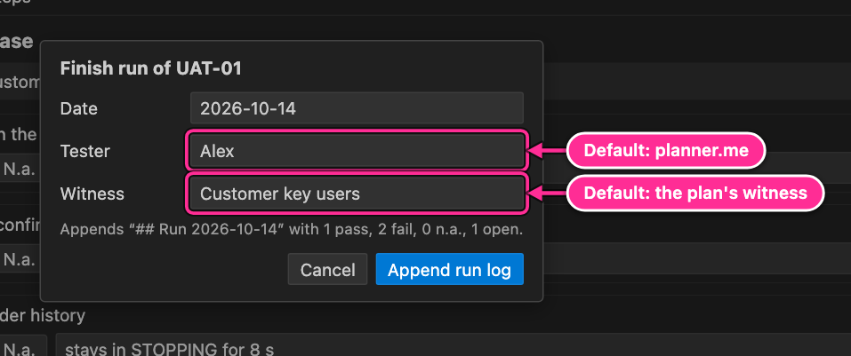
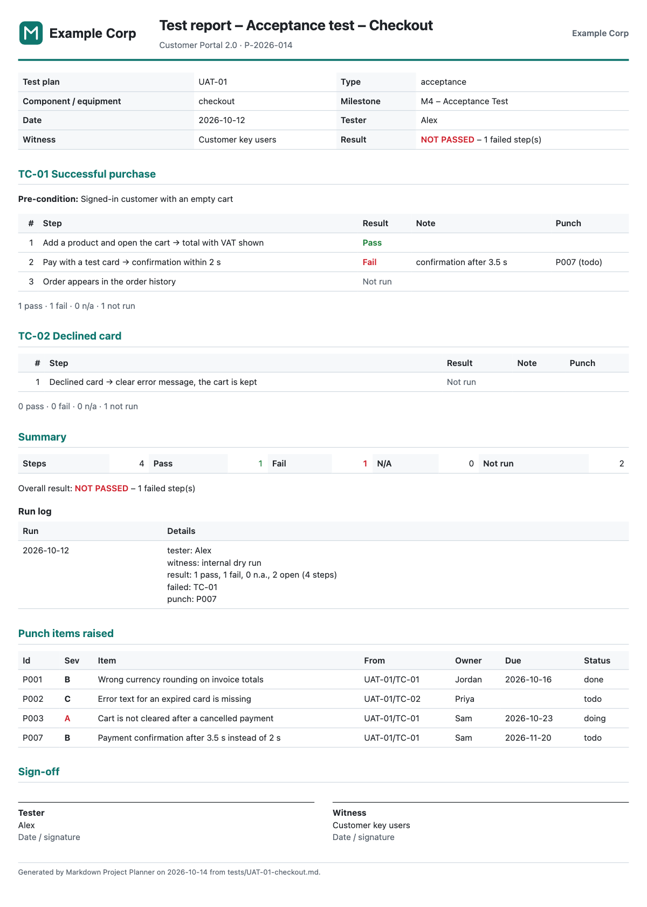

# 12. Tests and punch list

For acceptance tests (and FAT, SAT, integration or unit tests), the planner keeps the test plan, the results, the run log and
the punch items in Markdown next to the rest of the plan, and produces a signed test report from
them. This chapter covers the whole cycle:

1. Write the test plan in `tests/`.
2. Run it in the **test runner**: record pass, fail or n.a. per step.
3. Raise **punch items** from failed steps.
4. **Finish the run**: a run log is appended to the test plan.
5. **Export the test report** for signing.
6. Work off the punch list until acceptance.

## Write a test plan

Create a file in `tests/`, for example `tests/UAT-01-checkout.md`:

```markdown
# Acceptance test – Checkout

id: UAT-01
type: acceptance
milestone: M4
eq: checkout
witness: Customer key users

## TC-01 Successful purchase

pre: Signed-in customer with an empty cart

- [ ] Add a product and open the cart → total with VAT shown
- [ ] Pay with a test card → confirmation within 2 s
- [ ] Order appears in the order history

## TC-02 Declined card

- [ ] Declined card → clear error message, the cart is kept
```

Each `##` heading is a test case and each checkbox a step. Link the work that prepares the test to
the plan with `@test:UAT-01` on the tasks; they show up as **linked tasks** in the runner. The
format is described in full in [Plan files › Test plans](04-plan-files.md#test-plans-tests).

## The test runner

Open it by clicking a test plan in the **Tests** view (or its beaker button), with the beaker in the
Tests view toolbar, or with **Planner: Open test runner**.


| #   | Element                | What it does                                                                                                                                  |
| --- | ---------------------- | --------------------------------------------------------------------------------------------------------------------------------------------- |
| 1   | Test plan              | Switches to another test plan.                                                                                                                |
| 2   | Plan details           | Type, milestone, component and witness from the plan's properties.                                                                            |
| 3   | Finish run…            | Appends a run log to the test plan ([below](#finish-a-run)).                                                                                  |
| 4   | Reset results          | Clears all results and notes for a new run, after confirmation. Punch links and earlier run logs stay.                                        |
| 5   | Export report          | Writes the test report as PDF (HTML when no Edge or Chrome is found) to `plan/reports/`.                                                      |
| 6   | Open file              | Opens the test plan file.                                                                                                                     |
| 7   | Undo / Redo            | Undo or redo the last change made in the runner (also Cmd+Z / Cmd+Shift+Z).                                                                   |
| 8   | Summary                | A bar and counts: pass, fail, n.a. and open steps of the whole plan.                                                                          |
| 9   | Test cases             | Click a case to open it. Icon: ⊗ a step failed, ✓ all steps recorded, ● partly recorded, ○ not started. The numbers are recorded/total steps. |
| 10  | Runs                   | Earlier run logs: date, tester, witness, result.                                                                                              |
| 11  | Linked tasks           | Tasks with `@test:` pointing to this plan, with their status. Click to open.                                                                  |
| 12  | Case and pre-condition | The selected case and its `pre:` line.                                                                                                        |
| 13  | Pass / Fail / N.a.     | Records the result of a step. Click the active button again to clear it.                                                                      |
| 14  | Note                   | A note on the step, saved when you press Enter or leave the field.                                                                            |
| 15  | Punch link             | The punch item raised from this step (greyed out once closed).                                                                                |
| 16  | Create punch item      | Shown on failed steps without a punch item ([below](#raise-a-punch-item)).                                                                    |
| 17  | Previous / Next case   | Moves between cases.                                                                                                                          |
| 18  | Key hint               | Keys for the focused step: **P** pass, **F** fail, **N** n.a., **Backspace** clear.                                                           |

### What a result writes

Recording a result ticks the step's checkbox and writes `@result:pass`, `@result:fail` or
`@result:na` (and the note as `@note:"…"`):

```markdown
- [x] Pay with a test card → confirmation within 2 s @result:fail @note:"confirmation after 3.5 s" @punch:P007
```

Clearing a result unticks the step and removes `@result` and `@note`. Every change is an undoable
edit of the test plan file, and the Tests view and dashboard update immediately.

**Fast keyboard run:** click the first step (or Tab to it), then press **P**, **F** or **N** for
each step and Tab to the next one.

## Raise a punch item

On a failed step, click **Create punch item**:



| Field    | Default                                                                       |
| -------- | ----------------------------------------------------------------------------- |
| Title    | The step text and its note.                                                   |
| Severity | **B – fix before SAT**. A blocks acceptance, C may wait until after handover. |
| Owner    | None; pick a person to write `@owner`.                                        |
| Due      | Empty, or a date `YYYY-MM-DD`.                                                |

**Create** writes a new item to `punchlist.md` (the file is created if it does not exist yet), for
example:

```markdown
- [ ] Order appears in the order history: stays in STOPPING for 8 s @sev:B @owner:sam @from:UAT-01/TC-01 ^P008
```

and links the step to it with `@punch:P008`, so you can navigate both ways (F12 on either id).

## Finish a run

When you are done for the session, click **Finish run…**:



The date defaults to today, the tester to you (`planner.me`) and the witness to the plan's
`witness:`. **Append run log** adds a section at the end of the test plan:

```markdown
## Run 2026-10-14

tester: Alex
witness: Customer key users
result: 1 pass, 2 fail, 0 n.a., 1 open (4 steps)
failed: TC-01
punch: P007, P008
```

These sections build the test history; they are shown under **Runs** and in the report. For the
next run, **Reset results** clears the steps but keeps the run logs.

## The test report

**Export report** in the runner (or **Planner: Export…** → _Test report_) writes
`plan/reports/<date>-<test plan>-report.pdf` (or `.html`):



It contains a header (test plan, component, milestone, date, tester, witness, overall result), every case
with its pre-condition, steps, results, notes and punch links, a summary with counts, the run log,
the punch items raised (linked from steps or with `@from` naming the plan), and a signature block
for tester and witness. Date, tester and witness come from the latest run log. The report uses your
branding ([Reports and export](13-reports-and-export.md#branding)).

## Working off the punch list

Punch items live in `punchlist.md` and behave like tasks without a schedule:

- The **Punch List** view groups open items by severity and owner, sorted by due date
  ([The sidebar](06-sidebar.md#punch-list)).
- The **punch-list board** shows them as cards per status, optionally in severity or owner lanes
  ([Kanban](08-kanban.md#the-punch-list-board)).
- Add items that do not come from a test with **+** in the Punch List toolbar or in a column of
  the punch-list board ([Inbox and punch items](03-add-and-edit.md#inbox-and-punch-items)).
- Edit an item with ✎ on its row or a double-click on its card; set status, owner, timer and logged
  time from the context menu, the board, or the editor.
- Close an item by setting it to done (`[x]`); it moves to the _Closed_ group, and the runner shows
  the step's punch link greyed out.
- The dashboard and the status report count open items per severity; any open **A** item is shown
  in red.

---

[← Time tracking](11-time-tracking.md) · [Contents](README.md) · [Next: Reports and export →](13-reports-and-export.md)
