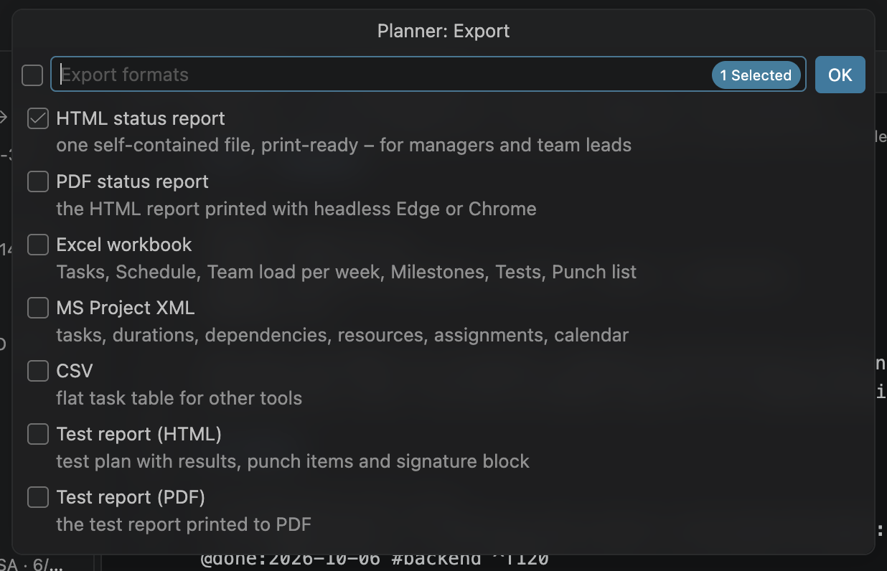
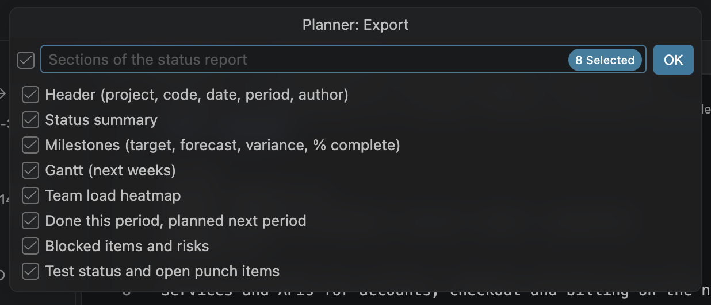
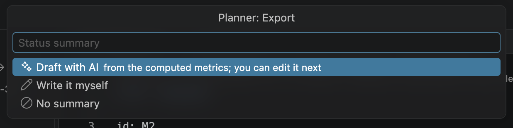
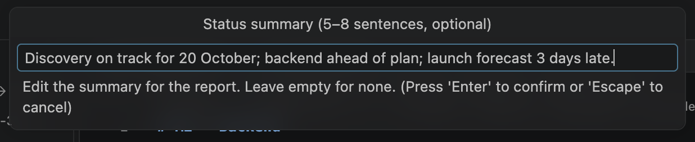
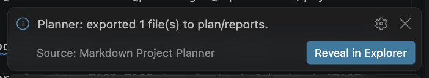
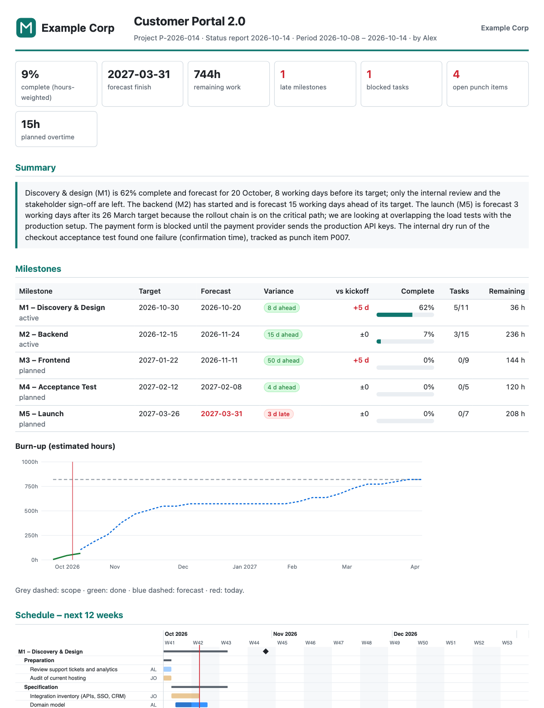
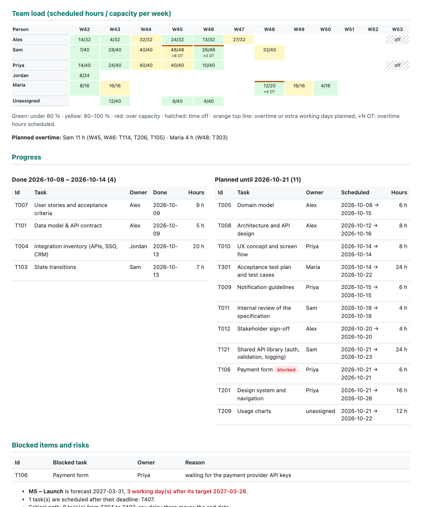

# 13. Reports and export

Colleagues and managers do not need the extension: send them a report. **Planner: Export…** writes
a self-contained HTML or PDF status report, an Excel workbook, an MS Project file, a CSV table or a
test report into `plan/reports/`.

## The export wizard

Run **Planner: Export…** (or click **Export…** in the Milestones view toolbar). It asks up to four
questions; each remembers your last answer, so a weekly report is a matter of pressing Enter.

**1. Formats.** Tick one or more formats, then press Enter or click **OK**.



**2. Sections** of the status report (only when HTML or PDF is selected). All are ticked the first
time.



**3. Summary** (only when the _Status summary_ section is ticked). With an AI provider you can
choose **Draft with AI** (drafted from the computed figures; you edit it next), **Write it
myself** (starts from the last summary) or **No summary**:



Then edit the text and press Enter. Leave it empty for no summary. The summary is remembered for the
next export but never written into the plan files.



**4. Test plan** (only for a test report when the plan has more than one test plan).

The files are written to `plan/reports/` and the first one is opened (turn this off with
`planner.export.openAfterExport`). A notification offers **Reveal in Explorer**:



## Formats

| Format             | File                             | Contents                                                                                                       |
| ------------------ | -------------------------------- | -------------------------------------------------------------------------------------------------------------- |
| HTML status report | `<date>-status-report.html`      | One self-contained file with inline styles and charts; no scripts, prints on A4.                               |
| PDF status report  | `<date>-status-report.pdf`       | The HTML report printed by Edge or Chrome in headless mode.                                                    |
| Excel workbook     | `<date>-plan.xlsx`               | Sheets: Tasks, Schedule, Team load per week, Milestones, Tests, Punch list.                                    |
| MS Project XML     | `<date>-plan.xml`                | MSPDI: tasks, durations, dependencies, resources, assignments and calendars.                                   |
| CSV                | `<date>-tasks.csv`               | A flat task table (UTF-8 with BOM, so Excel opens it correctly).                                               |
| Test report (HTML) | `<date>-<test plan>-report.html` | Results, punch items and signature block of a test plan ([Tests](12-tests-and-punch-list.md#the-test-report)). |
| Test report (PDF)  | `<date>-<test plan>-report.pdf`  | The same, printed to PDF.                                                                                      |

`<date>` is today. Exporting twice on the same day overwrites the files of that day.

## The status report



| Section                               | Contents                                                                                                                                                                                                                     |
| ------------------------------------- | ---------------------------------------------------------------------------------------------------------------------------------------------------------------------------------------------------------------------------- |
| Header                                | Logo and company name, project name, code, report date, reporting period and author; key figures (complete, forecast finish, remaining work, forecast against the budget, late milestones, blocked tasks, open punch items). |
| Status summary                        | Your text from step 3.                                                                                                                                                                                                       |
| Milestones                            | Per milestone: target, forecast, variance, change since the latest baseline, % complete, tasks done/total, remaining hours; and the project burn-up chart.                                                                   |
| Gantt (next weeks)                    | A static Gantt of the previous week plus the next `planner.export.ganttWeeks` weeks (12).                                                                                                                                    |
| Team load heatmap                     | Scheduled hours / capacity per person and week, for the same weeks. Weeks with overtime or extra working days are marked, with the overtime hours scheduled, and a line lists the planned overtime per person.               |
| Done this period, planned next period | Tasks completed in the last `planner.export.periodDays` days (7), and tasks scheduled in the next period.                                                                                                                    |
| Blocked items and risks               | Blocked tasks with reasons, and computed risks (below).                                                                                                                                                                      |
| Test status and open punch items      | Pass/fail per test plan and open punch items by severity.                                                                                                                                                                    |



The **risks** are computed from the schedule, not written by the AI:

- milestones forecast after their target, or with two working days of buffer or less
- tasks scheduled after their deadline
- the critical path (the chain that sets the end date)
- blocked tasks with no more room than the critical path, or that already hold the plan up
- people with more work than capacity in the next eight weeks (demand)
- open tasks without an estimate or without an owner, and tasks that cannot be scheduled

The report uses fixed colours (not your VS Code theme), so it looks the same on every screen and on
paper.

## Branding

Put your company name, accent colour and logo on every report (also the test report):

```json
{
  "planner.export.branding": {
    "company": "Example Corp",
    "accentColor": "#0f766e",
    "logo": "docs/logo.svg"
  },
  "planner.export.author": "Alex Morgan"
}
```

- `logo` is relative to the workspace folder (or absolute): PNG, JPEG, GIF, SVG or WebP. It is
  embedded in the file, so the report stays self-contained.
- `author` defaults to the name of `planner.me`.

## Report settings

| Setting                          | Default | Meaning                                                                     |
| -------------------------------- | ------- | --------------------------------------------------------------------------- |
| `planner.export.periodDays`      | `7`     | Length of the reporting period ("done this period", "planned next period"). |
| `planner.export.ganttWeeks`      | `12`    | Weeks in the report's Gantt and team-load sections.                         |
| `planner.export.author`          | (empty) | Author name; empty = the name of `planner.me`.                              |
| `planner.export.browserPath`     | (empty) | Edge or Chrome for PDF; empty = detect automatically.                       |
| `planner.export.csvDelimiter`    | `,`     | `,`, `;` (Excel in many European locales) or a tab.                         |
| `planner.export.openAfterExport` | `true`  | Open the first exported file.                                               |

## PDF

PDF export prints the HTML report with Microsoft Edge or Google Chrome in headless mode (Edge is
preferred on macOS and Windows). The browser is found automatically in the usual install locations;
set `planner.export.browserPath` if yours is elsewhere. Without a browser, or if printing fails,
the HTML report is written instead and a warning tells you why.

## Excel

The workbook has one sheet per topic: **Tasks** (every task with its attributes), **Schedule**
(scheduled start, finish, slack, critical), **Team load per week** (one row per person and week
with hours, capacity, load % (over 100 % in red), days off, overtime capacity and overtime
scheduled; easy to filter and pivot), **Milestones**,
**Tests** and **Punch list**.

## MS Project

The MSPDI file (Microsoft Project's XML exchange format) contains the tasks with the milestone
structure, durations and work in hours, dependencies, resources from `team.md`, assignments and
calendars: the project calendar, plus a resource calendar per person with their work week, time off
and extra working days. Overtime on working days is not part of an MS Project calendar and is not
exported; the scheduled dates already include it. Tasks are fixed-duration with a "start no earlier than" constraint at their scheduled start, so
that a project planning tool reproduces the planner's resource-levelled dates instead of levelling
the plan again. Work under way exports its `@started` as the actual start, and so does a to-do task
with logged time.

> [!NOTE]
> The file is checked against the MSPDI structure in the extension's tests, but it has not yet been
> opened in Microsoft Project itself. Check the first import before relying on it.

## Exports from the command line

The same exports run without VS Code, for example every night in CI:

```sh
node <extension>/dist/cli.js export --plan plan --format html,xlsx,mspdi
```

See [MCP server and command line](15-mcp-and-cli.md#the-command-line).

---

[← Tests and punch list](12-tests-and-punch-list.md) · [Contents](README.md) · [Next: AI assistant →](14-ai-assistant.md)
