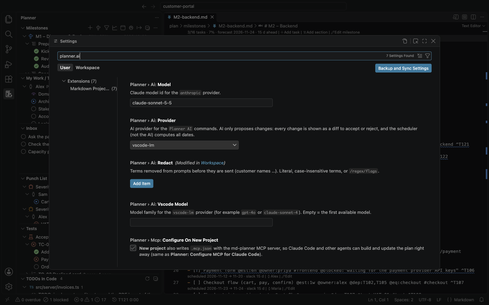
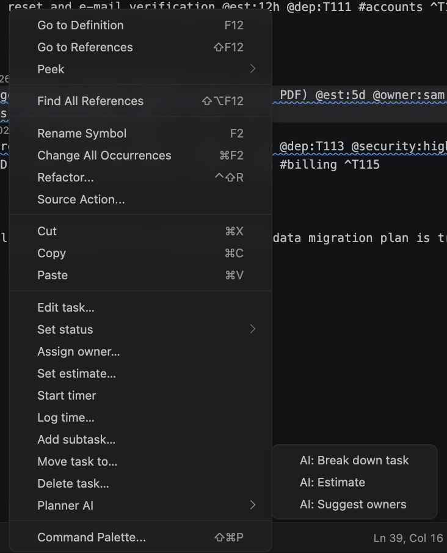
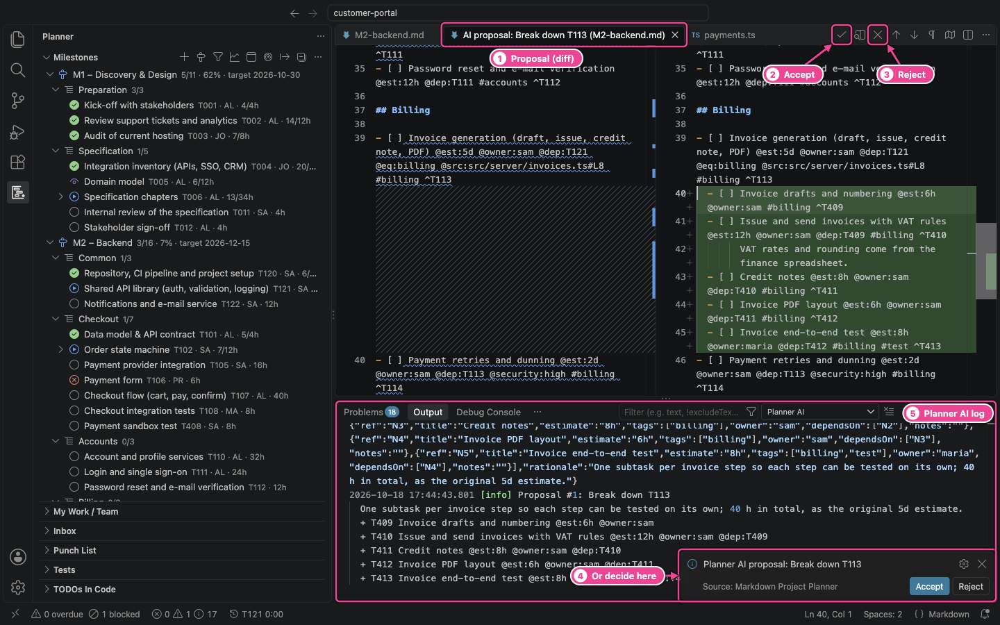

# 14. AI assistant

The AI commands help with the parts of planning that need judgement: breaking work down,
estimating, choosing owners, turning a scope description into tasks, writing a status summary and
reviewing the schedule. They follow three rules:

1. **The AI proposes, you decide.** Every change is shown as a diff of the Markdown with **Accept**
   and **Reject**. Nothing is written before you accept.
2. **The AI never computes dates.** It suggests estimates, owners and dependencies; the scheduler
   places the work on the calendar.
3. **Nothing is sent until you run an AI command**, and then only what that command needs, after
   removing the terms in `planner.ai.redact`. Every request and reply is logged.

Agents that work on the plan by themselves, such as Claude Code or Copilot agent mode, use the
planner's MCP server instead, and the md-planner skill teaches them the same rules: see
[MCP server and command line](15-mcp-and-cli.md#teach-the-agent-the-rules-instructions-and-the-skill).

Without an AI provider every other feature works as usual.

## Choose a provider

Set **`planner.ai.provider`** (Settings → search `planner.ai`):



| Provider              | Setup                                                                                                                                                                                                                                                                                       |
| --------------------- | ------------------------------------------------------------------------------------------------------------------------------------------------------------------------------------------------------------------------------------------------------------------------------------------- |
| `vscode-lm` (default) | Uses a language model installed in VS Code, such as GitHub Copilot. Install and sign in to the model provider; VS Code may ask once whether the planner may use it. `planner.ai.vscodeModel` picks a model family (for example `gpt-4o` or `claude-sonnet-4`); empty = the first available. |
| `anthropic`           | Calls the Claude API directly. Run **Planner: Set API key (Claude)** and paste your key; it is kept in VS Code's encrypted storage and only sent to the Claude API. `planner.ai.model` sets the model (default `claude-sonnet-5-5`).                                                        |
| `none`                | Hides every AI command and menu.                                                                                                                                                                                                                                                            |

If no model or key is available, the command tells you what to set up instead of doing nothing.

## Where the AI commands are

- **Right-click a task** in the Milestones or My Work / Team view, or a task line in the editor →
  **Planner AI** → _Break down task_, _Estimate_, _Suggest owners_:

  

- The **Command Palette**: all seven commands start with **Planner: AI:**. The task commands need a
  plan file open with the cursor on a task (or lines selected).
- **Planner: Export…** offers **Draft with AI** for the report summary.

## Review a proposal

While the AI works, a progress notification shows (with **Cancel**). Then the proposal opens as a
diff editor: the current file on the left, the file with the proposed changes on the right.



| #   | Element        | What it does                                                                              |
| --- | -------------- | ----------------------------------------------------------------------------------------- |
| 1   | Proposal tab   | `AI proposal: <what> (<file>)`, one tab per file that would change.                       |
| 2   | Accept (✓)     | Applies the proposal.                                                                     |
| 3   | Reject (✕)     | Discards it.                                                                              |
| 4   | Notification   | The same choice, with the AI's rationale. Also **Planner: Accept / Reject AI proposal**.  |
| 5   | Planner AI log | The output channel with the request as sent, the raw reply and a summary of the proposal. |

**Accept** applies exactly the edits shown, as one undoable edit (Cmd+Z in the file reverts all of
it). If the file was changed after the proposal was made, or another task took one of the new
ids it proposes, nothing is applied and you are told so; run the command again.

Before you see a proposal, the reply has already been checked: unknown owners and unknown
dependency ids are removed (and listed as warnings in the log), invalid durations are rejected,
answers about tasks that were not asked about are ignored, and owner suggestions without a reason
are refused. New tasks get fresh ids from the plan (two open proposals never share one), and
dependencies between new tasks are wired up with those ids. A dependency that would make the plan
invalid (on the task's own parent, or a loop) is left out with a warning. Text in a title that a
task line would read as a date, an owner, a tag or an id (`@due:…`, `#urgent`) is kept in brackets
as plain text, so the AI never sets dates or owners that way. Notes over several lines are written
as the task's notes. **Break down** also sets the parent's `@est` to the subtasks' total when every
subtask has an estimate.

Plan text sent to the AI is marked as data: instructions written in a task note ("ignore the
rules and …") are not followed. An invalid pattern in `planner.ai.redact` stops the request before
anything is sent, so a name you meant to hide is never sent by mistake.

## The AI commands

| Command                     | Run it on                                                                                                                                                                                      | What it proposes                                                                                                                                                                                                                                                            |
| --------------------------- | ---------------------------------------------------------------------------------------------------------------------------------------------------------------------------------------------- | --------------------------------------------------------------------------------------------------------------------------------------------------------------------------------------------------------------------------------------------------------------------------- |
| **AI: Break down task**     | One task (cursor or context menu)                                                                                                                                                              | Subtasks with estimates, tags, owners, notes and dependencies between them, inserted under the task. It uses the task's notes, its milestone, the sibling tasks and typical project work as context.                                                                        |
| **AI: Estimate**            | A task from the context menu; or, in the editor, the selected tasks without an estimate (or the one task under the cursor); or else every open task without an estimate in the file (up to 60) | `@est` for each task, with a one-line rationale per task in the notification and the log. It uses similar estimated tasks in your plan as reference.                                                                                                                        |
| **AI: Calibrate estimates** | The whole plan (Command Palette)                                                                                                                                                               | Corrected `@est` for open tasks whose owner or tag has a clear history of under- or overestimating. The numbers are computed, not guessed by the AI ([below](#how-calibration-works)).                                                                                      |
| **AI: Suggest owners**      | A task without owner from the context menu, or every open task without owner (up to 60)                                                                                                        | `@owner` for each task, each with a reason based on skills, scheduled load and time off.                                                                                                                                                                                    |
| **AI: Plan from text…**     | A scope description: the selected text, the clipboard, or text you type; then a milestone                                                                                                      | A new section in that milestone with tasks, estimates and dependencies. Paste a specification chapter or a customer e-mail.                                                                                                                                                 |
| **AI: Status summary**      | The whole plan                                                                                                                                                                                 | A 5–8 sentence summary drafted from computed figures only (progress, forecast against target, slips since the baseline, blocked items, tests). You edit it, then it is kept for the next report; **Export report now** or **Copy** follows. Nothing is written to the plan. |
| **AI: Schedule review**     | The whole plan                                                                                                                                                                                 | Opens a new, unsaved Markdown document with risks by severity: overloaded people, long critical chains, missing estimates, milestones without buffer. It never changes the plan.                                                                                            |

### How calibration works

Calibration is deterministic: the planner computes, from completed tasks with both `@est` and
`@act`, the actual/estimate ratio per person and per tag. For each open task (with an estimate and
no actual hours yet) it uses the owner's ratio when the owner has at least three completed tasks,
otherwise the best-sampled tag ratio with at least three tasks. The factor is kept between 0.5 and
2.5, differences under 10 % are ignored, and results are rounded to half hours. The AI only writes
the insight lines (for example _"#frontend tasks: you underestimate by 28 % (n = 14)"_) and may leave
out tasks with a reason. When there is not enough history yet, the command says so and shows the
current statistics.

## Privacy

- Only the data a command needs is sent: the relevant tasks and milestone, a team summary
  (names, skills, capacity, load) and statistics. Never your source code.
- **`planner.ai.redact`** removes terms before anything is sent: customer names, order numbers,
  internal code names. Each entry is a literal, case-insensitive term or a regular expression `/pattern/flags`.
  Matches are replaced by `[redacted]`:

  ```json
  {
    "planner.ai.redact": ["Customer Portal 2.0", "Example Corp", "/45\\d{8}/"]
  }
  ```

- The **Planner AI** output channel (View → Output → _Planner AI_) logs every request exactly as
  sent (after redaction) and every reply.
- With `anthropic`, the API key is kept in VS Code's encrypted storage, never in settings or files.

## Tips

- Give tasks a short note before **Break down task**: the AI uses it as the scope.
- Run **Estimate** on a whole file right after creating a project from a template. Accept the
  proposal, then correct the few numbers you disagree with in the file.
- After a few weeks of logging time, run **Calibrate estimates** before a re-plan.
- Use **Schedule review** before a steering meeting as a second pair of eyes; the risks section of
  the status report is computed independently of the AI.

---

[← Reports and export](13-reports-and-export.md) · [Contents](README.md) · [Next: MCP server and command line →](15-mcp-and-cli.md)
