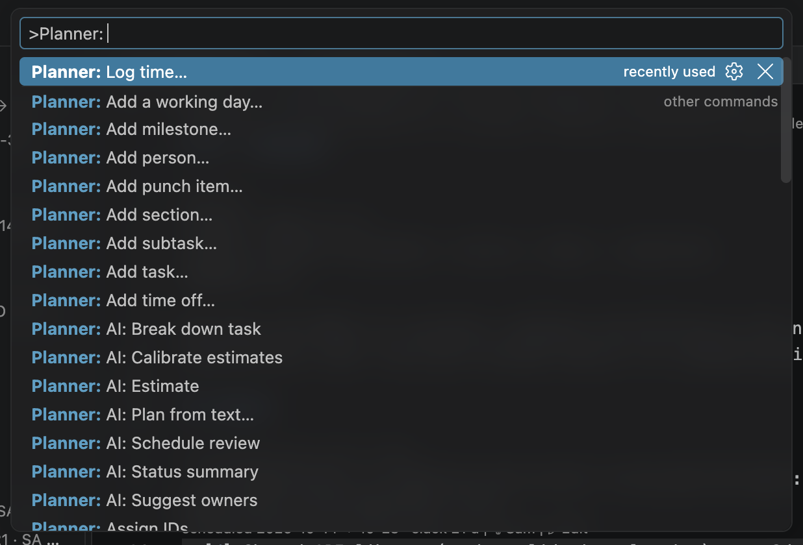

# 17. Power-user guide

This chapter collects what experienced users rely on: a working rhythm, recipes for common
situations, custom templates, working with git, and complete lists of shortcuts, commands and
settings, followed by troubleshooting.

## A working rhythm

**Every morning (5 minutes)**

1. Glance at the status bar: `⚠ overdue` and `⊘ blocked` counts. Click it if they are not zero.
2. Open My Work / Team: your next tasks are at the top, in schedule order.
3. Start the timer on the task you pick up (right-click → **Start timer**).
4. Update statuses as you go: hover the checkbox, ↻ on the task's row, or drag cards on the
   Kanban board.

**Every week (30 minutes)**

1. Process the **Inbox**: plan each item into a milestone (→ on its row), or delete it.
2. Open the **dashboard**: late milestones, blocked items, overdue tasks, unassigned and
   unestimated work. Fix the lists until they are empty or explained.
3. Open **Team load** in **Demand** mode and resolve the red weeks.
4. Check the **Gantt** with the critical path on: are the red tasks staffed and estimated well?
5. **Export** the status report (and Excel if someone needs it); commit the plan.

**At every milestone or re-plan**

1. Run **AI: Calibrate estimates** if you have logged time for a while.
2. Agree the new plan, then **Save baseline** with a meaningful name (`after sign-off`).
3. Commit the baseline file.

## Recipes

### Let an agent draft the plan

Write the project down the way you would explain it to a colleague (milestones with dates, the work
in each, who does what, what waits for what) and ask Claude Code to plan it. It builds the plan
through the MCP server in one validated step ([Let an agent build the plan from text](15-mcp-and-cli.md#let-an-agent-build-the-plan-from-text)).
Then review it like any plan: the Gantt for the dates, the team load for overload, and git for the
exact Markdown it wrote. Ask for changes in plain words ("move the acceptance test a week later", "Priya joins
in January at 24 hours a week").

### Capture now, plan later

Click **+** in the Inbox toolbar (**Capture to inbox…**) and type what came up, `#tags` allowed.
It becomes a checkbox line in `inbox.md`, which you can also write yourself:

```markdown
- [ ] Check the seat count of the design tool licences #frontend
```

In the weekly review, use **Plan into milestone…** in the Inbox view. Until then it is not
scheduled and does not disturb the plan.

### Model a customer date

- A hard delivery date for a task: `@due:2026-11-20`. You get a `late-task` warning and a red
  deadline marker on the Gantt if the schedule misses it.
- A date before which work cannot start (material delivery, site access): `@start:2027-02-01`.
- A milestone the customer expects: its `target:`. Its forecast is compared with it everywhere.
- A fixed waiting time between two tasks (curing, review by the customer): a lag, `@dep:T303+5d`.

### Recover a late milestone with overtime or weekend work

1. Open the **Gantt** with the critical path on: the red chain decides the milestone date. Note who
   owns those tasks and in which weeks.
2. Open **Team load**, select that person's week and choose **Plan overtime…** (for example
   `+8h/week` for two weeks) or **Add a working day…** (a Saturday).
3. The schedule updates at once: check the milestone's forecast on the dashboard. Keep adding or
   remove the overtime until the forecast is back before the target.
4. The dashboard's **Planned overtime** and the status report show what it costs, per person and
   week. Agree it with the team, then save a baseline.

Overtime only helps where the critical tasks are: hours added to someone whose tasks have slack
just finish their work earlier.

### Hand over work during someone's holiday

Add their leave with 📅 **Add time off** on their row in My Work / Team (it writes
`off: 2026-12-21..2027-01-01` in `team.md`). Their tasks move after the leave. If that makes
something late, filter My Work / Team or the Kanban board on that person, and reassign the critical
tasks: drag cards between owner lanes, or click the owner on a card.

### Split a big task between people

Turn it into a parent with subtasks, each with its own owner and estimate. Right-click the task →
**Add subtask…** and use **Create and add another** for the next one. The result:

```markdown
- [ ] Portal pages ^T205
  - [ ] Checkout pages @est:2d @owner:priya
  - [ ] Account pages @est:2d @owner:sam
  - [ ] Billing pages @est:1d @owner:priya
```

The subtasks run in parallel where capacity allows; the parent rolls up. Dependencies on `T205`
wait for all three. **AI: Break down task** proposes such a split for you.

### Re-plan after a slip

1. Save a baseline of the current state if you have none yet, to see the effect of the re-plan.
2. Open the Gantt with **Critical path** on and the baseline visible.
3. Work the levers from the [Tutorial](02-tutorial.md#step-7--read-the-schedule): estimates,
   owners, priorities, dependencies, splitting, scope.
4. When the plan is agreed, save a new baseline (`re-plan january`).

### Find out what changed this week

The plan is text in git, so `git log -p plan/` shows every change with its author. In VS Code,
open a milestone file and use the **Timeline** view (Explorer) to compare versions. The status
report's "done this period" list and the baseline slip (`+3d`) tell the same story in numbers.

### Turn code TODOs into tracked work

Write `// TODO: …` comments while coding, then promote the ones that matter from **TODOs in Code**.
The comment gets the task id (`TODO(T142): …`) and the task gets `@src:` pointing back. When the
task is done, the TODO view shows it in green, a reminder to remove the comment.

### Keep customer names out of the AI

Add them to `planner.ai.redact` in the workspace settings (the sample uses `"Customer Portal 2.0"`
and a regular expression for order numbers). Check the **Planner AI** output channel to see exactly
what was sent.

### Several plans

The plan folder is per workspace. Keep one plan per repository (or per workspace folder) and use
`planner.planFolder` when the plan is not in `plan/`. To look at a second plan, open it in a second
VS Code window.

## Custom project templates

**Planner: New project…** also offers your own templates. A template is a folder with the files of a
plan; set `planner.templatesFolder` to the folder that contains your templates (one sub-folder per
template, relative to the workspace or absolute):

```text
company-templates/
  website-relaunch/
    project.md
    team.md
    milestones/
      M1-design.md
      M2-build.md
    tests/
      UAT-01.md
```

Placeholders are replaced when the project is created:

| Placeholder     | Becomes                                                                                              |
| --------------- | ---------------------------------------------------------------------------------------------------- |
| `{{name}}`      | The project name.                                                                                    |
| `{{code}}`      | The project code. A property line that ends up empty (`code: {{code}}` without a code) is dropped.   |
| `{{start}}`     | The start date.                                                                                      |
| `{{end}}`       | The end date.                                                                                        |
| `{{today}}`     | Today's date.                                                                                        |
| `{{lead}}`      | The name typed as first team member. A heading that ends up empty drops its section.                 |
| `{{leadId}}`    | That person's id.                                                                                    |
| `{{date:0.25}}` | Start date plus 25 % of the project duration, moved back to a weekday. Use it for milestone targets. |

Example milestone template:

```markdown
# M1 – Design

id: M1
target: {{date:0.2}}
status: active

- [ ] Kick-off with {{name}} stakeholders #meeting ^T001
- [ ] Functional specification @dep:T001 ^T002
```

Templates may contain ids and dependencies (as above); estimates and owners are usually left out
because they depend on the project.

## Working with git

- **Commit** `project.md`, `team.md`, `milestones/`, `tests/`, `punchlist.md`, `inbox.md` and
  `baselines/`. The plan's `.gitignore` already excludes `.planner/` and `reports/`.
- **Review plan changes in pull requests**: edits touch only the characters that change, so a status
  change is a one-character diff and a new estimate one attribute.
- **Merge conflicts** are ordinary text conflicts. After resolving, check the Problems panel for
  duplicate ids (two people may have added `^T130` on different branches); rename one with F2.
- **Validate in CI** with the command-line tool ([MCP server and command line](15-mcp-and-cli.md#example-github-actions)).

## Keyboard shortcuts

### VS Code

| Shortcut (macOS) | Windows / Linux  | Action                                                  |
| ---------------- | ---------------- | ------------------------------------------------------- |
| Cmd+Option+X     | Ctrl+Alt+X       | Cycle the status of the task under the cursor.          |
| Cmd+.            | Ctrl+.           | Quick fixes (add estimate, remove broken dependency …). |
| Ctrl+Space       | Ctrl+Space       | Trigger completion.                                     |
| F12 / Cmd+click  | F12 / Ctrl+click | Go to definition (task, person, test plan, `@src`).     |
| Shift+F12        | Shift+F12        | Go to references (peek).                                |
| F2               | F2               | Rename a task id everywhere.                            |
| Cmd+Shift+M      | Ctrl+Shift+M     | Problems panel.                                         |
| Cmd+Shift+P      | Ctrl+Shift+P     | Command Palette (`Planner:` commands).                  |

Assign your own keys to any `Planner:` command in **Preferences → Keyboard Shortcuts**, for example
**Planner: Open Gantt** or **Planner: Start timer**.

### In the views

| View        | Keys                                                                                                                                                                    |
| ----------- | ----------------------------------------------------------------------------------------------------------------------------------------------------------------------- |
| Gantt       | ↑ ↓ Home End select rows · ← → collapse/expand · Enter reveal · F2 edit · Option+← → move a day · Shift+Option+← → resize a day · Delete remove the selected dependency |
| Kanban      | Tab between cards · Enter reveal · F2 or double-click edit · Option+← → move to the previous/next column · Option+↑ ↓ change priority                                   |
| Team load   | Arrows, Home, End move between cells · Enter or Space select                                                                                                            |
| Test runner | P pass · F fail · N n.a. · Backspace clear (on a focused step)                                                                                                          |
| Forms       | Type a field's name and Enter to change it · Enter on the main action saves · Escape leaves (asks when something changed)                                               |
| All views   | Cmd+Z undo · Cmd+Shift+Z (or Cmd+Y) redo the view's last edit                                                                                                           |

## All commands

Open the Command Palette and type `Planner:`:



| Command                                                           | What it does                                                             | Available             |
| ----------------------------------------------------------------- | ------------------------------------------------------------------------ | --------------------- |
| New project…                                                      | Creates a plan from a template.                                          | No plan yet           |
| Refresh                                                           | Reloads the plan folder.                                                 | Plan open             |
| Add task…                                                         | A new task, with the task form.                                          | Plan open, views      |
| Add subtask…                                                      | A new task under the task.                                               | Plan file, views      |
| Edit task…                                                        | The task form with every field.                                          | Plan file, views      |
| Move task to…                                                     | Moves the task to another milestone or section.                          | Plan file, views      |
| Delete task…                                                      | Deletes the task and the dependencies on it.                             | Plan file, views      |
| Add section…                                                      | A new `##` section in a milestone.                                       | Plan open, views      |
| Add milestone…                                                    | A new milestone file.                                                    | Plan open             |
| Edit milestone…                                                   | Name, target date, status, dependencies.                                 | Plan open, views      |
| Delete milestone…                                                 | Deletes the milestone file and every dependency on it (Undo offered).    | Plan open, views      |
| Add person…                                                       | A new person in `team.md`.                                               | Plan open             |
| Edit person…                                                      | Role, capacity, work week, time off, skills, colour.                     | Plan open, views      |
| Remove from team…                                                 | Removes a person; their items go to someone else or are unassigned.      | Plan open, views      |
| Add time off…                                                     | An `off:` period for a person.                                           | Plan open, views      |
| Plan overtime…                                                    | An `overtime:` period with extra hours for a person.                     | Plan open, views      |
| Add a working day…                                                | A `workday:` (weekend day or holiday) for a person.                      | Plan open, views      |
| Edit project settings…                                            | Name, dates, work week, hours per day, holidays.                         | Plan open             |
| Capture to inbox…                                                 | A new line in `inbox.md`.                                                | Plan open             |
| Plan into milestone…                                              | Moves an inbox item into a milestone.                                    | Views                 |
| Add punch item…                                                   | A new punch item.                                                        | Plan open             |
| Set status…                                                       | Picks a status for the task under the cursor.                            | Plan file             |
| To do / In progress / Review / test / Blocked… / Done / Cancelled | Sets that status directly.                                               | Plan file             |
| Cycle status                                                      | Next status (Cmd+Option+X).                                              | Plan file             |
| Assign owner…                                                     | Writes `@owner`.                                                         | Plan file, views      |
| Set estimate…                                                     | Writes `@est`.                                                           | Plan file, views      |
| Assign IDs                                                        | Adds missing ids to the active plan file (or all files).                 | Plan open             |
| Show overdue and blocked tasks                                    | A quick pick of overdue and blocked tasks; choose one to open it.        | Plan open             |
| Open Gantt                                                        | The Gantt chart.                                                         | Plan open             |
| Open Kanban                                                       | The task board.                                                          | Plan open             |
| Open punch-list board                                             | The punch-list board.                                                    | Plan open             |
| Open team load                                                    | The heatmap.                                                             | Plan open             |
| Open dashboard                                                    | The dashboard.                                                           | Plan open             |
| Save baseline…                                                    | Saves a baseline.                                                        | Plan open             |
| Start timer / Stop timer                                          | Time tracking.                                                           | Plan file / plan open |
| Log time…                                                         | Adds hours to `@act`.                                                    | Plan file, views      |
| Open test runner                                                  | The test runner.                                                         | Plan open             |
| Rescan TODOs                                                      | Rescans the workspace for TODO comments.                                 | Plan open             |
| Promote to task…                                                  | Turns the TODO under the cursor into a task.                             | Source file           |
| Export…                                                           | Reports and data exports.                                                | Plan open             |
| AI: Break down task                                               | Proposes subtasks.                                                       | Plan file, AI on      |
| AI: Estimate                                                      | Proposes estimates.                                                      | Plan file, AI on      |
| AI: Suggest owners                                                | Proposes owners.                                                         | Plan file, AI on      |
| AI: Calibrate estimates                                           | Corrects estimates from your history.                                    | Plan open, AI on      |
| AI: Plan from text…                                               | Turns a scope description into tasks.                                    | Plan open, AI on      |
| AI: Status summary                                                | Drafts the report summary.                                               | Plan open, AI on      |
| AI: Schedule review                                               | Lists schedule risks in a new document.                                  | Plan open, AI on      |
| Set API key (Claude)                                              | Stores the Claude API key.                                               | Provider `anthropic`  |
| Accept AI proposal / Reject AI proposal                           | Decides on the open proposal.                                            | A proposal is open    |
| Configure MCP for Claude Code                                     | Writes `.mcp.json` (also before a plan exists; New project does it too). | Folder open           |
| Open user manual                                                  | Opens this manual in the Markdown preview.                               | Always                |

"Plan file" means a file of the plan folder is the active editor; "views" means the command is also
in the context menu of the sidebar views.

## All settings

Open **Settings** and search for `planner`, or edit `.vscode/settings.json` for workspace settings.
The generated reference with every description is in [docs/settings.md](../settings.md).

| Setting                                 | Default                                                                                                 | Meaning                                                                   |
| --------------------------------------- | ------------------------------------------------------------------------------------------------------- | ------------------------------------------------------------------------- |
| **Plan and editor**                     |                                                                                                         |                                                                           |
| `planner.planFolder`                    | `plan`                                                                                                  | Folder with the plan files, relative to the workspace folder or absolute. |
| `planner.me`                            | (empty)                                                                                                 | Your person id: first in My Work, default tester, report author.          |
| `planner.autoAssignIds`                 | `true`                                                                                                  | Add missing ids when a milestone file or the punch list is saved.         |
| `planner.autoAssignIdsOnAutoSave`       | `false`                                                                                                 | Also on VS Code's delayed auto-save.                                      |
| `planner.autoSave`                      | `true`                                                                                                  | Save plan files after edits from forms, views and commands.               |
| `planner.editor.toggleOnClick`          | `false`                                                                                                 | Clicking inside a checkbox cycles the status (hover it to choose one).    |
| `planner.editor.moveTasksAsBlocks`      | `true`                                                                                                  | Option+↑ / ↓ on a task line move the task with its notes and subtasks.    |
| `planner.parentStatus`                  | `auto`                                                                                                  | Parents follow their subtasks' status (`off`: only when you change them). |
| `planner.confirmEarlyStart`             | `true`                                                                                                  | Ask before starting work while a milestone it waits for is not finished.  |
| `planner.codeLens.enabled`              | `true`                                                                                                  | CodeLens above milestone headings (and tasks).                            |
| `planner.codeLens.tasks`                | `true`                                                                                                  | Scheduled dates and slack above each task.                                |
| `planner.codeLens.actions`              | `true`                                                                                                  | Clickable actions in the CodeLens (owner, Edit, Add task …).              |
| `planner.templatesFolder`               | (empty)                                                                                                 | Folder with your own project templates.                                   |
| **Scheduling and views**                |                                                                                                         |                                                                           |
| `planner.scheduling.unassignedCapacity` | `40`                                                                                                    | Hours per week of the Unassigned pool.                                    |
| `planner.diagnostics.overbooked`        | `true`                                                                                                  | Info messages on tasks in overbooked weeks (demand).                      |
| `planner.kanban.wipLimits`              | `{}`                                                                                                    | WIP limit per column, e.g. `{ "doing": 3 }`.                              |
| `planner.time.roundingMinutes`          | `15`                                                                                                    | Timer time is rounded up to this many minutes.                            |
| **TODOs in code**                       |                                                                                                         |                                                                           |
| `planner.todos.keywords`                | `TODO`, `FIXME`, `HACK`                                                                                 | Comment keywords collected.                                               |
| `planner.todos.include`                 | `**/*.{ts,tsx,js,jsx,mjs,cjs,vue,svelte,py,java,kt,cs,go,rs,rb,php,swift,c,h,cpp,hpp,sql,sh,md,scl,st}` | Files scanned.                                                            |
| `planner.todos.exclude`                 | `**/{node_modules,.git,dist,out,build,target,coverage,vendor,.venv,.vscode-test}/**`                    | Files never scanned.                                                      |
| `planner.todos.maxFiles`                | `2000`                                                                                                  | Maximum number of files scanned.                                          |
| **Export**                              |                                                                                                         |                                                                           |
| `planner.export.branding`               | `{}`                                                                                                    | `company`, `accentColor`, `logo` of reports.                              |
| `planner.export.periodDays`             | `7`                                                                                                     | Reporting period in days.                                                 |
| `planner.export.ganttWeeks`             | `12`                                                                                                    | Weeks in the report's Gantt and team load.                                |
| `planner.export.author`                 | (empty)                                                                                                 | Report author; empty = the name of `planner.me`.                          |
| `planner.export.browserPath`            | (empty)                                                                                                 | Edge or Chrome for PDF; empty = detect.                                   |
| `planner.export.csvDelimiter`           | `,`                                                                                                     | `,`, `;` or tab.                                                          |
| `planner.export.openAfterExport`        | `true`                                                                                                  | Open the first exported file.                                             |
| **AI**                                  |                                                                                                         |                                                                           |
| `planner.ai.provider`                   | `vscode-lm`                                                                                             | `vscode-lm`, `anthropic` or `none`.                                       |
| `planner.ai.vscodeModel`                | (empty)                                                                                                 | Model family for `vscode-lm`; empty = first available.                    |
| `planner.ai.model`                      | `claude-sonnet-5-5`                                                                                     | Claude model for `anthropic`.                                             |
| `planner.ai.redact`                     | `[]`                                                                                                    | Terms or `/regex/` removed from AI prompts.                               |
| **MCP server**                          |                                                                                                         |                                                                           |
| `planner.mcp.configureOnNewProject`     | `true`                                                                                                  | New project also writes `.mcp.json` for Claude Code.                      |

A good starting point for a team workspace (`.vscode/settings.json`, committed):

```json
{
  "planner.kanban.wipLimits": { "doing": 3, "review": 2 },
  "planner.export.branding": {
    "company": "Example Corp",
    "accentColor": "#0f766e",
    "logo": "docs/logo.svg"
  },
  "planner.ai.redact": ["Customer Name"]
}
```

and in your user settings (personal, not committed): `"planner.me": "alex"`.

## Troubleshooting

| Symptom                                          | Cause and fix                                                                                                                                                                                             |
| ------------------------------------------------ | --------------------------------------------------------------------------------------------------------------------------------------------------------------------------------------------------------- |
| The Milestones view says "No plan folder found". | The workspace has no `plan/project.md`. Open the folder that contains `plan/`, or set `planner.planFolder`, then **Planner: Refresh**.                                                                    |
| A file's tasks do not appear.                    | Only these files are read: `project.md`, `team.md`, `inbox.md`, `punchlist.md`, and `.md` files under `milestones/` and `tests/` (sub-folders allowed). Other Markdown in the plan folder is ignored.     |
| A line is not a task.                            | It needs a list marker, a space and a checkbox: `- [ ] Title`. `-[ ]`, `- []`, `- [ ]Title` or `[ ] Title` is not a task; the editor warns and the quick fix rewrites the line.                           |
| A task shows `not scheduled`.                    | It is in a circular dependency, waits for one, or its owner has no capacity. Hover the CodeLens for the reason; check the Problems panel.                                                                 |
| A task is scheduled with 0 hours.                | It has no `@est` (info message). Add an estimate.                                                                                                                                                         |
| `@est:12` is reported as invalid.                | Durations need a unit: `12h`, `1.5d`, `1w`.                                                                                                                                                               |
| Ids are not added when saving.                   | Only milestone files and the punch list get ids, only on an explicit save (or with `planner.autoAssignIdsOnAutoSave`), and only when `planner.autoAssignIds` is on. **Planner: Assign IDs** always works. |
| Clicking a checkbox does nothing.                | That is the default: hover the checkbox and click a status, or press Cmd/Ctrl+Alt+X. To change it with a click, turn on `planner.editor.toggleOnClick`.                                                   |
| A Gantt drag is refused.                         | Only open leaf tasks can be moved, resized or edited; links that would create a cycle are refused.                                                                                                        |
| A Kanban drop is refused.                        | Cards cannot be dragged to another milestone or severity lane. Right-click the card → **Move task to…** (milestone) or **Edit task…** (severity).                                                         |
| I cannot find a button.                          | Narrow sidebars move toolbar buttons into the **…** menu. Row buttons appear on hover (and on the selected row). Every action is also in the Command Palette (`planner add`, `planner edit`).             |
| The CodeLens actions are in the way.             | Turn them off with `planner.codeLens.actions`; the schedule CodeLens stays.                                                                                                                               |
| A form closed and nothing changed.               | Changes are written only with the main action (Enter on _Save changes_ / _Create …_). Escape on a form with changes asks whether to keep them.                                                            |
| A deleted task should come back.                 | Open its file and press Cmd+Z. A delete that also removed dependencies in other files is undone across all of them (VS Code asks).                                                                        |
| Many `overbooked` info messages.                 | They show raw demand. Resolve them in Team load, or turn them off with `planner.diagnostics.overbooked`.                                                                                                  |
| Planned overtime is not used.                    | Overtime only adds hours on working days, and only helps tasks of that person that are ready then. A warning appears when the period has no working days; use `workday:` for weekends and holidays.       |
| A `workday:` has a warning.                      | The day is already a working day (use `overtime: … +2h/day` for extra hours), or the person is off that day (time off wins).                                                                              |
| PDF export produced an HTML file.                | No Edge or Chrome was found, or printing failed (see the warning). Set `planner.export.browserPath`.                                                                                                      |
| The logo is missing from the report.             | The path in `planner.export.branding.logo` is relative to the workspace folder and must be PNG, JPEG, GIF, SVG or WebP. A warning names the problem.                                                      |
| AI commands are missing from the menus.          | `planner.ai.provider` is `none`. Set `vscode-lm` or `anthropic`.                                                                                                                                          |
| "No VS Code language model is available."        | Install and sign in to a model provider such as GitHub Copilot, or switch to `anthropic`.                                                                                                                 |
| An accepted AI proposal was not applied.         | The file changed after the proposal was made. Run the command again.                                                                                                                                      |
| Claude Code does not see the planner tools.      | Run **Planner: Configure MCP for Claude Code**, start Claude Code in the workspace folder, approve the server. Re-run the command after moving VS Code or the plan.                                       |
| An agent's change was refused.                   | The answer lists why (unknown owner, invalid date, a dependency loop …); nothing was written. The agent can fix the input and try again.                                                                  |
| A rename with F2 is refused.                     | The new id is not a valid id or is already in use.                                                                                                                                                        |
| Two tasks have the same id after a git merge.    | Rename one of them with F2 (the `@dep`s follow).                                                                                                                                                          |
| Something looks wrong and you want details.      | **View → Output → Planner** shows the extension's log; **Planner AI** shows AI traffic.                                                                                                                   |

---

[← How scheduling works](16-how-scheduling-works.md) · [Contents](README.md)
