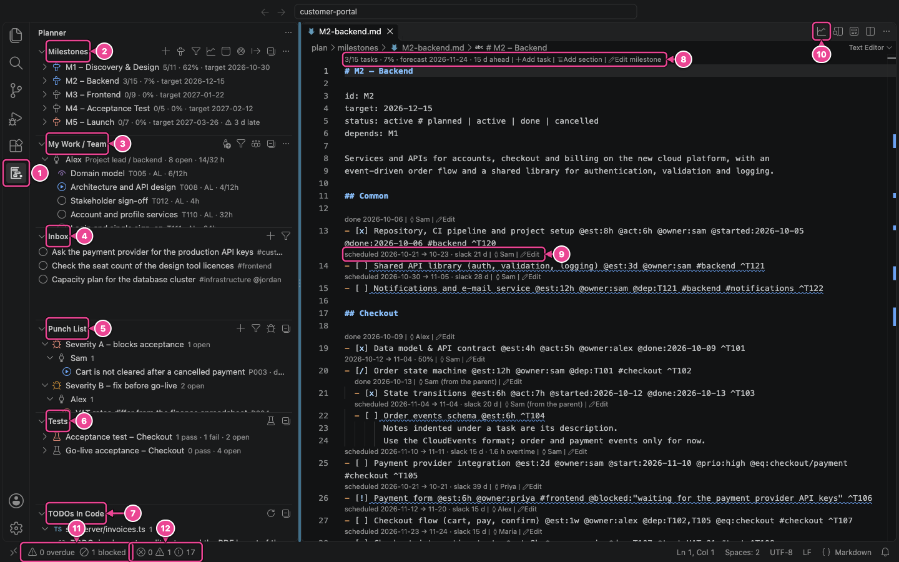

# Markdown Project Planner – User Manual

This manual teaches you to plan, schedule, track and report a project with the Markdown Project
Planner extension for VS Code, from your first plan to power-user workflows. Every button, menu
item, view and file format is covered, with annotated screenshots.

After reading it you will be able to:

- set up a plan with a calendar, a team with real capacity and time off, and milestones
- add and change tasks, owners, estimates and dependencies from forms, without typing Markdown,
  and let the scheduler place them
- read and steer the schedule on the Gantt chart, the Kanban board and the team-load heatmap
- track progress against a baseline, log time, and run acceptance tests with a punch list
- send managers a branded status report, and hand data to Excel or MS Project
- let an AI agent (Claude Code, Copilot) build and maintain the whole plan through the MCP server,
  with a skill that teaches it the planner's rules, use the optional AI assistant, and the
  command-line tool in CI

## How to read this manual

The manual comes with the extension: run **Planner: Open user manual** (or choose it in the **…**
menu of the Milestones view) to read it in VS Code, offline. Links between the chapters open in the
same preview, and the preview stays on the manual when you open other Markdown files.

1. Read **[Getting started](01-getting-started.md)** and do the **[Tutorial](02-tutorial.md)**.
   Together they take about an hour and touch every main feature once.
2. Read **[Add and edit from the UI](03-add-and-edit.md)**: where every add, edit, move and delete
   action lives, and how the forms work.
3. Use chapters 4 to 16 as a reference when you need the details of one area.
4. Read the **[Power-user guide](17-power-user-guide.md)** last: recipes, routines, every command,
   every setting and keyboard shortcuts.

Something does not work as expected? Look it up in
**[Troubleshooting](17-power-user-guide.md#troubleshooting)**. A word you do not know? The
**[Glossary](18-glossary.md)** explains each one in a sentence.

## Conventions

- This manual ships with the extension and describes the version you have installed. What changed
  between versions is in the extension's Change Log (Extensions view → Markdown Project Planner →
  **Changelog**).
- **Screenshots** come from the sample project `examples/customer-portal`, the release of a
  customer portal, as of **Wednesday 14 October 2026**, in VS Code's Dark Modern theme. Pink boxes,
  arrows and numbered badges are annotations; the numbers refer to the table under each picture.
- **Keyboard shortcuts** are written for macOS first. On Windows and Linux, read **Cmd** as
  **Ctrl** and **Option** as **Alt**, for example Cmd+Shift+P becomes Ctrl+Shift+P.
- **"Planner: Export…"** means a command in the Command Palette (Cmd+Shift+P). Type a few letters
  of the name, for example `planner exp`, and press Enter.
- **File paths** such as `milestones/M2-backend.md` are relative to the plan folder
  (`plan/` by default); a path that starts with `plan/`, such as `plan/reports/`, is relative to
  the workspace folder.
- `code like this` is text you type into a plan file or a setting.

## The screen at a glance

| #   | Part                         | What it is                                                                                  |
| --- | ---------------------------- | ------------------------------------------------------------------------------------------- |
| 1   | Planner icon                 | Opens the Planner sidebar (activity bar).                                                   |
| 2   | Milestones view              | Milestone → section → task → subtask, with progress and late flags. Toolbar adds and opens. |
| 3   | My Work / Team view          | Each person's open tasks in schedule order, with this week's load.                          |
| 4   | Inbox view                   | Ideas and requests that are not planned yet.                                                |
| 5   | Punch List view              | Defects and open points by severity and owner.                                              |
| 6   | Tests view                   | Test plans, cases and steps with pass/fail counts.                                          |
| 7   | TODOs in Code view           | `TODO` and `FIXME` comments in your source code.                                            |
| 8   | Milestone CodeLens           | Progress and forecast, and the clickable Add task, Add section and Edit milestone.          |
| 9   | Task CodeLens                | Scheduled dates and slack, the owner (click to change) and Edit, above every task.          |
| 10  | Open Gantt (editor title)    | Opens the Gantt chart from any plan file.                                                   |
| 11  | Overdue and blocked counter  | Click to open the dashboard.                                                                |
| 12  | Problems counter (VS Code's) | Plan diagnostics: unknown owners, broken dependencies, late tasks, overload …               |

## Contents

| Chapter                                                      | What you learn                                                                          |
| ------------------------------------------------------------ | --------------------------------------------------------------------------------------- |
| [1. Getting started](01-getting-started.md)                  | Install, open the sample, create your own plan, the walkthrough.                        |
| [2. Tutorial](02-tutorial.md)                                | Plan a project end to end: team, milestones, tasks, schedule, daily work, report.       |
| [3. Add and edit from the UI](03-add-and-edit.md)            | The forms, and where to add, edit, move and delete tasks, milestones, people, calendar. |
| [4. Plan files](04-plan-files.md)                            | The complete file format: project, team, milestones, tasks, tests, punch list.          |
| [5. The editor](05-editor.md)                                | Completion, hovers, navigation, rename, diagnostics, quick fixes, CodeLens actions.     |
| [6. The sidebar](06-sidebar.md)                              | The six views, their toolbars, row buttons, context menus and filters.                  |
| [7. Gantt chart](07-gantt.md)                                | Reading the chart, critical path, baselines, drag to move, resize and link.             |
| [8. Kanban board](08-kanban.md)                              | Columns, cards, swimlanes, WIP limits, adding cards, the punch-list board.              |
| [9. Team load](09-team-load.md)                              | The capacity heatmap, demand mode and how to resolve overload.                          |
| [10. Dashboard and baselines](10-dashboard-and-baselines.md) | KPIs, milestone forecasts, burn-up, estimate accuracy, baselines and slip.              |
| [11. Time tracking](11-time-tracking.md)                     | The timer, logging time, and how actual hours feed forecasts.                           |
| [12. Tests and punch list](12-tests-and-punch-list.md)       | Writing test plans, the test runner, punch items, run logs, test reports.               |
| [13. Reports and export](13-reports-and-export.md)           | HTML/PDF status reports with branding, Excel, MS Project XML, CSV.                      |
| [14. AI assistant](14-ai-assistant.md)                       | Providers, every AI command, reviewing proposals, privacy.                              |
| [15. MCP server and command line](15-mcp-and-cli.md)         | Let an agent build and run the whole plan from plain text; validate and export in CI.   |
| [16. How scheduling works](16-how-scheduling-works.md)       | The rules behind every date, so you can steer the schedule on purpose.                  |
| [17. Power-user guide](17-power-user-guide.md)               | Recipes, routines, all commands, all settings, shortcuts, troubleshooting.              |
| [18. Glossary](18-glossary.md)                               | The planner's words in one sentence each.                                               |

---

[Next: Getting started →](01-getting-started.md)
